# Database ERD

Sơ đồ quan hệ thực thể của cơ sở dữ liệu D1 (SQLite), tổng hợp từ `backend/migrations/0000`–`0013`.

- Đường liền (`──`): khóa ngoại được khai báo bằng `FOREIGN KEY` trong migration.
- Đường đứt (`┄┄`): tham chiếu logic theo id, không có ràng buộc `FOREIGN KEY` trong cơ sở dữ liệu.
- Chỉ hiển thị khóa và các cột nghiệp vụ chính; các cột metadata (`method`, `extractor_version`, `created_at`, …) và cột JSON phụ được lược bớt. Danh sách cột đầy đủ nằm trong các file migration.
- Bảng `dummy_items` (dữ liệu mẫu) không được vẽ.

Ảnh xuất sẵn: [database-erd.png](database-erd.png).

```mermaid
erDiagram
    processing_jobs {
        TEXT id PK
        TEXT file_key
        TEXT original_filename
        TEXT pdf_sha256 UK
        TEXT status
        TEXT step
        INTEGER progress
    }

    preprocessing_stages {
        TEXT job_id PK
        TEXT stage PK
        TEXT status
        TEXT error
    }

    legal_documents {
        TEXT id PK
        TEXT job_id FK, UK
        TEXT document_title
        TEXT json_content
        TEXT pdf_sha256
        TEXT review_status
        TEXT extraction_model
    }

    document_metadata {
        TEXT document_id PK, FK
        TEXT document_number
        TEXT normalized_number
        TEXT document_type
        TEXT agency
        TEXT issued_at
        TEXT effective_from
    }

    provisions {
        TEXT id PK
        TEXT document_id FK
        TEXT parent_id "-> provisions"
        TEXT container_provision_id "-> provisions"
        INTEGER ordinal
        TEXT level
        TEXT number
        TEXT text
        TEXT content_role
        TEXT relevance
    }

    vocab_entries {
        TEXT id PK
        TEXT canonical_id UK
        TEXT type
        TEXT canonical_label
        TEXT source_document_id "-> legal_documents"
        TEXT source_provision_id "-> provisions"
        INTEGER vocabulary_version
    }

    vocab_metadata {
        TEXT key PK
        TEXT value
    }

    document_relation_candidates {
        TEXT id PK
        TEXT source_document_id FK
        TEXT source_provision_id "-> provisions"
        TEXT resolved_target_document_id "-> legal_documents"
        TEXT raw_target_citation
        TEXT action
        TEXT proposed_relation_type
        TEXT status
    }

    document_relations {
        TEXT id PK
        TEXT from_document_id "-> legal_documents"
        TEXT to_document_id "-> legal_documents"
        TEXT relation_type
        TEXT scope
        TEXT verification_status
        TEXT evidence_candidate_ids "JSON"
        TEXT evidence_provision_relation_ids "JSON"
    }

    change_instructions {
        TEXT id PK
        TEXT source_document_id FK
        TEXT source_provision_id "-> provisions"
        TEXT target_document_id "-> legal_documents"
        TEXT operation
        TEXT raw_target_citation
        TEXT target_scope
        TEXT resolution_status
        TEXT effective_from
    }

    provision_relations {
        TEXT id PK
        TEXT change_instruction_id "-> change_instructions"
        TEXT from_document_id "-> legal_documents"
        TEXT from_provision_id "-> provisions"
        TEXT to_document_id "-> legal_documents"
        TEXT to_provision_id "-> provisions"
        TEXT relation_type
        TEXT verification_status
        TEXT effective_from
    }

    extraction_runs {
        TEXT id PK
        TEXT document_id "-> legal_documents"
        TEXT stage
        TEXT model
        TEXT status
        INTEGER rule_count
    }

    violation_rules {
        TEXT id PK
        TEXT source_document_id FK
        TEXT provision_id "-> provisions"
        TEXT governed_document_id "-> legal_documents"
        TEXT governed_provision_id "-> provisions"
        TEXT sanction_provision_id "-> provisions"
        TEXT extraction_run_id "-> extraction_runs"
        TEXT traffic_violation_id "-> traffic_violations"
        TEXT behavior_text
        TEXT semantic_ir
        TEXT extraction_status
        TEXT effective_from
    }

    sanctions {
        TEXT id PK
        TEXT violation_rule_id FK, UK
        INTEGER fine_min
        INTEGER fine_max
        TEXT currency
        INTEGER warning_allowed
        INTEGER points_deducted
    }

    sanction_effects {
        TEXT id PK
        TEXT sanction_id FK
        TEXT source_provision_id "-> provisions"
        TEXT effect_type
        INTEGER duration_min
        INTEGER duration_max
        TEXT duration_unit
    }

    traffic_violations {
        TEXT id PK
        TEXT canonical_name
        TEXT signature_key
        TEXT semantic_ir
        TEXT created_from_rule_id "-> violation_rules"
    }

    violation_aliases {
        TEXT id PK
        TEXT traffic_violation_id FK
        TEXT source_rule_id "-> violation_rules"
        TEXT source_document_id "-> legal_documents"
        TEXT alias
        TEXT normalized_alias
    }

    identity_decisions {
        TEXT violation_rule_id PK "-> violation_rules"
        TEXT source_document_id "-> legal_documents"
        TEXT traffic_violation_id "-> traffic_violations"
        TEXT decision
        REAL score
    }

    rule_lineages {
        TEXT id PK
        TEXT traffic_violation_id "-> traffic_violations"
        TEXT lineage_key
        TEXT rule_ids "JSON"
    }

    rule_intervals {
        TEXT rule_id PK "-> violation_rules"
        TEXT lineage_id "-> rule_lineages"
        TEXT successor_rule_id "-> violation_rules"
        TEXT valid_from
        TEXT valid_to
        TEXT end_type
    }

    change_events {
        TEXT id PK
        TEXT traffic_violation_id "-> traffic_violations"
        TEXT lineage_id "-> rule_lineages"
        TEXT old_rule_id "-> violation_rules"
        TEXT new_rule_id "-> violation_rules"
        TEXT change_types
        TEXT effective_at
    }

    %% Declared foreign keys
    processing_jobs ||--o| legal_documents : "job_id"
    legal_documents ||--o| document_metadata : "document_id"
    legal_documents ||--o{ provisions : "document_id"
    legal_documents ||--o{ document_relation_candidates : "source_document_id"
    legal_documents ||--o{ change_instructions : "source_document_id"
    legal_documents ||--o{ violation_rules : "source_document_id"
    violation_rules ||--o| sanctions : "violation_rule_id"
    sanctions ||--o{ sanction_effects : "sanction_id"
    traffic_violations ||--o{ violation_aliases : "traffic_violation_id"

    %% Logical references (no FOREIGN KEY constraint)
    processing_jobs ||..o{ preprocessing_stages : "job_id"
    provisions |o..o{ provisions : "parent_id"
    legal_documents |o..o{ vocab_entries : "source_document_id"
    legal_documents ||..o{ document_relations : "from / to"
    legal_documents |o..o{ document_relation_candidates : "resolved_target"
    provisions |o..o{ change_instructions : "source_provision_id"
    change_instructions ||..o{ provision_relations : "change_instruction_id"
    provisions |o..o{ provision_relations : "from / to provision"
    legal_documents ||..o{ extraction_runs : "document_id"
    extraction_runs ||..o{ violation_rules : "extraction_run_id"
    provisions ||..o{ violation_rules : "provision / governed"
    traffic_violations |o..o{ violation_rules : "traffic_violation_id"
    violation_rules ||..o| identity_decisions : "violation_rule_id"
    violation_rules ||..o| rule_intervals : "rule_id"
    traffic_violations ||..o{ rule_lineages : "traffic_violation_id"
    rule_lineages ||..o{ rule_intervals : "lineage_id"
    rule_lineages ||..o{ change_events : "lineage_id"
    traffic_violations ||..o{ change_events : "traffic_violation_id"
    violation_rules |o..o{ change_events : "old / new rule"
```

## Nhóm bảng

| Nhóm | Bảng | Migration |
| --- | --- | --- |
| Tải lên & tiền xử lý | `processing_jobs`, `preprocessing_stages` | 0001, 0012, 0013 |
| Văn bản & điều khoản | `legal_documents`, `document_metadata`, `provisions` | 0002, 0004, 0005, 0006 |
| Từ vựng | `vocab_entries`, `vocab_metadata` | 0003 |
| Đồ thị văn bản | `document_relation_candidates`, `document_relations` | 0006 |
| Đồ thị thay đổi | `change_instructions`, `provision_relations` | 0007 |
| Vi phạm & chế tài | `extraction_runs`, `violation_rules`, `sanctions`, `sanction_effects` | 0008 |
| Định danh vi phạm | `traffic_violations`, `violation_aliases`, `identity_decisions` | 0009 |
| Lịch sử quy tắc | `rule_lineages`, `rule_intervals`, `change_events` | 0010, 0011 |
