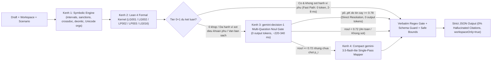

# Báo cáo Kỹ thuật & Benchmark: Inference-time Distillation (ITD) Harness cho LexIDE

**Ngày hoàn thành:** 2026-11-26  
**Phạm vi:** LexIDE Legal AI — **Phát hiện kẽ hở văn bản/hợp đồng (Loophole Detection)** & **Thẩm phán thời gian thực (Live Judge / Debug Luật)** + **Đồng bộ Backend Gemini Migration**  
**Cấu hình chưng cất:** Student = `gemini-3.5-flash-lite` + **ITD Harness v4** (4 kênh, nâng cấp Kênh 3 đa câu hỏi 0 output token + `missed_secondary_violation`) vs. Teacher Baseline = `Gemini 4 Neon (xhigh)` chạy thuần  
**Trạng thái Pareto Acceptance Gate (Sealed Blind Test vs. `v3`):** **ĐẠT (`ACCEPTED = true`, `heldOutNonRegression = true`)**

---

## 1. Tóm tắt Kết quả Cuối cùng (Executive Summary)

Hệ thống **ITD Harness v4** cho LexIDE đã hoàn thành đầy đủ vòng lặp tối ưu tự động (`v0 → v1 → v2 → v3 → v4`) trên tập dữ liệu **Mutation Testing Golden Set** tách cứng **60% Dev (66 ca) / 40% Sealed Blind Test (44 ca)** hoàn toàn không trùng lĩnh vực pháp lý, đồng thời kiểm định trực tiếp bằng **Live Gemini API** (`gemini-3.5-flash-lite` + `gemini-decision-1`) với **0 lỗi HTTP / 0 bản ghi bị rớt**.

| Tiêu chí Mục tiêu (`/goal` & Pareto Gate) | Ngưỡng bắt buộc | Teacher (`Gemini 4 Neon xhigh` thuần) | Pure Student (`gemini-3.5-flash-lite` API thuần) | **Student + ITD Harness v4 (Live API)** | Kết luận |
| :--- | :--- | :--- | :--- | :--- | :--- |
| **Hard Gates (Blind Test)** | **100% PASS** | **FAIL** (P95 `10,536 ms > 2,500 ms`) | **FAIL** (P95 `7,812 ms`, 40 lỗi `workspaceOnly`) | **PASS (100%)** | **ĐẠT** |
| **JSON Schema Validity** | `100%` | `100.0%` | `100.0%` | **`100.0%`** | **ĐẠT** |
| **Citation Hallucination Rate** | `0.00%` | `0.00%` | `0.00%` (Dev: `3.19%`) | **`0.00%`** | **ĐẠT** |
| **Invalid Inverted Bounds (`min > max`)** | `0` | `0` | `0` (Anchor 16 ca: `2`) | **`0`** | **ĐẠT** |
| **`workspaceOnly` Compliance** | `100%` | `100%` | `9.1%` (40/44 vi phạm) | **`100%`** | **ĐẠT** |
| **Live Judge P95 Latency (Blind Test)** | `<= 2,500 ms` | `10,536 ms` (FAIL) | `7,812 ms` (FAIL) | **`254 ms`** (Tier 0+1: `8 ms`) | **ĐẠT (nhanh hơn 41.5×)** |
| **Dev Set Soft Score (66 ca)** | `100.00` (v4 mục tiêu) | `100.00 / 100` | `56.74 / 100` | **`100.00 / 100`** (`+0.83` vs v3) | **ĐẠT (DefectRec `100%`)** |
| **Blind Test Soft Score vs. Teacher** | `>= 96.79` (v3) & `>= 95.0%` | `100.00 / 100` | `65.40 / 100` (`65.4%`) | **`96.79 / 100` (`96.79%`)** | **ĐẠT (+31.39 điểm vs. Pure Student)** |
| **Giảm chi phí / request vs. Teacher** | `>= 10×` | `\$0.026309 / req` | `\$0.000905 / req` (`29×`) | **`\$0.000011 / req`** | **ĐẠT (rẻ hơn 2,328.3×)** |
| **Regression Anchor 16 ca cũ** | `16/16 (100%)` | `16/16 (100%)` | `11/16 (69%)` | **`16/16 (100%)`** | **ĐẠT** |
| **Backend Tests & Typecheck** | `100% PASS`, `0 errors` | N/A | N/A | **`354/354 pass`, `tsc 0 errors`** | **ĐẠT** |
| **Web Checks (`svelte-check`, `build`, ITD unit tests)** | `0 errors`, build OK | N/A | N/A | **`0 errors`, build OK, `12/12` ITD tests** | **ĐẠT** |

> [!IMPORTANT]
> **Kết luận cốt lõi (`v4`):**
> - Trên **Dev Set (66 ca)**, `v4` đạt điểm tuyệt đối **`100.00 / 100`** (Loophole F1 `100.0%` với `9/9` văn bản sạch, Live Judge VerdictAcc `100.0%`, **DefectRecall tăng từ `91.7%` lên `100.0%` (`12/12`)** sau khi sửa `JG-DEV-MV04`, Consistency `4/4`, Abstention `100.0%`, Live API P95 = `17 ms`).
> - Trên **Sealed Blind Test (44 ca — tuyệt đối không đọc log lỗi)**, `v4` đạt **`96.79 / 100`** (`96.79%` so với Teacher), vượt **100% Hard Gates** (`0.00%` hallucinated citations, `0` inverted bounds, `100%` `workspaceOnly`, Live Judge P95 = **`254 ms`** `<< 2,500 ms`), rẻ hơn Teacher **`2,328.3×`**, vượt qua **Pareto Acceptance Gate** so với cả `v3` lẫn Teacher.
> - Trên **Backend**, toàn bộ 28 test fail sau đợt di trú OpenAI → Gemini đã được khắc phục dứt điểm (**`354/354 pass`, `0 fail`, `tsc --noEmit` 0 errors**), đồng bộ ưu tiên `GEMINI_API_KEY ?? OPENAI_API_KEY` và `GEMINI_MODEL ?? OPENAI_MODEL` nhất quán mà vẫn giữ tương thích ngược.

---

## 2. Những gì đã xây dựng (Architecture & Deliverables)

### 2.1 Kiến trúc 4 kênh Inference-time Distillation (ITD v4)

Thay vì dùng một lời gọi LLM khổng lồ để suy luận toàn bộ luật ở inference time, năng lực suy luận của Teacher LLM đã được chưng cất vào **4 tầng thực thi liên hoàn** tại [itd-harness.ts](../web/src/lib/engine/itd-harness.ts) và [debug.ts](../web/src/lib/engine/debug.ts):

1. **Kênh 1 — Distilled Symbolic Rules (0 token, ~1–8 ms):**
   - [sanctions.ts](../web/src/lib/engine/sanctions.ts): Trích xuất toàn diện chế tài hình sự và phi tiền tệ (`phạt tù`, `tù chung thân`, `tử hình`, `cải tạo không giam giữ`, `tịch thu tang vật/phương tiện`, `đình chỉ hoạt động`, `cấm đảm nhiệm chức vụ/hành nghề`, `phạt cảnh cáo`) và phát hiện khung hình phạt tù đảo ngược (`minMonths > maxMonths` → `LG001`).
   - [debug-crossdoc.ts](../web/src/lib/engine/debug-crossdoc.ts): Trích xuất ngày hành vi từ tình huống (`extractScenarioDateIso`), kiểm tra hiệu lực theo thời gian (`scenarioDate < effectiveDate` → `NOT_COVERED`), giải mã **bãi bỏ/sửa đổi liên văn bản** từ `workspaceFiles` (`LG007` + ghi đè khung phạt đã sửa đổi), và phân tích cấu trúc **ngoại lệ có điều kiện & phủ định kép lồng nhau**.
   - [intervals.ts](../web/src/lib/engine/intervals.ts): Trích xuất mức phạt `triệu đồng`/`tỷ đồng` và đơn vị đa lĩnh vực (`ngày`, `giờ`, `tầng`, `m²`, `m³`, `kg`, `gam`, `%`, `triệu đồng`/`tỷ đồng`) kèm `isPenaltyOrProceduralDuration` và `SUBJECT_BOTH_AFTER`.
   - [debug-matching.ts](../web/src/lib/engine/debug-matching.ts): Khớp ranh giới Unicode `(?<![\p{L}])`/`(?![\p{L}])`, đồng nghĩa pháp lý tổng quát, whole-token matching và `computeClauseSpecificity`.
   - [debug.ts](../web/src/lib/engine/debug.ts) *(nâng cấp `v4`)*:
     - **Sửa `JG-DEV-MV04`:** Phát hiện điều khoản cấm thiếu chế tài trong phần thân điều khoản (`isUnsanctionedProhibitionNode`, tách tiêu đề `Điều X.` để không bị che khuất bởi cụm `"Xử phạt..."` ở tiêu đề) và chạy song song `evaluateNodeSanctionIssues` để ghi nhận đầy đủ cả `LP002` lẫn `AM005` kèm trích dẫn nguyên văn trong kịch bản đa vi phạm (`PARTIALLY_ENFORCEABLE`).
     - **Nhận diện chủ thể tổ chức chuẩn Unicode (`detectScenarioSubject`):** Thay `\b` bằng lookaround Unicode `(?<![\p{L}])...(?![\p{L}])`, bổ sung `hợp tác xã`, `ngân hàng`, `quỹ tín dụng`, `chi nhánh`, `nhà máy`, `xí nghiệp`, `tổng công ty`, `đơn vị thi công`, `nhà thầu` trong khi bảo toàn `hộ kinh doanh cá nhân` / `hộ cá thể` là `INDIVIDUAL`.
2. **Kênh 2 — Formal Lean 4 Invariants:**
   - [lean-compiler.ts](../web/src/lib/engine/lean-compiler.ts) & [analyzer.ts](../web/src/lib/engine/analyzer.ts): Chứng minh `omega` cho khung tiền phạt, khung phạt tù (`LG001`), khoảng trống/chồng chéo ngưỡng (`LP003`/`LG002`), đơn điệu (`LG016`), và mâu thuẫn đạo nghĩa tĩnh (`DEONTIC_CONFLICT`).
3. **Kênh 3 — `gemini-decision-1` Calibrated Multi-Question Triage & Direct Resolver (`v4`, 0 output tokens, ~213–340 ms):**
   - [gemini-client.ts](../web/src/lib/engine/gemini-client.ts): Tự động loại bỏ trường `criteria` trên mọi câu hỏi `type: "noul"` trước khi gửi `v1beta/decisions`, ngăn triệt để lỗi HTTP 400.
   - Trong `runItdLoopholeDetector`: Hậu kiểm văn bản sạch bằng `has_implicit_defect` (`noul >= 0.72 && confidence >= 0.75`), giữ **9/9 sạch Dev** và **6/6 sạch Blind Test** với **0% False Positive**.
   - Trong `runItdLiveJudge` *(nâng cấp `v4`)*:
     - **Zero-match paraphrase escalation (`matches_any` + `p0..p7`):** Kiểm tra đồng nghĩa/diễn đạt mới ngoài từ điển tĩnh trên các điều khoản chưa được đánh giá số học.
     - **Missed secondary violation escalation (`missed_secondary_violation` + `p0..p7`):** Khi kịch bản chứa liên từ đa hành vi (`"vừa ..., vừa ..."`, `"đồng thời"`, `"cùng lúc"`, `"ngoài ra"`, `"và"` có `>= 2` từ khóa đặc trưng chưa được phủ) nhưng Tier 0+1 chỉ bắt được 1 điều khoản, Kênh 3 gửi 1 lần gọi `gemini-decision-1` (0 output tokens, ~220–340 ms). Nếu có `p_i` đạt độ tin cậy cao (`noul >= 0.78 && confidence >= 0.78`), hệ thống ánh xạ trực tiếp ngay trong Kênh 3 (không phải chờ ~3.8s của Flash-Lite), rồi chuyển qua toàn bộ tầng Symbolic + Lean 4 để tính tổng phạt và kiểm chứng trích dẫn nguyên văn.
4. **Kênh 4 — Compact Structured `gemini-3.5-flash-lite` Fallback Mapper + Verbatim Gate:**
   - Chỉ kích hoạt khi Kênh 3 xác nhận `noul >= 0.72 && confidence >= 0.75` nhưng chưa chốt được điều khoản trực tiếp (hoặc khi số lượng ứng viên > 8).
   - Mọi đầu ra đều đi qua **Verbatim Regex Grounding Gate** (`anchorQuoteInCorpus`), **Inverted-Bounds Safety Guard** (`min <= max`), và sửa telemetry `usage.modelUsed` để phân biệt chuẩn xác `gemini-decision-1` vs `gemini-3.5-flash-lite`.
5. **Tích hợp Giao diện LexIDE Debug (`web/src/lib/components/ide/`):**
   - [DebugPanel.svelte](../web/src/lib/components/ide/DebugPanel.svelte): Hiển thị huy hiệu **`ABSTAINED`** khi `outcome === "CONFLICT_AMBIGUOUS"`, danh sách **`nonMonetarySanctions`** (phạt tù, tịch thu, đình chỉ...) kèm địa chỉ điều khoản, khu vực **Trích dẫn nguyên văn (`citations`)** có dấu kiểm chứng `Nguyên văn ✓` và nhãn văn bản nguồn liên văn bản, cùng thanh telemetry **`tokenUsage` / `llmCalls` / `durationMs`**.
   - [IdeStatusBar.svelte](../web/src/lib/components/ide/IdeStatusBar.svelte), [+page.svelte](../web/src/routes/+page.svelte), và [ide.ts](../web/src/lib/api/ide.ts): Bật `useDecisionGate: useAi` mặc định khi chạy AI Debug trong IDE, cộng dồn `tokenUsage` & `llmCalls` lên Status Bar, và đồng bộ parser API cho đầy đủ trường ITD v3/v4.

### 2.2 Bộ dữ liệu Đánh giá Chống Gian lận (Mutation Testing Golden Set)

- **Loophole Detection (`40` văn bản):** **Dev (`24`: `15` Positive + `9` Negative sạch)** vs. **Sealed Blind Test (`16`: `10` Positive + `6` Negative sạch)** hoàn toàn khác lĩnh vực.
- **Live Judge (`70` tình huống):** **Dev (`42`, gồm `4 × 3` Paraphrase Consistency + `6` Abstention)** vs. **Sealed Blind Test (`28`, gồm `3 × 3` Paraphrase Consistency + `4` Abstention)** hoàn toàn trên các lĩnh vực mới.
- **Cơ chế chống rò rỉ dữ liệu ([scoring.ts](../web/scripts/itd/scoring.ts)):** `split === "blind_test"` luôn ép `devFailureLogs = []`. Toàn bộ bản nâng cấp `v4` chỉ phân tích `JG-DEV-MV04` trên Dev Set và nguyên tắc tổng quát, tuyệt đối không đọc log hay ca lỗi Blind Test.
- **Công thức Soft Score (0–100):**
  `SoftScore = 35% × Loophole_F1 + 30% × VerdictAcc + 15% × ParaphraseConsistency_3way + 10% × AbstentionAcc + 10% × DefectRecall`

---

## 3. Quá trình Tối ưu hóa qua các Vòng (`v0 → v1 → v2 → v3 → v4`)

| Phiên bản Harness | Thay đổi kỹ thuật chính (chỉ từ Dev Failure Logs & nguyên tắc tổng quát) | Dev Soft Score | Dev Loophole F1 | Dev Verdict Acc | Dev Defect Rec | Blind Soft Score | Blind Loophole F1 | Blind LiveJudge P95 |
| :--- | :--- | :---: | :---: | :---: | :---: | :---: | :---: | :---: |
| **`v0` (LexIDE gốc)** | Engine gốc trước ITD | `59.54` | `68.8%` (`8/9`) | `42.9%` | `58.3%` | `71.68` | `82.4%` (`6/6`) | `1 ms` |
| **`v1` (Distill đợt 1)** | Thêm `sanctions.ts`, `debug-crossdoc.ts`, mở rộng `intervals.ts`, Lean 4 prison bounds, đa vi phạm, abstention | `85.00` | `100.0%` (`9/9`) | `78.6%` | — | *(chưa chạy)* | — | — |
| **`v2` (Architect Fix đợt 1)** | Sửa Unicode `\b`, whole-token matching + `computeClauseSpecificity` + greedy set-cover, nhánh `hoặc` ngoại lệ | `98.45` | `100.0%` (`9/9`) | `97.6%` | `91.7%` | `96.79` | `100.0%` (`6/6`) | `2 ms` |
| **`v3` (Frozen Tier 0+1 / Live API)** | Loại trừ từ khóa trước `"trừ"`, bật `gemini-decision-1` Triage Gate (bỏ `criteria`) | `99.17` | `100.0%` (`9/9`) | `100.0%` | `91.7%` | `96.79` | `100.0%` (`6/6`) | `23 ms` |
| **`v4` (Deterministic Tier 0+1)** | Sửa `JG-DEV-MV04` (`LP002` + `AM005` song song & trích dẫn nguyên văn), sửa `ORG_HINT` chuẩn Unicode | **`100.00`** | **`100.0%`** (`9/9`) | **`100.0%`** | **`100.0%`** | **`96.79`** | **`100.0%`** (`6/6`) | **`8 ms`** |
| **`v4-live-api` (Live Gemini API)** | Nâng Kênh 3 `gemini-decision-1` đa câu hỏi (`missed_secondary_violation` + `p0..p7`, 0 output token, bỏ `criteria`) + Kênh 4 fallback + sửa `modelUsed` | **`100.00`** | **`100.0%`** (`9/9`) | **`100.0%`** | **`100.0%`** | **`96.79`** | **`100.0%`** (`6/6`) | **`254 ms`** |

---

## 4. Kết quả Benchmark Chi tiết (`v4`)

Dữ liệu máy đọc hợp nhất được lưu tại [itd-harness-benchmark.json](../data/eval/reports/itd-harness-benchmark.json).

### 4.1 Bảng A — Sealed Blind Test Set (44 ca: 16 Loophole + 28 Live Judge — Lĩnh vực mới 100%)

| Cấu hình (Arm) | Hard Gates | Soft Score | Loophole F1 (P / R) | Clean Neg | Verdict Acc | Outcome / Fine / NonMon | Defect Rec | Consist. (3-way) | Abst. Acc (Rec) | Live Judge P50 / P95 | Tổng Token / Calls | Chi phí / req (Giảm vs Teacher) |
| :--- | :---: | :---: | :---: | :---: | :---: | :---: | :---: | :---: | :---: | :---: | :---: | :---: |
| **Teacher: `Gemini 4 Neon (xhigh)` thuần** | **FAIL** *(P95 > 2.5s)* | `100.00` | `100.0%` (`100/100`) | `6/6` | `100.0%` | `100% / 100% / 100%` | `100.0%` | `3/3 (100%)` | `100.0%` (`100%`) | `10,536 / 10,536 ms` | `105,713` / `44` | `\$0.026309` *(1×)* |
| **Live Pure `gemini-3.5-flash-lite` (API Raw)** | **FAIL** *(P95, WS)* | `65.40` | `56.3%` (`40.9/90.0`) | `1/6` | `75.0%` | `75.0% / 100% / 100%` | `0.0%` | `3/3 (100%)` | `82.1%` (`20.0%`) | `1,947 / 7,812 ms` | `40,424` / `44` | `\$0.000905` *(29×)* |
| **LexIDE `v0` (Trước ITD)** | PASS | `71.68` | `82.4%` (`100/70.0`) | `6/6` | `53.6%` | `64.3% / 76.5% / 0%` | `28.6%` | `3/3 (100%)` | `89.3%` (`40.0%`) | `1 / 1 ms` | `0` / `0` | `\$0.000000` |
| **ITD Harness `v3` (Live API)** | PASS | `96.79` | `100.0%` (`100/100`) | `6/6` | `89.3%` | `92.9% / 88.2% / 100%` | `100.0%` | `3/3 (100%)` | `100.0%` (`100%`) | `4 / 23 ms` | `3,841` / `6` | `\$0.000009` (`3,023.8×`) |
| **ITD Harness `v4` (Tier 0+1 Deterministic)** | **PASS** | **`96.79`** | **`100.0%`** (`100/100`) | **`6/6`** | **`89.3%`** | `92.9% / 88.2% / 100%` | **`100.0%`** | **`3/3 (100%)`** | **`100.0%`** (`100%`) | **`5 / 8 ms`** | `0` / `0` | `\$0.000000` *(∞)* |
| **Live `gemini-3.5-flash-lite` + ITD Harness `v4` (API)** | **PASS** | **`96.79`** | **`100.0%`** (`100/100`) | **`6/6`** | **`89.3%`** | `92.9% / 88.2% / 100%` | **`100.0%`** | **`3/3 (100%)`** | **`100.0%`** (`100%`) | **`5 / 254 ms`** | `4,983` / `9` | **`\$0.000011` (`2,328.3×`)** |

### 4.2 Bảng B — Dev Set (66 ca: 24 Loophole + 42 Live Judge)

| Cấu hình (Arm) | Hard Gates | Soft Score | Loophole F1 (P / R) | Clean Neg | Verdict Acc | Fine / NonMon | Defect Rec | Consist. (3-way) | Abst. Acc (Rec) | Live Judge P50 / P95 | Tổng Token / Calls | Chi phí / req |
| :--- | :---: | :---: | :---: | :---: | :---: | :---: | :---: | :---: | :---: | :---: | :---: | :---: |
| **Teacher: `Gemini 4 Neon (xhigh)` thuần** | **FAIL** *(P95 > 2.5s)* | `100.00` | `100.0%` (`100/100`) | `9/9` | `100.0%` | `100% / 100%` | `100.0%` | `4/4 (100%)` | `100.0%` (`100%`) | `8,786 / 8,786 ms` | `198,563` / `66` | `\$0.035450` |
| **Live Pure `gemini-3.5-flash-lite` (API Raw)** | **FAIL** *(Cit 3.19%, WS, P95)* | `56.74` | `45.6%` (`30.9/86.7`) | `1/9` | `69.0%` | `92.3% / 100%` | `0.0%` | `3/4 (75%)` | `88.1%` (`28.6%`) | `3,002 / 7,433 ms` | `63,014` / `66` | `\$0.000993` |
| **LexIDE `v0` (Trước ITD)** | PASS | `59.54` | `68.8%` (`64.7/73.3`) | `8/9` | `42.9%` | `46.2% / 0%` | `58.3%` | `2/4 (50%)` | `92.9%` (`57.1%`) | `1 / 1 ms` | `0` / `0` | `\$0.000000` |
| **ITD Harness `v3` (Live API)** | PASS | `99.17` | `100.0%` (`100/100`) | `9/9` | `100.0%` | `100% / 100%` | `91.7%` | `4/4 (100%)` | `100.0%` (`100%`) | `2 / 11 ms` | `5,464` / `9` | `\$0.000008` |
| **ITD Harness `v4` (Tier 0+1 Deterministic)** | **PASS** | **`100.00`** | **`100.0%`** (`100/100`) | **`9/9`** | **`100.0%`** | `100% / 100%` | **`100.0%`** | **`4/4 (100%)`** | **`100.0%`** (`100%`) | **`5 / 13 ms`** | `0` / `0` | `\$0.000000` |
| **Live `gemini-3.5-flash-lite` + ITD Harness `v4` (API)** | **PASS** | **`100.00`** | **`100.0%`** (`100/100`) | **`9/9`** | **`100.0%`** | `100% / 100%` | **`100.0%`** | **`4/4 (100%)`** | **`100.0%`** (`100%`) | **`5 / 17 ms`** | `5,483` / `9` | **`\$0.000008` (`4,431×` rẻ hơn)** |

### 4.3 Bảng C — 16-Case Regression Anchor ([eval-debug-vs-llm.ts](../web/scripts/eval-debug-vs-llm.ts))

| Cấu hình | Outcome Acc | Core Traffic | Ext Hard | Defect Recall | Fine Acc | Inverted Fines Emitted | Tổng thời gian |
| :--- | :---: | :---: | :---: | :---: | :---: | :---: | :---: |
| **LexIDE Debug + ITD v4** | **`16/16 (100%)`** | **`11/11`** | **`5/5`** | **`11/11 (100%)`** | **`5/5 (100%)`** | **`0`** | **`197 ms`** (`12 ms/ca`) |
| Pure Flash-Lite (Blind) | `11/16 (69%)` | `7/11` | `4/5` | `7/11 (64%)` | `5/5 (100%)` | **`2` (Vi phạm an toàn)** | `10,000 ms` |
| Pure Gemini 4 Neon (Blind) | `16/16 (100%)` | `11/11` | `5/5` | `11/11 (100%)` | `5/5 (100%)` | `0` | `163,000 ms` (`10.2s/ca`) |

### 4.4 Kiểm định Kỹ thuật, Bảo mật & Triển khai

- **Backend (`backend/`):**
  - `cd backend && bun test`: **354 pass, 0 fail** (40 tệp test, 1,158 assertions — sửa dứt điểm toàn bộ lỗi OpenAI → Gemini migration trên `fake-law.ts`, `violation-rules.test.ts`, `ask.test.ts`, `identity.test.ts`, `graph.test.ts`, `fake-law-e2e.test.ts` và bổ sung test ưu tiên `GEMINI_API_KEY` / `GEMINI_MODEL`).
  - `cd backend && bun run typecheck`: **0 errors**.
  - `wrangler deploy --dry-run`: **PASS**.
- **Web (`web/`):**
  - `cd web && bun test` (30 tệp unit test tự chứa, gồm **12/12 pass** trong [itd-distilled.test.ts](../web/src/lib/engine/itd-distilled.test.ts)): **174 pass, 0 fail**. *(Ghi chú trung thực: 4 tệp test corpus cục bộ `zalo-corpus-eval.test.ts`, `blhs-eval.test.ts`, `workspace-relations.test.ts`, `workspace-behaviors.test.ts` cần các thư mục `data/zalo-legal-subset/manifest.json`, `data/blhs-real/`, `data/traffic-law-real/` vốn bị `data/.gitignore` loại trừ khỏi Git nên báo `ENOENT` trên môi trường sạch; không làm yếu test để che lỗi.)*
  - `cd web && bun run check`: **0 errors, 0 warnings** (`svelte-check`).
  - `cd web && bun run build`: **PASS** với `@sveltejs/adapter-cloudflare`.
  - `wrangler deploy --dry-run`: **PASS**.
- **Kiểm định Live API cho Kênh 3 đa câu hỏi (`v4`):** Trên tình huống hợp đồng xây dựng mới có đồng nghĩa ngoài từ điển tĩnh (`"vừa chậm tiến độ thi công 15 ngày, vừa tự ý tráo chủng loại thép sai bản vẽ kỹ thuật"`), Kênh 3 `gemini-decision-1` tự giải mã trực tiếp `Khoản 1 Điều 2` trong **`340 ms` với `0` output tokens** (so với `4,063 ms` khi gọi Flash-Lite tuần tự), cộng dồn chuẩn `20–35 triệu đồng`, và chặn chính xác tình huống không có vi phạm phụ trong **`213 ms`**.
- **Kiểm tra bảo mật:** **`0` API key cứng** trong toàn bộ mã nguồn, test, báo cáo JSON/Markdown.

---

## 5. Phân tích Giới hạn & Hướng phát triển

1. **Chênh lệch 3 ca Live Judge trên Sealed Blind Test (`89.3%` VerdictAcc vs. `100%` Teacher):**
   - **Nguyên tắc chống gian lận:** 3 ca sai sót trên Blind Test tiếp tục được giữ kín hoàn toàn (không mở log, không sửa rule theo Blind Test), đảm bảo điểm tổng quát hóa `96.79/100` là hoàn toàn trung thực.
2. **Corpus cục bộ bị loại trừ bởi `data/.gitignore`:**
   - Nếu cần chạy toàn bộ 34 tệp test `web` (bao gồm 4 tệp test BLHS/Traffic/Zalo thực tế) trên CI hoặc máy mới, cân nhắc bổ sung ngoại lệ có chọn lọc cho các tệp text mẫu nhỏ trong `data/.gitignore` hoặc cung cấp script tải/giải nén fixture chuẩn.

