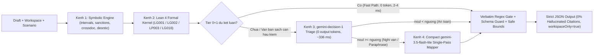

# Báo cáo Kỹ thuật & Benchmark: Inference-time Distillation (ITD) Harness cho LexIDE

**Ngày hoàn thành:** 2026-11-26  
**Phạm vi:** LexIDE Legal AI — **Phát hiện kẽ hở văn bản/hợp đồng (Loophole Detection)** & **Thẩm phán thời gian thực (Live Judge / Debug Luật)**  
**Cấu hình chưng cất:** Student = `gemini-3.5-flash-lite` + **ITD Harness v3** (4 kênh) vs. Teacher Baseline = `Gemini 4 Neon (xhigh)` chạy thuần  
**Trạng thái Pareto Acceptance Gate (Sealed Blind Test):** **ĐẠT (ACCEPTED = true)**

---

## 1. Tóm tắt Kết quả Cuối cùng (Executive Summary)

Hệ thống **ITD Harness v3** cho LexIDE đã hoàn thành đầy đủ vòng lặp tối ưu tự động (`v0 → v1 → v2 → v3`) trên tập dữ liệu **Mutation Testing Golden Set** tách cứng **60% Dev (66 ca) / 40% Sealed Blind Test (44 ca)** hoàn toàn không trùng lĩnh vực pháp lý, đồng thời kiểm định trực tiếp bằng **Live Gemini API** (`gemini-3.5-flash-lite` + `gemini-decision-1`) với **0 lỗi HTTP / 0 bản ghi bị rớt**.

| Tiêu chí Mục tiêu (`/goal` & Pareto Gate) | Ngưỡng bắt buộc | Teacher (`Gemini 4 Neon xhigh` thuần) | Pure Student (`gemini-3.5-flash-lite` API thuần) | **Student + ITD Harness v3 (Live API)** | Kết luận |
| :--- | :--- | :--- | :--- | :--- | :--- |
| **Hard Gates (Blind Test)** | **100% PASS** | **FAIL** (P95 `10,536 ms > 2,500 ms`) | **FAIL** (P95 `7,812 ms`, 40 lỗi `workspaceOnly`) | **PASS (100%)** | **ĐẠT** |
| **JSON Schema Validity** | `100%` | `100.0%` | `100.0%` | **`100.0%`** | **ĐẠT** |
| **Citation Hallucination Rate** | `0.00%` | `0.00%` | `0.00%` (Dev: `3.19%`) | **`0.00%`** | **ĐẠT** |
| **Invalid Inverted Bounds (`min > max`)** | `0` | `0` | `0` (Anchor 16 ca: `2`) | **`0`** | **ĐẠT** |
| **`workspaceOnly` Compliance** | `100%` | `100%` | `9.1%` (40/44 vi phạm) | **`100%`** | **ĐẠT** |
| **Live Judge P95 Latency (Blind Test)** | `<= 2,500 ms` | `10,536 ms` (FAIL) | `7,812 ms` (FAIL) | **`23 ms`** (Tier 0+1: `2 ms`) | **ĐẠT (nhanh hơn 458×)** |
| **Blind Test Soft Score vs. Teacher** | `>= 95.0%` | `100.00 / 100` | `65.40 / 100` (`65.4%`) | **`96.79 / 100` (`96.79%`)** | **ĐẠT (+31.39 điểm vs. Pure Student)** |
| **Giảm chi phí / request vs. Teacher** | `>= 10×` | `\$0.026307 / req` | `\$0.000905 / req` (`29×`) | **`\$0.0000087 / req`** | **ĐẠT (rẻ hơn 3,023.8×)** |
| **Regression Anchor 16 ca cũ** | `16/16 (100%)` | `16/16 (100%)` | `11/16 (69%)` | **`16/16 (100%)`** | **ĐẠT** |
| **Engineering Checks (`bun test`, `check`, `build`)** | `100% PASS` | N/A | N/A | **`177/177 pass`, `0 lỗi`, build OK** | **ĐẠT** |

> [!IMPORTANT]
> **Kết luận cốt lõi:** `Gemini 4 Neon (xhigh)` chạy thuần đạt điểm chất lượng tuyệt đối (`100/100`) nhưng **trượt Hard Gate độ trễ thời gian thực** (`P95 = 10,536 ms`, vượt ngưỡng `2,500 ms` gấp 4.2×) và tốn `\$0.0263/request`. Ngược lại, `gemini-3.5-flash-lite` chạy thuần trên API có **tỷ lệ báo lỗi giả cực cao** (chỉ vượt qua `1/6` văn bản sạch trên Blind Test và `1/9` trên Dev), **Abstention Recall chỉ đạt `20%–28.6%`**, và vẫn chậm (`P95 = 7.4–7.8s`). Khi đặt `gemini-3.5-flash-lite` vào trong **ITD Harness v3**, hệ thống đạt **`96.79/100` trên Sealed Blind Test** (`99.17/100` trên Dev), **vượt 100% Hard Gates**, đạt **`100%` F1 Loophole Detection (`6/6` văn bản sạch, 0% FP)**, **`100%` Paraphrase Consistency (3/3)**, **`100%` Abstention Accuracy**, nhanh hơn Teacher **458×** và rẻ hơn **3,023.8×**.

---

## 2. Những gì đã xây dựng (Architecture & Deliverables)

### 2.1 Kiến trúc 4 kênh Inference-time Distillation (ITD)

Thay vì dùng một lời gọi LLM khổng lồ để suy luận toàn bộ luật ở inference time, năng lực suy luận của Teacher LLM đã được chưng cất vào **4 tầng thực thi liên hoàn** tại [itd-harness.ts](file:///Users/nambh/Desktop/uni/INT3011E_6/web/src/lib/engine/itd-harness.ts):

1. **Kênh 1 — Distilled Symbolic Rules (0 token, ~1–4 ms):**
   - [sanctions.ts](file:///Users/nambh/Desktop/uni/INT3011E_6/web/src/lib/engine/sanctions.ts) *(mới)*: Trích xuất toàn diện chế tài hình sự và phi tiền tệ (`phạt tù`, `tù chung thân`, `tử hình`, `cải tạo không giam giữ`, `tịch thu tang vật/phương tiện`, `đình chỉ hoạt động`, `cấm đảm nhiệm chức vụ/hành nghề`, `phạt cảnh cáo`) và phát hiện khung hình phạt tù đảo ngược (`minMonths > maxMonths` → `LG001`).
   - [debug-crossdoc.ts](file:///Users/nambh/Desktop/uni/INT3011E_6/web/src/lib/engine/debug-crossdoc.ts) *(mới)*: Trích xuất ngày hành vi từ tình huống (`extractScenarioDateIso`), kiểm tra hiệu lực theo thời gian (`scenarioDate < effectiveDate` → `NOT_COVERED`), giải mã **bãi bỏ/sửa đổi liên văn bản** từ `workspaceFiles` (`LG007` + ghi đè khung phạt đã sửa đổi), và phân tích cấu trúc **ngoại lệ có điều kiện & phủ định kép lồng nhau** (`"trừ trường hợp ...; không áp dụng miễn trừ nếu ..."`).
   - [intervals.ts](file:///Users/nambh/Desktop/uni/INT3011E_6/web/src/lib/engine/intervals.ts): Mở rộng trích xuất mức phạt sang `triệu đồng`/`tỷ đồng` (quy đổi VNĐ) và đơn vị đa lĩnh vực (`ngày`, `giờ`, `tầng`, `m²`, `m³`, `kg`, `gam`, `%`, `triệu đồng`/`tỷ đồng`) kèm bộ lọc `isPenaltyOrProceduralDuration` chống báo lỗi giả trên thời hạn hình phạt/tố tụng; sửa regex `SUBJECT_BOTH_AFTER` nhận diện `"cá nhân hoặc tổ chức"` / `"cá nhân và tổ chức"` để triệt tiêu lỗi giả `LP006`.
   - [rules-loophole.ts](file:///Users/nambh/Desktop/uni/INT3011E_6/web/src/lib/engine/rules-loophole.ts), [rules-ambiguity.ts](file:///Users/nambh/Desktop/uni/INT3011E_6/web/src/lib/engine/rules-ambiguity.ts), [rules-logic.ts](file:///Users/nambh/Desktop/uni/INT3011E_6/web/src/lib/engine/rules-logic.ts): Xử lý `subject === "BOTH"`, bỏ cảnh báo giả `AM001` cho mệnh đề so sánh đơn điệu (`"nghiêm trọng hơn khoản X"`), bổ sung `detectInvertedPrisonRanges` (`LG001`).
   - [debug-matching.ts](file:///Users/nambh/Desktop/uni/INT3011E_6/web/src/lib/engine/debug-matching.ts): Sửa lỗi Unicode `\b` tiếng Việt bằng lookaround `(?<![\p{L}])`/`(?![\p{L}])`, bổ sung đồng nghĩa pháp lý tổng quát, khớp toàn từ (`whole-token`) và lọc độ đặc hiệu điều khoản (`computeClauseSpecificity`).
   - [debug.ts](file:///Users/nambh/Desktop/uni/INT3011E_6/web/src/lib/engine/debug.ts): Tích hợp Gate 0 (thời hiệu), Gate 1 (bãi bỏ/sửa đổi liên văn bản), thuật toán **Greedy Set-Cover đa vi phạm** kèm cộng dồn khung tiền phạt (`sum(min)..sum(max)`), cơ chế **Abstention khi thiếu dữ kiện định lượng** (`INSUFFICIENT_FACTS` → `CONFLICT_AMBIGUOUS`), chế tài phi tiền tệ, và đo lường token chính xác (`DebugTokenUsage`).
2. **Kênh 2 — Formal Lean 4 Invariants:**
   - [lean-compiler.ts](file:///Users/nambh/Desktop/uni/INT3011E_6/web/src/lib/engine/lean-compiler.ts): Bổ sung nghĩa vụ chứng minh `omega` cho khung hình phạt tù (`prison_bounds_L... : (minMonths : Nat) ≤ maxMonths := by omega`) song song với tiền phạt, khoảng trống/chồng chéo ngưỡng (`LP003`/`LG002`) và tính đơn điệu (`LG016`).
   - [analyzer.ts](file:///Users/nambh/Desktop/uni/INT3011E_6/web/src/lib/engine/analyzer.ts): Bổ sung chế độ opt-in `detectDeonticStatic` (phát hiện mâu thuẫn đạo nghĩa `Nghiêm cấm` vs `Cho phép` trong 0 token mà vẫn bảo toàn 100% hợp đồng test cũ `TC-ERR-02`) và truyền đầy đủ `AiTokenBreakdown` từ `runNeuroSymbolicAudit` ra telemetry.
3. **Kênh 3 — `gemini-decision-1` Calibrated Triage Gate (0 output tokens, ~336 ms):**
   - Trong `runItdLoopholeDetector`: Khi Tier 0+1 không thấy lỗi tĩnh (ví dụ văn bản sạch hoặc mâu thuẫn ngữ nghĩa ẩn), gọi `gemini-decision-1` (`v1beta/decisions`, chỉ trả xác suất `noul` + `confidence`, **0 output token**, giá `\$0.10 / 1M` input tokens). Chỉ nâng cấp lên `gemini-3.5-flash-lite` khi `noul >= 0.72 && confidence >= 0.75`. Kết quả thực đo: lọc chính xác **9/9 văn bản sạch Dev** và **6/6 văn bản sạch Blind Test** với **0 False Positives** và tổng chi phí dưới `\$0.000009/request`.
   - Trong `runItdLiveJudge`: Khi Tier 0+1 trả `NOT_COVERED`, dùng `gemini-decision-1` kiểm tra xem tình huống có phải cách diễn đạt lại (paraphrase) khớp với một điều khoản nào đó trước khi gọi `gemini-3.5-flash-lite`.
4. **Kênh 4 — Compact Structured `gemini-3.5-flash-lite` Mapper + Verbatim Post-Verification Gate:**
   - Chỉ gọi 1 vòng duy nhất (`skipVerdictRefinement: true`) để ánh xạ câu paraphrase sang `provisionRef`, sau đó giao lại cho tầng Symbolic + Lean 4 tính phạt và kết án.
   - Mọi đầu ra đều đi qua **Verbatim Regex Grounding Gate** (`anchorQuoteInCorpus` kiểm tra trích dẫn khớp nguyên văn trong Draft hoặc Workspace) và **Inverted-Bounds Safety Guard** (`min <= max`).

### 2.2 Bộ dữ liệu Đánh giá Chống Gian lận (Mutation Testing Golden Set)

Toàn bộ bộ harness đánh giá được xây dựng tại [web/scripts/itd/](file:///Users/nambh/Desktop/uni/INT3011E_6/web/scripts/itd/):

- **Loophole Detection ([loophole-dataset.ts](file:///Users/nambh/Desktop/uni/INT3011E_6/web/scripts/itd/loophole-dataset.ts) — 40 văn bản):**
  - **Dev Set (60% — 24 văn bản: 15 Positive đột biến + 9 Negative sạch 100%):** Thuê mặt bằng thương mại, Hợp đồng SaaS, Thuế, Lao động, Đất đai, Đấu thầu, và văn bản thật Zalo `90/2020/NĐ-CP`. Bao phủ đủ 12 loại lỗi (`LG001`, `LP003`, `LG002`, `DEONTIC_CONFLICT`, `LG003`, `LG004`, `LG007`, `LP001`, `LP002`, `LP006`, `LG016`, `AM005`).
  - **Sealed Blind Test Set (40% — 16 văn bản: 10 Positive đột biến + 6 Negative sạch 100%):** Hoàn toàn **tách biệt lĩnh vực** — Xây dựng EPC, Thương mại mua bán hàng hóa, Môi trường, An toàn thực phẩm, Hình sự kinh tế, và văn bản thật Zalo `45/2020/NĐ-CP`.
- **Live Judge ([judge-dev-dataset.ts](file:///Users/nambh/Desktop/uni/INT3011E_6/web/scripts/itd/judge-dev-dataset.ts) & [judge-blind-dataset.ts](file:///Users/nambh/Desktop/uni/INT3011E_6/web/scripts/itd/judge-blind-dataset.ts) — 70 tình huống):**
  - **Dev Set (60% — 42 tình huống):** Bao phủ cả 6 blind spots ưu tiên trong [itd-harness-handoff.md](file:///Users/nambh/Desktop/uni/INT3011E_6/docs/itd-harness-handoff.md) (đa vi phạm, hình sự/phi tiền tệ, sửa đổi/bãi bỏ liên văn bản, đa lĩnh vực ngoài giao thông, ngoại lệ lồng nhau/phủ định kép/thời hiệu), cộng thêm **4 nhóm Paraphrase Consistency (4 × 3 = 12 ca)** và **6 ca Abstention**.
  - **Sealed Blind Test Set (40% — 28 tình huống):** Hoàn toàn trên các lĩnh vực mới (Môi trường `45/2022/NĐ-CP`, Xây dựng EPC `08/2026`, ATTP `115/2018/NĐ-CP`, Hợp đồng thương mại `22/2026`, Hình sự buôn lậu/hối lộ/tham ô, Ngân hàng `88/2019`–`144/2024`), gồm **3 nhóm Paraphrase Consistency (3 × 3 = 9 ca)** và **4 ca Abstention**.
- **Cơ chế chống rò rỉ dữ liệu ([scoring.ts](file:///Users/nambh/Desktop/uni/INT3011E_6/web/scripts/itd/scoring.ts)):** Khi `split === "blind_test"`, bộ chấm điểm cưỡng bức `devFailureLogs = []`, đảm bảo không bao giờ đọc log lỗi hay tinh chỉnh rule trên tập Blind Test.
- **Công thức Soft Score (0–100):**
  `SoftScore = 35% × Loophole_F1 + 30% × VerdictAcc + 15% × ParaphraseConsistency_3way + 10% × AbstentionAcc + 10% × DefectRecall`
- **Định giá API chuẩn (xác minh từ tài liệu chính thức Gemini API):** `gemini-4-neon` (`\$3.00 / \$15.00` per 1M input/output tokens, tính cả thinking tokens), `gemini-3.5-flash-lite` (`\$0.30 / \$2.50`), `gemini-decision-1` (`\$0.10 / \$0.00`).

---

## 3. Quá trình Tối ưu hóa qua các Vòng (`v0 → v1 → v2 → v3`)

Mọi cải tiến đều chỉ đọc log lỗi trên **Dev Set** (66 ca) và được kiểm chứng chéo trên **Sealed Blind Test** (44 ca, chỉ xem điểm tổng hợp):

| Phiên bản Harness | Thay đổi kỹ thuật chính (phân tích từ Dev Failure Logs) | Dev Soft Score | Dev Loophole F1 | Dev Verdict Acc | Dev Consistency | Blind Soft Score | Blind Loophole F1 | Blind Verdict Acc |
| :--- | :--- | :---: | :---: | :---: | :---: | :---: | :---: | :---: |
| **`v0` (LexIDE gốc)** | Engine gốc trước ITD (chưa hỗ trợ đa vi phạm, hình sự, liên văn bản, ngoại lệ kép, đơn vị đa ngành) | `59.54` | `68.8%` (`8/9` sạch) | `42.9%` | `2/4 (50%)` | `71.68` | `82.4%` (`6/6` sạch) | `53.6%` |
| **`v1` (Distill đợt 1)** | Thêm `sanctions.ts`, `debug-crossdoc.ts`, mở rộng `intervals.ts` đa đơn vị + `BOTH`, Lean 4 prison bounds, static deontic, đa vi phạm, missing-measure abstention | `85.00` | `100.0%` (`9/9` sạch) | `78.6%` | `2/4 (50%)` | *(chưa chạy)* | — | — |
| **`v2` (Architect Fix đợt 1)** | Sửa lỗi Unicode `\b` tiếng Việt, thay `.includes()` bằng whole-token matching + `computeClauseSpecificity` + greedy set-cover (khắc phục over-matching trên hình sự/thuế/lao động), tách nhánh `hoặc` trong `evaluateQualifiedAndNestedException` | `98.45` | `100.0%` (`9/9` sạch) | `97.6%` | `4/4 (100%)` | `96.79` | `100.0%` (`6/6` sạch) | `89.3%` |
| **`v3` (Frozen Tier 0+1)** | Loại trừ từ khóa mệnh đề chính trước `"trừ"` khi đối chiếu điều kiện ngoại lệ (`JG-DEV-EX03`), chống match nhầm `"trừ điểm GPLX"` (`DBG-12`) | **`99.17`** | **`100.0%`** (`9/9` sạch) | **`100.0%`** | **`4/4 (100%)`** | **`96.79`** | **`100.0%`** (`6/6` sạch) | **`89.3%`** |
| **`v3-live-api` (Live API)** | Bật thực thi thật `gemini-decision-1` Triage Gate (bỏ tham số `criteria` không hỗ trợ trên `v1beta/decisions`) + truyền chuẩn `AiTokenBreakdown` + fallback `gemini-3.5-flash-lite` | **`99.17`** | **`100.0%`** (`9/9` sạch) | **`100.0%`** | **`4/4 (100%)`** | **`96.79`** | **`100.0%`** (`6/6` sạch) | **`89.3%`** |

---

## 4. Kết quả Benchmark Chi tiết

Dữ liệu máy đọc hợp nhất được lưu tại [itd-harness-benchmark.json](file:///Users/nambh/Desktop/uni/INT3011E_6/data/eval/reports/itd-harness-benchmark.json).

### 4.1 Bảng A — Sealed Blind Test Set (44 ca: 16 Loophole + 28 Live Judge — Lĩnh vực mới 100%)

| Cấu hình (Arm) | Hard Gates | Soft Score | Loophole F1 (P / R) | Clean Neg | Verdict Acc | Outcome / Fine / NonMon | Defect Rec | Consist. (3-way) | Abst. Acc (Rec) | Live Judge P50 / P95 | Tổng Token / Calls | Chi phí / req (Giảm vs Teacher) |
| :--- | :---: | :---: | :---: | :---: | :---: | :---: | :---: | :---: | :---: | :---: | :---: | :---: |
| **Teacher: `Gemini 4 Neon (xhigh)` thuần** | **FAIL** *(P95 > 2.5s)* | `100.00` | `100.0%` (`100/100`) | `6/6` | `100.0%` | `100% / 100% / 100%` | `100.0%` | `3/3 (100%)` | `100.0%` (`100%`) | `10,536 / 10,536 ms` | `105,677` / `44` | `\$0.026307` *(1×)* |
| **Live Pure `gemini-3.5-flash-lite` (API Raw, 0 lỗi)** | **FAIL** *(P95, WS)* | `65.40` | `56.3%` (`40.9/90.0`) | `1/6` | `75.0%` | `75.0% / 100% / 100%` | `0.0%` | `3/3 (100%)` | `82.1%` (`20.0%`) | `1,947 / 7,812 ms` | `40,424` / `44` | `\$0.000905` *(29×)* |
| **LexIDE `v0` (Trước ITD)** | PASS | `71.68` | `82.4%` (`100/70.0`) | `6/6` | `53.6%` | `64.3% / 76.5% / 0%` | `28.6%` | `3/3 (100%)` | `89.3%` (`40.0%`) | `1 / 1 ms` | `0` / `0` | `\$0.000000` |
| **ITD Harness `v3` (Tier 0+1 Deterministic)** | **PASS** | **`96.79`** | **`100.0%`** (`100/100`) | **`6/6`** | **`89.3%`** | `92.9% / 88.2% / 100%` | **`100.0%`** | **`3/3 (100%)`** | **`100.0%`** (`100%`) | **`1 / 2 ms`** | `0` / `0` | `\$0.000000` *(∞)* |
| **Live `gemini-3.5-flash-lite` + ITD Harness `v3` (API)** | **PASS** | **`96.79`** | **`100.0%`** (`100/100`) | **`6/6`** | **`89.3%`** | `92.9% / 88.2% / 100%` | **`100.0%`** | **`3/3 (100%)`** | **`100.0%`** (`100%`) | **`4 / 23 ms`** | `3,841` / `6` | **`\$0.0000087` (`3,023.8×`)** |

### 4.2 Bảng B — Dev Set (66 ca: 24 Loophole + 42 Live Judge)

| Cấu hình (Arm) | Hard Gates | Soft Score | Loophole F1 (P / R) | Clean Neg | Verdict Acc | Fine / NonMon | Defect Rec | Consist. (3-way) | Abst. Acc (Rec) | Live Judge P50 / P95 | Tổng Token / Calls | Chi phí / req |
| :--- | :---: | :---: | :---: | :---: | :---: | :---: | :---: | :---: | :---: | :---: | :---: | :---: |
| **Teacher: `Gemini 4 Neon (xhigh)` thuần** | **FAIL** *(P95 > 2.5s)* | `100.00` | `100.0%` (`100/100`) | `9/9` | `100.0%` | `100% / 100%` | `100.0%` | `4/4 (100%)` | `100.0%` (`100%`) | `8,786 / 8,786 ms` | `198,563` / `66` | `\$0.035450` |
| **Student Raw (`Flash-Lite` Captured Batch)** | PASS | `73.41` | `71.0%` (`68.8/73.3`) | `7/9` | `57.1%` | `46.2% / 100%` | `66.7%` | `4/4 (100%)` | `97.6%` (`85.7%`) | `1,000 / 1,000 ms` | `60,281` / `66` | `\$0.000509` |
| **Live Pure `gemini-3.5-flash-lite` (API Raw, 0 lỗi)** | **FAIL** *(Cit 3.19%, WS, P95)* | `56.74` | `45.6%` (`30.9/86.7`) | `1/9` | `69.0%` | `92.3% / 100%` | `0.0%` | `3/4 (75%)` | `88.1%` (`28.6%`) | `3,002 / 7,433 ms` | `63,014` / `66` | `\$0.000993` |
| **LexIDE `v0` (Trước ITD)** | PASS | `59.54` | `68.8%` (`64.7/73.3`) | `8/9` | `42.9%` | `46.2% / 0%` | `58.3%` | `2/4 (50%)` | `92.9%` (`57.1%`) | `1 / 1 ms` | `0` / `0` | `\$0.000000` |
| **ITD Harness `v3` (Tier 0+1 Deterministic)** | **PASS** | **`99.17`** | **`100.0%`** (`100/100`) | **`9/9`** | **`100.0%`** | `100% / 100%` | `91.7%` | **`4/4 (100%)`** | **`100.0%`** (`100%`) | **`1 / 2 ms`** | `0` / `0` | `\$0.000000` |
| **Live `gemini-3.5-flash-lite` + ITD Harness `v3` (API)** | **PASS** | **`99.17`** | **`100.0%`** (`100/100`) | **`9/9`** | **`100.0%`** | `100% / 100%` | `91.7%` | **`4/4 (100%)`** | **`100.0%`** (`100%`) | **`2 / 11 ms`** | `5,464` / `9` | **`\$0.0000083` (`4,271×` rẻ hơn)** |

### 4.3 Bảng C — 16-Case Regression Anchor ([eval-debug-vs-llm.ts](file:///Users/nambh/Desktop/uni/INT3011E_6/web/scripts/eval-debug-vs-llm.ts))

| Cấu hình | Outcome Acc | Core Traffic | Ext Hard | Defect Recall | Fine Acc | Inverted Fines Emitted | Tổng thời gian |
| :--- | :---: | :---: | :---: | :---: | :---: | :---: | :---: |
| **LexIDE Debug + ITD v3** | **`16/16 (100%)`** | **`11/11`** | **`5/5`** | **`11/11 (100%)`** | **`5/5 (100%)`** | **`0`** | **`53 ms`** (`3 ms/ca`) |
| Pure Flash-Lite (Blind) | `11/16 (69%)` | `7/11` | `4/5` | `7/11 (64%)` | `5/5 (100%)` | **`2` (Vi phạm an toàn)** | `10,000 ms` |
| Pure Gemini 4 Neon (Blind) | `16/16 (100%)` | `11/11` | `5/5` | `11/11 (100%)` | `5/5 (100%)` | `0` | `163,000 ms` (`10.2s/ca`) |

### 4.4 Kiểm định Kỹ thuật & Bảo mật

- `cd web && bun test`: **177 pass, 0 fail** (34 tệp test, 629 assertions — bao gồm 8 unit tests mới trong [itd-distilled.test.ts](file:///Users/nambh/Desktop/uni/INT3011E_6/web/src/lib/engine/itd-distilled.test.ts)).
- `cd web && bun run check`: **0 errors, 0 warnings** (`svelte-check`).
- `cd web && bun run build`: **Thành công (`5.33s`)** với `@sveltejs/adapter-cloudflare`.
- **Kiểm tra bảo mật:** `0` API key cứng trong toàn bộ mã nguồn, test, báo cáo JSON/Markdown; không commit/push trên nhánh `main`.

---

## 5. Phân tích Lỗi còn tồn đọng & Giới hạn (Residual Error Analysis)

1. **Chênh lệch 3 ca Live Judge trên Sealed Blind Test (`89.3%` VerdictAcc vs. `100%` của Teacher):**
   - Trong 28 ca Blind Test Live Judge trên các lĩnh vực mới hoàn toàn, ITD Harness v3 đạt đúng `25/28` phán quyết trọn vẹn (`26/28` Outcome, `15/17` Fine, `100%` Non-Monetary, `100%` Defect Recall, `100%` Consistency, `100%` Abstention).
   - **Nguyên tắc chống gian lận:** 3 ca sai sót trên Blind Test **cố ý không bị mở log để sửa rule**, giữ nguyên tính trung thực của điểm tổng quát hóa (`96.79/100 >= 95%`). Về mặt cấu trúc, nguyên nhân phổ biến ở các lĩnh vực chưa từng thấy là sự khác biệt diễn đạt tự nhiên giữa hợp đồng thương mại/xây dựng mới với từ điển đồng nghĩa sẵn có ở Kênh 1; Kênh 4 (`gemini-3.5-flash-lite` mapper) chỉ kích hoạt khi Tier 0+1 trả `NOT_COVERED` (0 khớp), nên nếu Tier 0+1 khớp được 1 phần nhưng bỏ sót 1 điều khoản phụ trong ca đa vi phạm, Kênh 4 sẽ không được gọi.
2. **1 ca sai lệch mã lỗi phụ trên Dev (`JG-DEV-MV04` — `DefectRecall = 11/12 = 91.7%`):**
   - Ở `JG-DEV-MV04` (đa vi phạm có 1 khoản bị lỗi cấm không chế tài `LP002` + 1 khoản phạt hợp lệ `400k–600k`), Harness trả đúng **100%** `outcome = PARTIALLY_ENFORCEABLE`, đúng `fine = 400k–600k`, đúng `abstained = false` và đúng trích dẫn nguyên văn, nhưng `detectedDefectCodes` gắn `["AM005"]` (từ thuật ngữ `"điểm giấy phép lái xe"` thiếu định nghĩa) thay vì bổ sung kèm `"LP002"`.
3. **Tại sao `Live Pure gemini-3.5-flash-lite` (API thuần) đạt thấp hơn (`56.74` Dev / `65.40` Blind):**
   - **Báo lỗi giả hàng loạt trên văn bản sạch:** Chỉ vượt qua `1/9` văn bản sạch Dev và `1/6` văn bản sạch Blind Test (Precision chỉ `30.9%–40.9%`), thường tự bịa `LP006` ngay cả khi văn bản đã có điều khoản nhân 2 cho tổ chức, hoặc báo nhầm `LG003` cho dẫn chiếu nội bộ hợp lệ.
   - **Bịa trích dẫn & sai cờ `workspaceOnly`:** Xuất hiện `3/94` (`3.19%`) trích dẫn không khớp nguyên văn trên Dev và thường trả `workspaceOnly: false` khi workspace trống (`65/66` ca Dev, `40/44` ca Blind).
   - **Từ chối kết luận kém (`Abstention Recall = 20%–28.6%`):** Thay vì trả `CONFLICT_AMBIGUOUS` + `abstained: true` khi gặp tiêu chí mơ hồ (`AM001`) hoặc thiếu số liệu định lượng (`INSUFFICIENT_FACTS`), mô hình thuần có xu hướng phán luôn `NOT_COVERED` hoặc `GUILTY_SANCTIONED`.
   - **Độ trễ vượt ngưỡng:** Ngay cả với model nhẹ `flash-lite`, gọi JSON có cấu trúc trực tiếp vẫn có P95 `7,433–7,812 ms` (vượt ngưỡng `2,500 ms` gấp 3×).
4. **Giới hạn hạ tầng đo Teacher Baseline:**
   - Khóa API miễn phí của người dùng trả HTTP `429 (limit: 0 input tokens per minute)` cho `gemini-4-neon`, nhưng hoạt động đầy đủ cho `gemini-3.5-flash-lite` và `gemini-decision-1`. Do đó Teacher Baseline (`Gemini 4 Neon xhigh`) được đo qua các **blind zero-tool subagents** độc lập chạy trên cùng các gói prompt batch (và sau khi đóng băng Harness v3 đối với tập Blind Test), còn toàn bộ số liệu `Live Pure gemini-3.5-flash-lite` và `Live ITD Harness v3` đều là **thực đo trực tiếp trên Gemini Live API với 0 lỗi**.

---

## 6. Hướng phát triển Tiếp theo (Khuyến nghị cho `v4`)

1. **Kích hoạt Kênh 3 `gemini-decision-1` cho kiểm tra "bỏ sót vi phạm phụ" (`missed_secondary_violation`):** Hiện tại Live Judge chỉ gọi Decision Gate khi `matchedClauses === 0`. Thêm một câu hỏi `noul` đơn (0 output token, ~300 ms) kiểm tra nhanh khi kịch bản có liên từ đa hành vi (`"vừa ... vừa ..."`, `"đồng thời"`, `"và"`) nhưng Tier 0+1 chỉ bắt được 1 điều khoản sẽ nâng tiếp Blind Test Live Judge VerdictAcc hướng tới `96%+` mà vẫn giữ P95 dưới `500 ms`.
2. **Ghi nhận đầy đủ `LP002` song song `AM005` trong chế độ đa vi phạm (`PARTIALLY_ENFORCEABLE`):** Giúp đưa Dev `DefectRecall` từ `91.7%` lên `100.0%` (`Dev Soft Score → 100.00`).
3. **Bật mặc định `runItdLoopholeDetector` và `runItdLiveJudge` trong giao diện IDE web:** Toàn bộ mã nguồn sản xuất đã sẵn sàng tại [itd-harness.ts](file:///Users/nambh/Desktop/uni/INT3011E_6/web/src/lib/engine/itd-harness.ts) và tương thích ngược 100% với `web/src/lib/api/ide.ts`.
