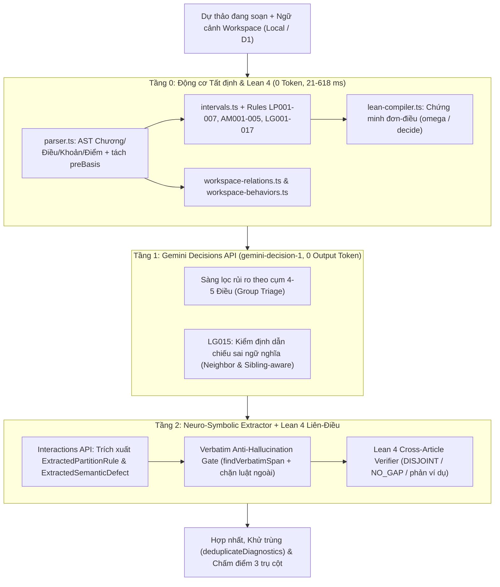
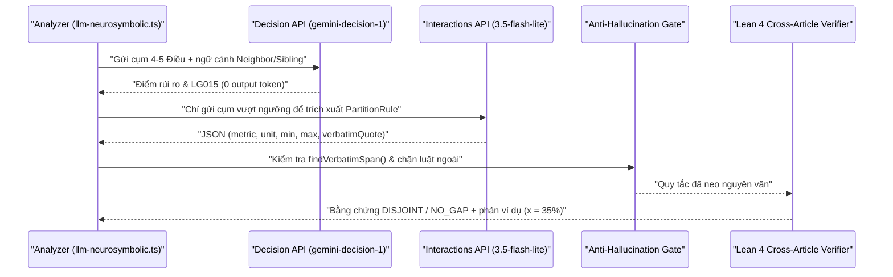

# INT3011E_6 — Soạn Luật Studio & LexIDE: Slide Báo Cáo Đồ Án (18 Slides)

> Bộ slide thuyết trình bảo vệ đồ án gồm 5 phần: **Giới thiệu bài toán**, **Giới thiệu sản phẩm**, **Giải thích luồng nghiệp vụ (Neuro-Symbolic Pipeline v4.1)**, **Benchmark thực nghiệm**, và **Case thất bại & Bài học thực chiến**.

---

## Slide 1 — Trang bìa: Soạn Luật Studio & LexIDE

### Môi trường Soạn thảo & Kiểm định Pháp luật Neuro-Symbolic (Lawmaker IDE)
- **Đề tài:** `INT3011E_6` — Nền tảng soạn thảo văn bản quy phạm pháp luật, soát logic tự động & phân tích phạm vi tác động.
- **5 nội dung trình bày:**
  1. **Giới thiệu bài toán** — Vì sao soạn luật Việt Nam cần IDE chuyên biệt & vì sao Pure LLM thất bại?
  2. **Giới thiệu sản phẩm** — Soạn Luật Studio & **LexIDE** (VS Code-style Lawmaker IDE).
  3. **Giải thích luồng nghiệp vụ** — Kiến trúc **Neuro-Symbolic Pipeline v4.1** (Tier 0 → Decision API → LLM + Lean 4).
  4. **Benchmark thực nghiệm** — Đối chiếu v1 → v4.1 vs Pure LLM (Free Tier & Paid `Gemini 4 Neon`) trên 3 bộ luật thật.
  5. **Case thất bại & Hướng phát triển** — 5 failure cases thật đã đo và lộ trình khắc phục.
- **Sản phẩm chạy thực tế (Cloudflare Workers):**
  - Web UI: `https://int3011e-web.nampe.workers.dev`
  - Backend API: `https://int3011e-backend.nampe.workers.dev`
- **Kiểm thử hệ thống:** `131/131` unit/integration tests pass (`26` file, `424` assertions), `0` lỗi TypeScript/Svelte.

> **Ghi chú thuyết trình:** Giới thiệu tên đề tài, nhấn mạnh sản phẩm đã deploy live trên Cloudflare Workers và toàn bộ số liệu benchmark trong bài đều đo trực tiếp trên văn bản pháp luật Việt Nam thật.

---

## Slide 2 — Phần 1: Giới thiệu bài toán — Thực trạng Kỹ thuật Lập pháp Việt Nam

### 3 Thách thức cốt lõi khi soạn thảo văn bản quy phạm pháp luật
1. **Quy mô khổng lồ & sửa đổi chồng chéo nhiều thế hệ:**
   - Bộ luật Hình sự thực tế gồm **500 trang** (`100/2015/QH13` 305 trang + `12/2017/QH14` 127 trang + `86/2025/QH15` 48 trang + `02/2018/NQ-HĐTP` 20 trang).
   - Một dự thảo mới phải đồng thời khớp `Căn cứ` chuẩn NĐ 34/2016, NĐ 154/2020, NĐ 30/2020 và không xung đột với hàng trăm điều khoản đang có hiệu lực.
2. **Thực tế số hóa văn bản nguồn:**
   - Trong 500 trang PDF chính thức của BLHS do người dùng cung cấp: **480 / 500 trang (96%) là bản scan đóng dấu đỏ (`0` text layer)**; chỉ `02/2018/NQ-HĐTP` (20 trang) có text layer (`43,782` ký tự ≈ `2,189.1` ký tự/trang).
3. **Lỗi kỹ thuật lịch sử có thật ngay trong luật đã ban hành:**
   - **BLHS `100/2015/QH13`**: từng phải lùi hiệu lực để ban hành Luật sửa đổi `12/2017/QH14` — trong mẫu thực nghiệm có **8 lỗi lõi thật**: chồng chéo/khoảng trống định lượng (`Điều 326`, `359`, `305`, `303`), dẫn chiếu sai tên/ngữ nghĩa (`Điều 389 → 299/304`, `Điều 298 → 225`, `Điều 398 → 135`), nghịch lý khung phạt (`Điều 235 K3` nặng hơn K1 nhưng phạt nhẹ hơn).
   - **NĐ `90/2020/NĐ-CP`** (`NghiemAbe/Legal-Corpus-Zalo`): tồn tại **14 lỗi thật**, gồm các khoảng trống phân loại xếp loại liên-điều `(20%, 50%]`, `(50%, 70%)`, `[0%, 70%)`.

> **Ghi chú thuyết trình:** Nhấn mạnh bài toán không phải giả định — các lỗi ở BLHS 2015 và NĐ 90/2020 đều là lỗi thật trên văn bản đã ban hành, gây hệ quả trực tiếp khi áp dụng pháp luật.

---

## Slide 3 — Phần 1: Tại sao Pure LLM thất bại khi làm IDE soạn luật thực tế?

| Nút thắt thực tế | Số liệu đo được trong thực nghiệm | Hệ quả đối với IDE soạn luật |
| :--- | :--- | :--- |
| **1. Chi phí Token & Scale 500 trang** | Tỷ lệ tokenize tiếng Việt đo thực tế: `2.96` ký tự/token (`19,227` ký tự = `6,491` input token). Toàn bộ 500 trang (`~1,094,550` ký tự) ≈ **`~370,000` input token/lượt** | Chỉ **10 lần sửa** đã tốn **`~3.7M` token**, vượt xa giới hạn TPM/RPD Free Tier và rất đắt đỏ ở Paid Tier |
| **2. Độ trễ không thể Realtime** | `gemini-3.7-flash` (Thinking): **`220,894 ms` (`3p 41s`)**; `Gemini 4 Neon`: **`~255s – 376s` (`4p – 6p 16s`)** cho 19k–34k ký tự | Không thể chạy kiểm định trực tiếp khi người dùng đang gõ phím |
| **3. Ảo giác (Hallucination)** | `gemini-3.5-flash-lite` trên `90/2020/NĐ-CP`: bắt **`0 / 14`** lỗi thật nhưng bịa đặt *"Điều 43 Luật Viên chức không có khoản 1, 2, 3"* | Nhà soạn luật mất niềm tin nếu công cụ tự bịa nội dung luật ngoài |
| **4. Độ ổn định & Quota** | `gemini-4-neon`: **`0 RPD`** trên Free Tier (`429`); `gemini-3.6-flash`: `20 RPD` (`429`); `3.5/3.6-flash` & `4-hydrogen`: thường xuyên **`503`** | Hệ thống thuần LLM sẽ tê liệt hoàn toàn khi API quá tải hoặc hết quota |

**Kết luận bài toán:** Cần kiến trúc **Neuro-Symbolic IDE** kết hợp **Phân tích tất định + Chứng minh hình thức Lean 4 (`0` token)** với **LLM sàng lọc có kiểm soát chống ảo giác**.

> **Ghi chú thuyết trình:** Đây là động lực kiến trúc cốt lõi của đồ án: không bỏ LLM, nhưng không giao toàn bộ văn bản thô cho LLM phán đoán cảm tính.

---

## Slide 4 — Phần 2: Giới thiệu sản phẩm — Hệ sinh thái Soạn Luật Studio & LexIDE

### Kiến trúc tổng thể & Nguyên tắc thiết kế
- **LexIDE (`/`)**: Môi trường soạn thảo & kiểm định pháp luật phong cách **Visual Studio Code** (Dark Modern & Light Modern), tích hợp **Neuro-Symbolic Pipeline v4.1**.
- **Hệ sinh thái đa màn hình:** Bàn soạn thảo cấu trúc (`/drafting`), Trung tâm Soát Logic & Phạm vi Tác động (`/audit`), Lược đồ tác động 2 chế độ (`/graph`), Quản lý đa Workspace cô lập (`/workspaces`), và luồng nạp PDF nền qua Queue.
- **Nguyên tắc Local-First & Workspace-Only:**
  - Không bắt đăng nhập trên LexIDE; mở trực tiếp thư mục luật trên máy (`showDirectoryPicker` / `webkitdirectory`).
  - Toàn bộ Tầng 0, **Lean 4 (`0` token)**, Lược đồ quan hệ, Hành vi, Run & Debug, Diff Viewer, giải nén `.zip` và xuất **DOCX/PDF chuẩn NĐ 30/2020** chạy 100% cục bộ trên trình duyệt.
  - Mọi kiểm tra thuật ngữ/dẫn chiếu chỉ dựa trên văn bản trong Workspace (`strictlyWorkspaceOnly`), **không bịa nguồn ngoài**.

| Lớp công nghệ | Công nghệ sử dụng | Vai trò chính |
| :--- | :--- | :--- |
| **Frontend & Engine cục bộ** | Svelte 5, SvelteKit, Tailwind CSS, shadcn-svelte, `web/src/lib/engine/` | Giao diện LexIDE, phân tích Tầng 0, Lean 4, Cache realtime |
| **Backend & Lưu trữ** | Elysia trên Cloudflare Workers, Drizzle ORM, Better Auth, D1, R2, Queues | API Workspace, Auth, lưu dự thảo, xử lý PDF nền |
| **AI & Chứng minh hình thức** | Gemini Decisions API (`/v1beta/decisions`), Interactions API (`/v1/interactions`), Lean 4 | Sàng lọc `0` output token, trích xuất cấu trúc, chứng minh `omega`/`decide` |

> **Ghi chú thuyết trình:** Nhấn mạnh tính thực dụng của thiết kế Local-First: người dùng giữ dữ liệu dự thảo nhạy cảm ngay trên máy, không phụ thuộc server cho các tác vụ phân tích lõi.

---

## Slide 5 — Phần 2: Trải nghiệm Soạn thảo trên LexIDE (VS Code-Style Lawmaker IDE)

### Bố cục 6 vùng chuẩn IDE
1. **Activity Bar (7 chế độ):** Explorer, Find & Replace, Source Control, Run & Debug, Library, **Lược đồ quan hệ**, **Hành vi & Lịch sử**.
2. **Primary Sidebar:** Cây thư mục dự thảo, Outline Điều/Khoản, Diff phiên bản, Thư viện luật nền.
3. **Law Editor:** Tô màu cú pháp (`Chương`/`Điều`/`Căn cứ`), gạch chân lượn sóng 3 nhóm lỗi (`LOOPHOLE` vàng, `AMBIGUITY` xanh dương, `LOGIC` đỏ).
4. **Bottom Panel:** Tab **Vấn đề** (lọc theo nhóm + QuickFix) & Tab **Lean 4 Compiler** (mệnh đề `PROVED`/`REFUTED`, phản ví dụ, token tiết kiệm, mã `.lean`).
5. **Inspector:** Điểm chất lượng (0–100), Thuật ngữ & Văn bản định nghĩa, Ma trận ngưỡng định lượng, Bản đồ dẫn chiếu nội bộ.
6. **Status Bar:** Phạm vi `Workspace`, trạng thái **Live AI Analyzer**, trạng thái `Lean 4`, số lỗi theo nhóm, vị trí `Ln, Col`.

### Tính năng nổi bật khi đang gõ
- **Hover dẫn chiếu thuật ngữ:** Rê chuột vào thuật ngữ đã định nghĩa để xem nguyên văn + nguồn Điều/Khoản/văn bản + cảnh báo nếu văn bản nguồn đã bị thay thế/bãi bỏ.
- **QuickFix 1-click:** Tự động sửa lỗi đảo ngược khung phạt (`LG001`) hoặc sửa dẫn chiếu sai tên tội danh (`LG008`: `Điều 299 → Điều 304`).
- **Live AI Analyzer Indicator + Nút Hủy (`AbortController`):** Theo dõi trực tiếp tiến trình AI trên Breadcrumb & Status Bar, hủy ngay khi gõ tiếp.
- **IntelliSense chuẩn Việt Nam (`Ctrl+Space`):** Tự đánh số Điều kế tiếp, chuẩn hóa điểm `a, b, c, d, đ, e...`, xuất **DOCX/HTML chuẩn NĐ 30/2020 (Times New Roman)**.

> **Ghi chú thuyết trình:** Giải thích cách LexIDE biến việc soạn luật từ "soạn trên Word rồi đọc dò bằng mắt" thành trải nghiệm giống lập trình viên dùng VS Code + TypeScript + Lean 4.

---

## Slide 6 — Phần 2: 3 Năng lực Phân tích Sâu & Kiểm chứng Hình thức

### 1. Lược đồ quan hệ vòng đời văn bản (`RelationGraphPanel`)
- Tự động phân tích toàn bộ văn bản trong Workspace (`workspace-relations.ts`) để dựng đồ thị quan hệ: `BASED_ON`, `REPLACES`, `AMENDS`, `SUPPLEMENTS`, `AMENDS_SUPPLEMENTS`, `REPEALS`, `IMPLEMENTS`, `REFERENCES`.
- Gán trạng thái vòng đời chính xác: `ACTIVE`, `AMENDED`, `PARTIALLY_REPEALED`, `REPLACED`, `REPEALED`, `DRAFT`.

### 2. Tab Hành vi & Lịch sử thay đổi 3 đời luật (`BehaviorsPanel`)
- Tổng hợp hành vi theo chủ thể và truy vết biến động chế tài qua các thế hệ luật với **`0` token LLM** (`workspace-behaviors.ts`):
  - **Luật Giao thông đường bộ:** `100/2019/NĐ-CP → 123/2021/NĐ-CP → 168/2024/NĐ-CP` (theo dõi lịch sử hành vi vượt đèn đỏ qua 3 đời Nghị định).
  - **Bộ luật Hình sự:** `100/2015/QH13 → 12/2017/QH14 → 86/2025/QH15` (`29` hành vi / `14` hành vi có lịch sử biến động: tăng phạt tiền, bỏ tử hình, bãi bỏ `Điều 292`).

### 3. Lean 4 Compiler & Tòa án giả lập (`Run & Debug`)
- **Lean 4 Compiler Panel:** Sinh mã `namespace LexIDE ... end LexIDE`, hiển thị bằng chứng `PROVED`/`REFUTED` và phản ví dụ cụ thể (ví dụ `x = 35%`, `x = 60%`).
- **Run & Debug:** Mô phỏng tình huống áp dụng luật, cho phép bật/tắt tương tác các điểm mơ hồ (`Assume = true/false`) để quan sát Call Stack và biến thiên kết quả xét xử.

> **Ghi chú thuyết trình:** Nhấn mạnh 2 tab mới (Lược đồ quan hệ & Hành vi) giúp người soạn luật nhìn thấy bức tranh lịch sử và tác động dây chuyền mà không tốn 1 token LLM nào.

---

## Slide 7 — Phần 3: Tổng quan Luồng Nghiệp vụ — Neuro-Symbolic Pipeline v4.1

> **Ghi chú thuyết trình:** Trình bày luồng đi từ trái/trên xuống: Tầng 0 lọc và chứng minh miễn phí trước; Tầng 1 dùng `gemini-decision-1` không tốn output token; Tầng 2 chỉ trích xuất cấu trúc để Lean 4 chứng minh toán học.

---

## Slide 8 — Phần 3: Luồng Tầng 0 — Bộ Quy tắc Đa lĩnh vực & Chấm điểm (`0` Token)

### Hệ thống quy tắc tất định (`LP001–LP007`, `AM001–AM005`, `LG001–LG017`, `WS001`)
- **Kẽ hở (`LP001–LP007` — vàng):** Ngoại lệ mở thiếu căn cứ; hành vi `nghiêm cấm` thiếu chế tài (hỗ trợ cả hành chính & hình sự); khoảng trống định lượng đa đơn vị (`km/h`, `kilôgam`, `đơn vị`, `giấy tờ giả`, `%`...); bỏ sót chế tài tổ chức (tự bỏ qua khi có quy đổi `2 lần` / `50%`); điều khoản rỗng (`LP007`).
- **Mơ hồ (`AM001–AM005` — xanh dương):** Từ định tính (tự bỏ qua thuật ngữ đã định nghĩa tại Điều 9 BLHS); liệt kê mở; chế tài tùy nghi (bỏ qua hình phạt bổ sung hợp lệ *"người phạm tội còn có thể bị..."*); kiểm tra định nghĩa thuật ngữ chuẩn Unicode.
- **Logic, Căn cứ & Đồ thị (`LG001–LG017` — đỏ):**
  - `LG008`: Dẫn chiếu sai số `Điều` so với tên tội danh trong ngoặc đơn (kèm QuickFix 1-click) & dẫn chiếu trùng lặp.
  - `LG009–LG014`: Audit `Căn cứ` ở vùng `preBasis` chuẩn **NĐ 34/2016**, **NĐ 154/2020**, **NĐ 30/2020** (đúng thứ bậc Hiến pháp → Bộ luật/Luật → Pháp lệnh → Nghị quyết → Nghị định → Quyết định → Thông tư).
  - `LG016`: Nghịch lý tăng tiến khung hình phạt (khoản nặng hơn nhưng mức phạt tối đa lại thấp hơn, chứng minh bằng Lean 4 `omega`).
  - `LG017`: Phát hiện điều khoản con bị bỏ sót dẫn chiếu (Orphaned Sub-Provision Graph Detector, `0` token).

**Công thức chấm điểm:** `overallScore = round(loopholeScore * 0.35 + clarityScore * 0.25 + logicScore * 0.40)` (sàn mỗi trụ cột `10`, trừ điểm `error = -14`, `warning = -7`, `info = -3`).

> **Ghi chú thuyết trình:** Nhấn mạnh bộ quy tắc đã được tổng quát hóa đa lĩnh vực (hình sự, hành chính, dân sự, công chức) chứ không chỉ gắn cứng với Luật Giao thông.

---

## Slide 9 — Phần 3: Luồng Tầng 1 & Tầng 2 — Decision API, Anti-Hallucination & Lean 4 Liên-Điều

- **4 trụ cột vượt trội Pure LLM cùng tầm:**
  1. **`gemini-decision-1` (`0` output token, 200 RPM / 10k RPD):** Sàng lọc cụm Điều và bắt lỗi dẫn chiếu sai ngữ nghĩa `LG015` nhờ ngữ cảnh Điều liền kề (`Neighbor`) & cùng mục (`Sibling`).
  2. **Không hardcode đơn vị:** LLM trích xuất `ExtractedPartitionRule` cho mọi đơn vị bất kỳ (`%`, `năm`, `kilôgam`, `đơn vị`...).
  3. **Verbatim Anti-Hallucination Gate:** Mọi kết quả LLM phải khớp nguyên văn trong dự thảo và bị chặn nếu viện dẫn luật ngoài không có trong Workspace.
  4. **Lean 4 Cross-Article Verifier:** Tự động gom quy tắc xuyên nhiều Điều để chứng minh `DISJOINT` / `NO_GAP` và sinh phản ví dụ cụ thể.

> **Ghi chú thuyết trình:** Đây là điểm khác biệt lớn nhất của đồ án: dùng LLM làm "trình trích xuất có kiểm soát", còn quyền "phán quyết toán học" thuộc về Lean 4.

---

## Slide 10 — Phần 3: Luồng Realtime Accuracy-First & Vòng đời Đa văn bản

### 1. Cơ chế Realtime khi đang gõ (`+page.svelte` & `llm-incremental.ts`)
- **Ưu tiên Accuracy kể cả Realtime:** Bật mặc định `deepNeuroSymbolic: true` ngay cả khi người dùng đang gõ (`debounce 900 ms`).
- **Tối ưu phản hồi & chi phí:**
  - `AbortController` hủy ngay request cũ nếu người dùng tiếp tục gõ.
  - `IncrementalLlmCache.neuroSymbolicCache` băm nội dung theo từng **nhóm Điều (`4–5` Điều/nhóm)**. Khi sửa 1 Điều, các nhóm không đổi lấy từ cache và tự động **Re-anchor** lại số dòng/offset khi thêm hoặc xóa dòng phía trên.
  - Chỉ gọi lại API cho đúng nhóm Điều vừa thay đổi.

### 2. Luồng Đa văn bản (Relation Graph & Behavior History — `0` Token)
- Quét toàn bộ thư mục Workspace → chuẩn hóa số hiệu (`documentNumber`) → dựng **Lược đồ quan hệ** (`workspace-relations.ts`) và đối chiếu **Hành vi qua nhiều thế hệ luật** (`workspace-behaviors.ts`).
- Tự động phát hiện văn bản đã bị thay thế/bãi bỏ khi người dùng hover thuật ngữ hoặc kiểm tra `Căn cứ`.

> **Ghi chú thuyết trình:** Giải thích cách hệ thống giải quyết mâu thuẫn giữa "Accuracy cao" và "Realtime mượt" bằng cache theo nhóm Điều + Re-anchor tọa độ dòng.

---

## Slide 11 — Phần 4: Benchmark Thực nghiệm — 3 Bộ Dữ liệu Luật Thật

| Bộ dữ liệu | Nguồn & Quy mô thực tế | Mục tiêu kiểm chứng |
| :--- | :--- | :--- |
| **1. Luật Giao thông đường bộ** (`data/traffic-law-real/`) | `7` tệp (`8,384` ký tự): `23/2008`, `36/2024`, `35/2024`, `100/2019`, `123/2021`, `168/2024` + dự thảo sửa đổi | Kiểm tra `Căn cứ`, vòng đời văn bản, lịch sử 3 đời Nghị định |
| **2. Bộ luật Hình sự thật 500 trang** (`data/blhs-real/library/`) | `4` văn bản (`100/2015/QH13`, `12/2017/QH14`, `02/2018/NQ-HĐTP`, `86/2025/QH15`); mẫu lõi `100/2015/QH13` (`19,227` ký tự, `107` đơn vị) | **8 lỗi thật lịch sử** (Điều 326, 359, 305, 303, 389, 235 K3, 298→225, 398→135) + **6 lỗi sâu** |
| **3. Tập đa lĩnh vực `NghiemAbe/Legal-Corpus-Zalo`** (`data/zalo-legal-subset/`) | `6` văn bản hoàn chỉnh từ Hugging Face (`208` Điều, `388,137` ký tự): `91/2010/TT-BTC`, `01/2011/QH13`, `212/2012/TT-BTC`, `45/2020/NĐ-CP`, `45/2019/NĐ-CP`, `90/2020/NĐ-CP` | Clean Real (`90/2020/NĐ-CP` — **14 lỗi thật**), Adversarial Long-Context (`45/2020/NĐ-CP` — 10 lỗi gài), và Full Workspace 6 văn bản |

**Các đối thủ đối chiếu:** Pipeline **v1 → v2 → v3 → v4.1** vs Pure LLM Free Tier (`gemini-3.5-flash-lite`, `3.6-flash`, `3.7-flash`) vs Pure Paid Frontier (**`Gemini 4 Neon`** blind audit).

> **Ghi chú thuyết trình:** Toàn bộ benchmark đều chạy trên văn bản thật và lưu báo cáo JSON trong `data/eval/reports/`.

---

## Slide 12 — Phần 4: Hành trình Tiến hóa Pipeline v1 → v4.1 trên BLHS `100/2015/QH13`

### Kết quả trên 8 lỗi thật lịch sử của BLHS 2015 (`19,227` ký tự)

| Phiên bản Pipeline | Lỗi lõi bắt được | Thời gian | Token LLM | Bước tiến kỹ thuật |
| :--- | :---: | :---: | :---: | :--- |
| **v1 (Traffic-tuned)** | `0 / 8` | `94 ms` (T0) / `68.4s` (drain 503) | `14,315` | Overfit đơn vị GTĐB; `63` chẩn đoán nhiễu; `decision-1` lọc `34.6%` (`37/107`) |
| **v2 (Domain-general T0 + LG015)** | `6 / 8` | `53 ms` + `566 ms` | `725` in / `0` out | T0 bắt ngay `5/8` (`0` tok) + `LG015` bắt `Điều 298→225`; sót `Điều 398→135` & `235 K3` |
| **v3 (+LG016 & Neighbor LG015)** | **`8 / 8` (`100%`)** | **`8.3s`** (`8,317 ms`) | **`3,736` in / `0` out** | Sửa `EXTERNAL_DOC_AFTER`, thêm `LG016` & Neighbor-aware `LG015`; Graph & 3-Gen History `0` tok |
| **v4.1 (Neuro-Symbolic + Lean 4)** | **`8 / 8` (`100%`)** | `108.6s` (cold) | `19,947` (Free Tier) | Trích xuất phân hoạch đa đơn vị + `24` mệnh đề Lean 4 `REFUTED` kèm phản ví dụ |

- **Điểm nhấn:** Từ `0/8` ở v1 nâng lên **`8/8` (`100%` Recall lỗi lõi)** ở v3–v4.1 trên Free Tier (`0đ`), đồng thời dựng Lược đồ quan hệ (`16` cạnh) & Lịch sử 3 đời BLHS (`29` hành vi / `14` có lịch sử) trong `53 ms` với `0` token.

> **Ghi chú thuyết trình:** Bảng này cho thấy quá trình cải tiến có đo lường rõ ràng qua từng vòng lặp kỹ thuật chứ không làm một lần rồi thôi.

---

## Slide 13 — Phần 4: Đối đầu Trực diện — Pipeline v4.1 vs Pure LLM (Free & Paid `Gemini 4 Neon`)

| Hệ thống / Mô hình | BLHS `100/2015/QH13` (`19,227` ký tự) | Zalo `90/2020/NĐ-CP` (`34,207` ký tự, 25 Điều) | Chi phí & Độ tin cậy |
| :--- | :--- | :--- | :--- |
| **Pure `3.5-flash-lite` (Free)** | `0/8` (lỗi `503` quá tải) | **`0 / 14` lỗi thật + 1 hallucination nặng** (`1.3s`, `9,689` tok) | `0đ`, bịa nguồn luật ngoài |
| **Pure `3.6-flash` (Free)** | `0/8` (`503` / `429: 20 RPD`) | — | `0đ`, dễ chạm trần RPD |
| **Pure `3.7-flash` (Thinking)** | `8/8` lỗi lõi, `0` FP (`9,962` tok) | — | **`220.9s` (`3p 41s`)**, không realtime |
| **Pipeline v3** | **`8/8` lỗi lõi** (`8.3s`, `3,736` in / `0` out) | `0/14` sâu (`102 ms`, `0` tok, `0` lỗi) | **`0đ`**, cực nhanh |
| **Pipeline v4.1** *(3.5-flash-lite + Lean 4)* | **`8/8` lõi + Lean 4** (`108.6s`, `19,947` tok) | **Bắt dead zone `(20%, 50%]`, `(50%, 70%)`, `[0%, 70%)` + phản ví dụ Lean 4; `0` hallucination** (`76.3s` cold → **`14.6s` warm**) | **`0đ` (Free Tier)**, có bằng chứng toán học |
| **Pure `Gemini 4 Neon`** *(Blind Paid)* | **`14` lỗi thật (`8/8` lõi + `6` sâu)**, `0` FP (`~376s`) | **`14 / 14` lỗi thật**, `0` FP (`~255s`) | **Paid Tier** (`0 RPD` Free), `4–6` phút |

**Kết luận trung thực:** Pipeline v4.1 **vượt trội hoàn toàn Pure LLM cùng tầm (Free Tier)**; còn so với **Paid Frontier (`Gemini 4 Neon`)**, hai bên mang tính **bổ trợ** (IDE realtime tốc độ + Lean 4 vs Frontier rà soát chính sách sâu ngoại tuyến).

> **Ghi chú thuyết trình:** Trình bày thẳng thắn kết quả đối đầu với `Gemini 4 Neon`: không tô hồng, chỉ rõ chỗ mình thắng (Free Tier, tốc độ warm, 0 hallucination, Lean 4) và chỗ Neon mạnh hơn (suy luận chính sách sâu).

---

## Slide 14 — Phần 4: Long-Context Adversarial, Workspace 208 Điều & Scale 500 Trang

### Kết quả trên các bài test mở rộng
1. **Adversarial Long-Context `45/2020/NĐ-CP` (`48,986` ký tự, 10 lỗi gài `Z01–Z10`):**
   - **Pipeline v3:** `9/10` (`3.86s`, `5,258` tok; warm `1.96s`, `2,306` tok) → **v4.1: `10/10`** (sau khi sửa `LG004`).
   - **Pure Free Tier LLM:** **`0/10`** (thất bại do `404`/`429`/`503`).
2. **Full Workspace 6 văn bản Zalo (`388,137` ký tự, `208` Điều):**
   - Tầng 0 quét trọn 6 văn bản + dựng Lược đồ quan hệ trong **`618 ms`, `0` token**.
3. **Hiệu quả Incremental Cache (`90/2020/NĐ-CP`):**
   - Cold `76.3s` (`18,889` tok) → Warm `14.6s` (`6,746` tok): giảm **`80.8%` độ trễ** và **`64.3%` token**.
4. **Luật GTĐB (`data/traffic-law-real/`, 7 tệp):**
   - Tầng 0 chạy **`21 ms`, `0` token** (`8` diagnostics, `17` cạnh quan hệ, `15` nhóm hành vi / `3` có lịch sử 3 đời).
5. **Ngoại suy Scale 500 trang (`~1,094,550` ký tự):**
   - Pure LLM tốn `~370,000` input token/lượt (`~3.7M` token cho 10 lần sửa), trong khi Tầng 0 cục bộ giữ **`0` token**.

> **Ghi chú thuyết trình:** Nhấn mạnh con số `618 ms` cho `388,137` ký tự (`208` Điều) và mức giảm `80.8%` độ trễ khi warm cache.

---

## Slide 15 — Phần 5: Case Thất Bại (1/3) — Những Lỗi Đã Gặp & Khắc Phục

### Case 1 — Domain Overfitting (Pipeline v1 trên BLHS)
- **Triệu chứng:** Bắt `0/8` lỗi BLHS, sinh `63` chẩn đoán nhiễu (`11 AM001`, `7 AM003`, `LG009/LG013` báo nhầm vào câu văn Điều 9 *"Căn cứ vào tính chất..."*), và `parser.ts` nhận nhầm `100/2015/QH13` là **Hiến pháp (rank 1)** vì thấy chuỗi `"Căn cứ Hiến pháp..."` trong 1,500 ký tự đầu.
- **Nguyên nhân:** Hardcode đơn vị Luật GTĐB (`km/h`, `mg/100ml`), chưa tách vùng `preBasis` trước `Điều 1`.
- **Khắc phục:** Tách `preBasis`, ưu tiên hậu tố số hiệu văn bản (`QH`, `NĐ-CP`, `NQ-HĐTP`), chuyển sang Neuro-Symbolic không hardcode đơn vị ở v4.1.

### Case 2 — Bẫy Regex & Biên vị trí (`v2 → v3`)
- **Triệu chứng:** `EXTERNAL_DOC_AFTER` nhận nhầm `"của Bộ luật này"` / `"Nghị định này"` là văn bản ngoài → bỏ lọt `Điều 398 K1 → Điều 135`; kiểm tra biên `startOffset <= node.startOffset + 12` bỏ sót dẫn chiếu đầu khoản → `LG017` không kích hoạt trên `90/2020/NĐ-CP`.
- **Khắc phục:** Thêm negative lookahead `(?!\s+này...)` và kiểm tra theo cấp AST (`node.level === "ARTICLE"`).

> **Ghi chú thuyết trình:** Hai case này cho thấy rủi ro thực tế khi chuyển từ một lĩnh vực hẹp (Luật GTĐB) sang bộ luật tổng quát (BLHS, Nghị định).

---

## Slide 16 — Phần 5: Case Thất Bại (2/3) — 3 Lỗ Hổng Precision Còn Tồn Đọng ở v4.1

| Case thất bại | Vị trí thực tế | Biểu hiện sai đo được | Nguyên nhân gốc rễ |
| :--- | :--- | :--- | :--- |
| **Case 3a — Phân bậc lồng nhau** | `Điều 5 & Điều 9`, `NĐ 90/2020/NĐ-CP` | Báo `4` lỗi `LG002` chồng chéo tại `x = 80%`, `x = 100%` | Mức *Hoàn thành tốt* (`≥80%`) **bao hàm** trong *Hoàn thành nhiệm vụ* (`>70%`) — là thứ bậc lồng nhau (subsumption), không phải xung đột rời nhau |
| **Case 3b — Đơn vị rời rạc** | `Điều 135` (`30%→31%`), `Điều 305` (`3000→3001` cái) BLHS | Báo nhầm `LP003` khoảng trống `(30, 31)` và `(3000, 3001)` | Lean 4 kiểm tra trên miền số thực liên tục, chưa gắn cờ số nguyên rời rạc (`discrete`) và LLM chuẩn hóa đơn vị `"cái"` lệch `"nụ xuỳ"` |
| **Case 3c — Ngưỡng `LG015` & Warm Cache** | `Điều 298 K1/K4` BLHS; Warm run `90/2020/NĐ-CP` | `LG015` ở ngưỡng `0.55` báo nhạy vào `Điều 224`, `Điều 281`; Warm run vẫn tốn `6,746` token | Chưa hiệu chuẩn ngưỡng tách biệt theo ngữ cảnh danh sách nhiều điều; `LG015` chưa cache hoàn toàn ở cấp nhóm không đổi |

> **Ghi chú thuyết trình:** Đây là 3 điểm yếu thật đang tồn tại trong `neurosymbolic-v4-benchmark.json`, giúp hội đồng thấy nhóm đã kiểm thử kỹ và hiểu rõ giới hạn của hệ thống.

---

## Slide 17 — Phần 5: Case Thất Bại (3/3) — Trần Suy Luận Đa Biến & Nút Thắt Hạ Tầng

### Case 4 — Trần suy luận chính sách & logic đa biến (so với `Gemini 4 Neon`)
Với backbone Free Tier `3.5-flash-lite`, Pipeline v4.1 chưa bắt được các lỗi đòi hỏi suy luận nhiều điều kiện kết hợp:
- **Nghịch lý 2 biến thời gian:** `W = 6` tháng làm việc & `L = 6` tháng nghỉ ốm tại `Điều 2 K3`, `NĐ 90/2020/NĐ-CP`.
- **Toán tử Boolean & cấu trúc phức hợp:** Nhầm `"và"` vs `"hoặc"` (`Điều 12 K2d`, `NĐ 90/2020`), cấu trúc `(A ∧ B) ∨ C` & ngưỡng `5 tỷ` (`Điều 40 K3c`, BLHS).
- **Lỗi chính sách / ngữ nghĩa sâu:** Copy-paste đối tượng (`Điều 13 K2d`, `NĐ 90/2020`), khái niệm chưa định lượng (`"quy mô thương mại"`, `Điều 225` BLHS).

### Case 5 — Nút thắt Dữ liệu & Hạ tầng ngoài đời thực
- **96% PDF luật là bản scan (`480/500` trang BLHS):** Không có text layer → cần tầng OCR/VLM tiền xử lý có hậu kiểm số học trước khi nạp vào LexIDE.
- **API Free Tier thiếu ổn định:** `503` quá tải liên tục và `429` (`0 RPD` trên Neon, `20 RPD` trên 3.6-flash) → khẳng định vai trò sống còn của cơ chế **Graceful Degradation về Tầng 0 (`0` token)**.

> **Ghi chú thuyết trình:** Lean 4 giải xuất sắc bài toán định lượng & cấu trúc, nhưng không thay thế được Frontier LLM ở bài toán chính sách nhiều biến.

---

## Slide 18 — Kết luận, Mô hình Triển khai Lý tưởng & Hướng Phát Triển

### Kiến trúc Hybrid 2 lớp tối ưu cho thực tế
1. **Trong lúc soạn thảo (Realtime IDE):** **LexIDE Neuro-Symbolic v4.1** (Tầng 0 Local-First + Lean 4 + `gemini-decision-1` + Cache theo nhóm Điều) — nhanh, `0đ` đến cực rẻ, không bịa nguồn, có phản ví dụ toán học.
2. **Trước khi trình ký / thẩm định (On-Demand Batch):** Cắm **Frontier Model (`Gemini 4 Neon`)** vào **Tầng 2** của chính Pipeline v4.1 để kết hợp **suy luận chính sách 14/14** với **Anti-Hallucination Gate + bằng chứng Lean 4**.

### 4 Hướng phát triển trực tiếp từ Failure Cases
1. Bổ sung thuộc tính `hierarchical: boolean` (thang xếp loại lồng nhau) và `domain: "integer" | "real"` (đơn vị rời rạc) trong `ExtractedPartitionRule` + Lean 4.
2. Cache toàn phần cho `LG015` (đưa warm edit xuống gần `0` token) và hiệu chuẩn ngưỡng `LG015` theo độ dài danh sách điều luật.
3. Tích hợp pipeline OCR / Vision PDF tiếng Việt có hậu kiểm bảng số cho kho 96% văn bản scan.
4. Mở rộng benchmark định lượng Precision/Recall trên nhiều lĩnh vực hơn trong `NghiemAbe/Legal-Corpus-Zalo`.

**Demo Live:** `https://int3011e-web.nampe.workers.dev` · **Tài liệu:** [lexide.md](lexide.md) · [walkthrough-slides.md](walkthrough-slides.md)

> **Ghi chú thuyết trình:** Chốt lại thông điệp: LexIDE không cố thay thế con người hay Frontier LLM, mà kết hợp **tính tất định của Lean 4** với **AI có kiểm soát** để giải bài toán soạn luật thực tế.
