# SRS — Vietnamese Traffic Violation Sanction Intelligence

**Version:** 0.12\
**Domain:** Xử phạt vi phạm giao thông đường bộ Việt Nam  
**Project type:** Legal AI / Engineering + R&D  
**Base project:** Legal Document Change Detection

---

## 1. Mục tiêu hệ thống

Hệ thống xây dựng cơ sở tri thức về **hành vi vi phạm giao thông và mức xử phạt tương ứng** từ văn bản pháp luật, ưu tiên CSDL quốc gia về văn bản pháp luật (VBPL). Hệ thống tự xây dựng lược đồ quan hệ từ nội dung và bằng chứng pháp lý; không giả định VBPL hoặc nguồn khác cung cấp graph đầy đủ.

Điểm nhấn của hệ thống là **track hành vi qua nhiều văn bản và nhiều điều khoản khác nhau**.

Với một hành vi như:

~~~text
Đỗ xe trên phần đường xe chạy ngoài đô thị
~~~

hệ thống phải xác định được:

- quy định xử phạt hiện hành;
- mức phạt hiện hành;
- Điều / Khoản / Điểm đang là căn cứ;
- các điều khoản trước đó từng quy định cùng hành vi;
- điều khoản nào sửa đổi, bổ sung, thay thế hoặc bãi bỏ điều khoản nào;
- mức phạt và phạm vi hành vi đã thay đổi ra sao theo thời gian;
- văn bản nguồn cho từng thay đổi.

North-star question:

> Given a traffic violation, what is the currently applicable sanction, which provision establishes it, and how did that rule evolve over time?

---

## 2. Phạm vi

### 2.1. In scope

MVP chỉ tập trung vào **quy định xử phạt vi phạm hành chính đối với hành vi giao thông đường bộ**.

Các rule hình sự, dân sự hoặc trách nhiệm bồi thường không thuộc scope MVP.

Hệ thống xử lý các dữ liệu cần thiết để xác định:

- hành vi vi phạm;
- chủ thể / loại phương tiện;
- địa điểm, điều kiện và ngoại lệ;
- mức phạt tiền;
- trạng thái áp dụng cơ chế trừ điểm giấy phép lái xe và số điểm bị trừ nếu có;
- hình thức xử phạt bổ sung liên quan trực tiếp, được chuẩn hóa theo loại;
- biện pháp khắc phục hậu quả liên quan trực tiếp;
- hiệu lực của rule;
- rule áp dụng tại một thời điểm cụ thể (as-of date);
- lịch sử sửa đổi, bổ sung, thay thế, bãi bỏ của rule;
- quan hệ giữa các Điều / Khoản / Điểm;
- quan hệ giữa các văn bản cần thiết để reconstruct lịch sử rule.

Nguồn dữ liệu MVP:

~~~text
https://vbpl.vn/
~~~

Admin import bằng một hoặc nhiều tệp PDF của văn bản pháp luật; URL không còn là input import bắt buộc. Hệ thống giữ PDF gốc/hash và có thể dùng nguồn chính thức để acquire các văn bản đích hoặc đối chiếu bản gốc. URL chỉ là provenance/discovery nội bộ hoặc metadata bổ sung, không phải thao tác nhập bằng link. Header và toàn văn PDF là evidence chính; lược đồ nguồn là observations tùy chọn.

### 2.2. Corpus discovery và graph scope

Khi import một văn bản, hệ thống đọc toàn văn để phát hiện dẫn chiếu và câu lệnh pháp lý, resolve identity văn bản đích, rồi xây dựng DocumentRelation có evidence. Discovery và graph building chạy tăng dần: văn bản mới có thể bổ sung cạnh tới văn bản đã xử lý. Metadata/lược đồ nguồn chỉ cung cấp candidate để đối chiếu.

Corpus discovery phải:

- thu thập văn bản được nhắc trong toàn văn, phần căn cứ, điều khoản sửa đổi/hiệu lực/chuyển tiếp và bản hợp nhất;
- tìm kiếm ngược theo số hiệu, tên, cơ quan và ngày để tìm văn bản sửa đổi/thay thế/bãi bỏ root, kể cả khi nguồn bỏ sót incoming links;
- phân biệt canonical Document với source identity `(source, source_item_id)`; hỗ trợ ID số/UUID và alias đã xác minh;
- lưu snapshot, search query, pagination, thời điểm/cutoff, candidate chưa resolve và lý do dừng;
- chống refetch cycle bằng visited set nhưng vẫn giữ mọi cạnh tới node đã visited;
- có retry, cache, checkpoint và safety limit theo discovery policy đã khai báo.

Frontier rỗng chỉ nghĩa là đã xử lý hết candidate trong phạm vi lần chạy, không chứng minh tìm thấy tất cả văn bản pháp luật. Safety cap hoặc khoảng thiếu ảnh hưởng đến chuỗi đang xét phải được thể hiện PARTIAL/UNCERTAIN và có thể resume; không ép một graph có nhiều dẫn chiếu thành traversal toàn bộ pháp luật.

Document reference/relation extraction chạy trên toàn bộ văn bản trước relevance filtering. Semantic processing chuyên sâu tập trung vào provision định nghĩa hành vi, chế tài hoặc tác động tới sanction rule. Giữ các relation ngoài traffic relevance đã phát hiện để không làm mất căn cứ và đường truy vết.

---

### 2.3. Out of scope

MVP không nhằm:

- bao phủ toàn bộ pháp luật giao thông;
- tư vấn pháp lý cho một vụ việc cụ thể;
- tự kết luận một cá nhân có vi phạm hay không;
- phân tích quy hoạch, hạ tầng hoặc tiêu chuẩn kỹ thuật không liên quan tới xử phạt hành vi;
- phân tích tổ chức bộ máy và trách nhiệm cơ quan nếu không tác động tới sanction rule;
- hỗ trợ upload DOCX hoặc định dạng tùy ý ngoài PDF;
- thay thế CSDL VBPL chính thức;
- train foundation model riêng;
- yêu cầu human review cho mỗi extraction.

---

## 3. Actors

### 3.1. User

User có thể:

- search văn bản;
- xem nội dung văn bản;
- xem quan hệ của văn bản với các VBPL khác;
- thấy provision xử phạt nào còn hiệu lực hoặc đã bị tác động;
- search hành vi thủ công bằng full-text search;
- hỏi bằng AI chat để hệ thống tự tìm các hành vi / rule liên quan và trả lời kèm reference;
- xem mức phạt hiện hành;
- xem các provision hiện hành áp dụng cho hành vi;
- xem lịch sử provision và mức phạt của hành vi.

### 3.2. Admin

Admin có thể:

- upload PDF văn bản pháp luật, gồm các phần/phụ lục khi văn bản có nhiều tệp;
- xem trạng thái crawl / process;
- xem import ở trạng thái READY / PARTIAL / FAILED, cùng discovery scope, cutoff, coverage và candidate/conflict chưa giải quyết;
- retry import thất bại;
- trigger reprocess khi cần;
- xem xét văn bản ở trạng thái `REVIEW_REQUIRED`: đối chiếu các lỗi/cảnh báo validation và danh sách Điều đã đọc (kèm trang, chất lượng đọc) với PDF gốc, rồi duyệt để công bố.

Admin và Reviewer được gộp thành một role.

MVP không có manual review queue bắt buộc: văn bản `REVIEW_REQUIRED` không chặn các văn bản khác, và chỉ được dùng cho tra cứu, hỏi đáp sau khi Admin/Reviewer duyệt. Duyệt chỉ chuyển trạng thái sang `ACCEPTED` (không sửa nội dung) rồi chạy các bước tiền xử lý; văn bản sai được xử lý bằng cách upload lại.

### 3.3. System

System tự động:

- discover corpus từ toàn văn và tìm kiếm ngược;
- extract dẫn chiếu/câu lệnh pháp lý, resolve document identity và tự build document graph có evidence;
- parse Điều / Khoản / Điểm;
- classify provision relevance;
- extract amendment instructions;
- resolve provision-to-provision relations;
- extract traffic violations;
- extract sanctions;
- resolve identity của hành vi;
- detect semantic changes;
- reconstruct history;
- determine current rule;
- index cho full-text / semantic search;
- retrieve evidence cho AI chat;
- sinh câu trả lời có reference tới source provision.

---

## 4. Domain Definitions

### 4.1. Document

Một văn bản pháp lý có canonical identity nội bộ, có thể có nhiều bản ghi nguồn VBPL/Công báo hoặc nguồn chính thức khác. Source ID không đồng nghĩa domain ID; số hiệu một mình không đủ để merge. Matching phải đối chiếu loại, số/ký hiệu, cơ quan, ngày ban hành và evidence; chưa phân biệt được thì giữ candidate/AMBIGUOUS. Content hash nhận diện snapshot, không thay thế legal identity.

Ví dụ:

~~~text
Nghị định 36/CP
Nghị định 75/1998/NĐ-CP
Nghị định 36/2001/NĐ-CP
~~~

Một văn bản sửa đổi hoặc thay thế được model thành một Document riêng, không phải version của cùng một Document.

### 4.2. Provision

Đơn vị pháp lý có thể tham chiếu:

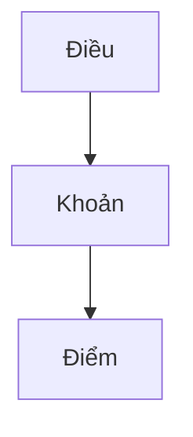

Ví dụ:

~~~text
Điểm a Khoản 2 Điều 6
~~~

Provision là node chính trong provision change graph.

### 4.3. Document Relation

Quan hệ có hướng giữa hai văn bản do hệ thống tự xây dựng từ toàn văn và bằng chứng pháp lý. Cạnh tác động chuẩn hóa từ văn bản tác động → văn bản bị tác động; REFERENCES và LEGAL_BASIS từ văn bản đang đọc → văn bản được dẫn chiếu/làm căn cứ. Quan hệ inverse để hiển thị được suy từ cùng cạnh, không tạo một cạnh trùng khác.

Taxonomy tối thiểu:

~~~text
AMENDS
SUPPLEMENTS
AMENDS_OR_SUPPLEMENTS
PARTIALLY_REPLACES
FULLY_REPLACES
PARTIALLY_REPEALS
FULLY_REPEALS
CORRECTS
REFERENCES
LEGAL_BASIS
GUIDES
DETAILS
EXPLAINS
SUSPENDS
EXTENDS_EFFECT
RESUMES_EFFECT
CONTINUES_APPLICATION
CONSOLIDATES
UNKNOWN
~~~

AMENDS_OR_SUPPLEMENTS giữ action kết hợp khi evidence chưa tách được sửa/bổ sung; CONTINUES_APPLICATION giữ ngoại lệ tiếp tục áp dụng, khác RESUMES_EFFECT sau đình chỉ. UNKNOWN bảo toàn action chưa phân loại ở candidate, không dùng làm legal effect chắc chắn.

Mỗi candidate giữ raw citation, câu/đoạn evidence, source snapshot/locator, method/version, scope và ngày tác động nếu xác định được. Trạng thái CANDIDATE / UNRESOLVED / AMBIGUOUS / CONFLICT / ACCEPTED / REJECTED tách khỏi confidence và evidence_level. Confidence của model không tự xác nhận một cạnh.

ACCEPTED yêu cầu identity hai đầu đã xác minh và evidence hỗ trợ đúng loại/chiều. Scope, ngoại lệ hoặc ngày tác động chưa đủ evidence phải giữ UNKNOWN/null và giới hạn sử dụng; không được lan truyền legal effect khi thông tin cần thiết còn thiếu. Candidate chỉ từ lược đồ nguồn hoặc semantic similarity không được tự dùng để quyết định hiệu lực hoặc tạo legal history chắc chắn.

Một cặp văn bản có thể có nhiều loại/scope quan hệ. Hợp nhất là CONSOLIDATES riêng, không tự coi là văn bản sửa đổi/thay thế. Scope một phần, ngoại lệ, điều kiện áp dụng và ngày pháp lý phải được giữ; không suy scope từ tên văn bản hoặc ngày ban hành.

Document Relation dùng để discover corpus và hỗ trợ resolve thay đổi, nhưng không thay thế Provision Relation. Có thể tổng hợp DocumentRelation từ ChangeInstruction/ProvisionRelation đã xác minh; không tự tạo correspondence giữa tất cả provisions khi có quan hệ thay thế cấp văn bản.

---

### 4.4. Provision Relation

Quan hệ có hướng giữa hai Điều / Khoản / Điểm.

Các relation quan trọng:

~~~text
AMENDS
SUPPLEMENTS
REPLACES
REPEALS
REFERENCES
SPLITS_INTO
MERGES_INTO
~~~

Ví dụ:

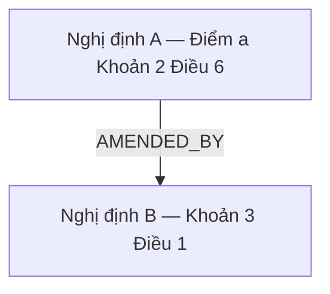

Hệ thống phải lưu evidence chỉ ra vì sao hai provision được nối.

### 4.5. Traffic Violation

Canonical identity của một hành vi vi phạm giao thông.

Một TrafficViolation không đồng nhất với một Provision.

Một hành vi có thể được quy định bởi nhiều provision qua thời gian.

Ví dụ:

~~~text
ACTION:
    Đỗ xe

VEHICLE:
    Ô tô

LOCATION:
    Phần đường xe chạy

CONDITIONS:
    Ngoài đô thị
~~~

### 4.6. Violation Rule

Một rule cụ thể gắn TrafficViolation với một Provision trong một context pháp lý nhất định.

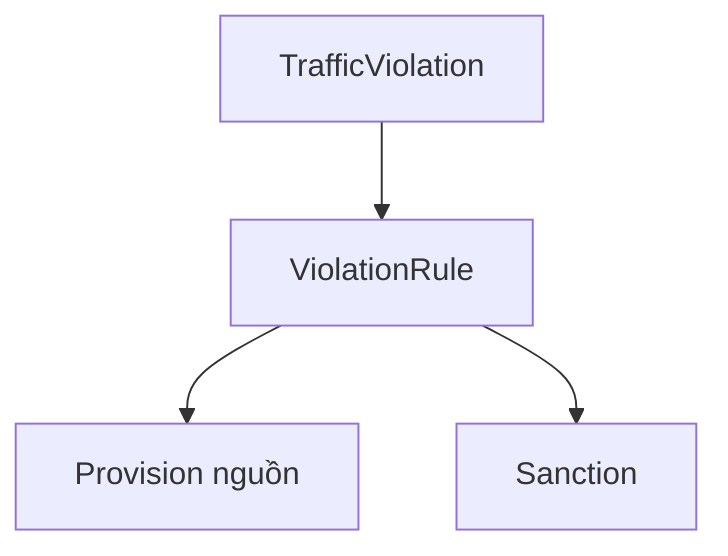

### 4.6.1. Rule Lineage

TrafficViolation là identity của **hành vi**, nhưng một hành vi có thể có nhiều rule song song theo vehicle / subject / context.

Vì vậy history không được tạo bằng cách nối tất cả ViolationRule của cùng một TrafficViolation vào một timeline duy nhất.

System phải duy trì **RuleLineage** để biểu diễn một chuỗi rule mà trong đó rule sau thực sự sửa đổi, thay thế hoặc kế thừa rule trước.

Ví dụ:

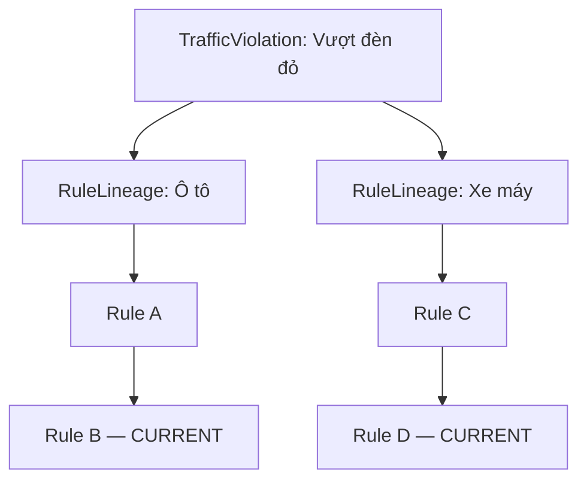

Semantic diff chỉ được thực hiện giữa các rule thuộc cùng lineage hoặc có ProvisionRelation / legal evidence chứng minh quan hệ kế thừa.

### 4.6.2. Behavior Signature

Mỗi TrafficViolation phải có một semantic signature ổn định dùng cho resolution và deduplication.

Signature không chứa sanction hoặc effective date.

Tối thiểu có thể gồm:

~~~text
action
polarity
target
location
core conditions
~~~

Subject / vehicle / context có thể thuộc ViolationRule nếu chúng tạo ra các rule áp dụng song song thay vì một hành vi hoàn toàn khác.

### 4.6.3. Evidence Level

Mọi relation / mapping quan trọng phải ghi nhận evidence level:

~~~text
SOURCE_METADATA
EXPLICIT_LEGAL_TEXT
STRUCTURED_DERIVATION
SEMANTIC_INFERENCE
~~~

Evidence pháp lý explicit được ưu tiên; structured derivation phải trace về evidence đó. SOURCE_METADATA là observation/đầu mối đối chiếu, không cao hơn nội dung pháp lý và không chứng minh nguồn có đủ cạnh. Semantic inference không được override evidence pháp lý; mâu thuẫn giữa nguồn hoặc câu chữ phải được giữ CONFLICT, không chọn chỉ bằng confidence.

### 4.6.4. Domain Vocabulary

Domain Vocabulary là registry có version dùng để chuẩn hóa các giá trị semantic được LLM/extractor sử dụng khi tạo Behavior Signature và ViolationRule IR.

Vocabulary tối thiểu có thể phân loại theo:

~~~text
ACTION
SUBJECT
VEHICLE
TARGET
LOCATION
CONDITION
EXCEPTION
~~~

Mỗi vocabulary entry phải có canonical ID, type, canonical label, aliases nếu có, provenance, thời điểm tạo và vocabulary version/run có liên quan. Vocabulary là knowledge dùng lại qua nhiều import, không đồng nhất với TrafficViolation; nhiều TrafficViolation/ViolationRule có thể tham chiếu cùng vocabulary entry.

Trong import pipeline, LLM phải ưu tiên reuse vocabulary hiện có trước khi đề xuất tạo vocabulary mới. Vocabulary được expose cho LLM qua MCP server nội bộ ([#36](https://github.com/NamPE286/INT3011E_6/issues/36), [hướng dẫn kết nối](mcp-server.md)):

~~~text
get_vocab_snapshot(version?)
add_vocab(type, canonical_label, aliases?, definition?, evidence, source_provision_id, source_document_id?, base_vocabulary_version)
~~~

Vocabulary MVP nhỏ nên `get_vocab_snapshot` trả **toàn bộ** registry dạng compact (canonical ID, type, label, aliases, definition ngắn), thứ tự deterministic và có `vocabulary_version`; caller cache theo version, truyền lại version đang có để nhận `NOT_MODIFIED`. Khi registry lớn tới mức snapshot không còn hợp lý về token, có thể bổ sung retrieval theo type/query mà không đổi canonical store. `add_vocab` chỉ được gọi sau khi đã nạp snapshot và chỉ khi candidate biểu diễn một semantic value thực sự mới, không chỉ khác wording.

`add_vocab` phải xác minh evidence thuộc Provision nguồn, re-check duplicate/alias/similarity ở server và có thể trả:

~~~text
EXISTING
CREATED
AMBIGUOUS
STALE_VERSION
~~~

`STALE_VERSION` nghĩa registry đã đổi kể từ `base_vocabulary_version` của caller; caller phải nạp lại snapshot trước khi thử lại. Các lời gọi `add_vocab` trong một run phải tuần tự.

Cùng MCP server còn có tool `search_legal_documents` phục vụ document discovery/identity resolution (FR-02/FR-03), không thuộc behavior labeling; kết quả chỉ là candidate, rỗng không chứng minh văn bản không tồn tại.

LLM không được tự tạo canonical vocabulary vô điều kiện. `AMBIGUOUS` phải giữ candidate/chờ resolver thay vì ép tạo entry mới. Mọi entry mới phải trace được về legal evidence và Provision nguồn đã làm phát sinh candidate.

### 4.7. Sanction

Chế tài áp dụng cho ViolationRule.

Sanction phải lưu có cấu trúc, không dùng một chuỗi `additional_sanction` duy nhất để biểu diễn mọi hình thức xử phạt bổ sung.

Tối thiểu hỗ trợ:

~~~text
fine_min
fine_max
currency

point_deduction_applicability:
    APPLIES
    NOT_APPLICABLE
    UNKNOWN

points_deducted

additional_sanctions[]
remedial_measures[]
~~~

`point_deduction_applicability` là trạng thái pháp lý explicit của rule tại effective period tương ứng:

- `APPLIES`: provision quy định áp dụng trừ điểm GPLX; `points_deducted` phải có giá trị dương;
- `NOT_APPLICABLE`: rule không áp dụng cơ chế trừ điểm GPLX trong context/effective period đó;
- `UNKNOWN`: evidence chưa đủ để kết luận có hay không áp dụng trừ điểm.

Không được suy `NOT_APPLICABLE` chỉ vì `points_deducted = null`. Null có thể là dữ liệu chưa extract được hoặc evidence chưa đủ.

Hình thức xử phạt bổ sung được lưu thành các `SanctionEffect` typed. Taxonomy tối thiểu:

~~~text
LICENSE_SUSPENSION
LICENSE_POINT_DEDUCTION
VEHICLE_CONFISCATION
OTHER
~~~

`LICENSE_POINT_DEDUCTION` phải nhất quán với `point_deduction_applicability = APPLIES` và `points_deducted`. `LICENSE_SUSPENSION` phải lưu được khoảng thời gian tước quyền sử dụng GPLX; `VEHICLE_CONFISCATION` phải phân biệt với tạm giữ phương tiện.

Tạm giữ phương tiện/GPLX để xác minh hoặc bảo đảm thi hành là biện pháp thủ tục/ngăn chặn, không được tự map thành `SanctionEffect` hoặc `remedial_measure` trong MVP.

Mọi additional sanction/effect phải truy vấn được trạng thái `point_deduction_applicability` của parent Sanction để UI/history thể hiện rõ rule đó thuộc cơ chế trừ điểm, không trừ điểm hay chưa xác định. Không duplicate trạng thái này xuống từng effect nếu có thể suy duy nhất từ parent Sanction.

### 4.8. Change Instruction

Biểu diễn có cấu trúc của một câu lệnh sửa đổi pháp luật.

Ví dụ:

~~~text
Sửa đổi điểm a khoản 2 Điều 6 như sau...
Bãi bỏ khoản 3 Điều 5.
Bổ sung điểm c vào khoản 4 Điều 7.
~~~

ChangeInstruction là bridge giữa raw amendment text và ProvisionRelation, đồng thời cung cấp evidence để tự build DocumentRelation. Phải giữ raw target citation, danh sách/range locator, scope, ngoại lệ, câu chữ được trích dẫn và thời điểm/điều kiện áp dụng. Target mơ hồ/không tìm được được giữ unresolved; bổ sung một provision mới không bắt buộc resolve tới provision cũ chưa tồn tại.

---

<a id="5-high-level-architecture"></a>
<a id="5-system-design"></a>

## 5. System Design — Thiết kế hệ thống

Chương này mô tả kiến trúc đích của MVP, đặt trước functional requirements để người đọc hiểu cách các thành phần phối hợp. Mục 6 xác định hành vi cần đáp ứng; mục 7–8 chi tiết hóa dữ liệu; mục 9 mô tả các phase xử lý; mục 11 là hợp đồng API sơ bộ. Thiết kế không đồng nghĩa mọi thành phần đã được triển khai trong repository.

### 5.1. System context và ranh giới

Hệ thống có hai luồng chính: Admin nhập PDF và theo dõi xử lý bất đồng bộ; User tra cứu văn bản, hành vi, lịch sử và hỏi AI trên cơ sở tri thức đã được kiểm chứng.

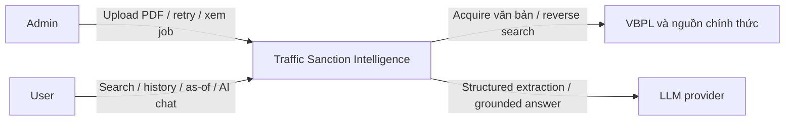

PDF là đầu vào import chính thức. VBPL và nguồn bổ trợ cung cấp văn bản/metadata cho acquisition nội bộ; graph nguồn chỉ là observations. LLM là external boundary: kết quả phải được kiểm tra schema, quality và evidence trước khi sử dụng trong canonical knowledge base. Lựa chọn engine/model cụ thể phải được ghi theo ExtractionRun, không gắn cứng vào domain.

### 5.2. Kiến trúc thành phần và triển khai

MVP tổ chức backend theo module trong cùng codebase, tách HTTP request khỏi xử lý nền bằng Queue. Chưa cần tách mỗi bước Legal NLP thành một microservice. Frontend SvelteKit gọi API Elysia trên Cloudflare Worker; Worker dùng D1 cho dữ liệu có cấu trúc, R2 cho tệp/snapshots và Queues cho công việc nền.

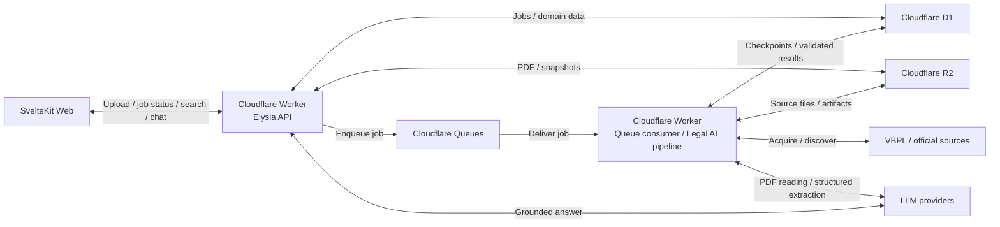

Sơ đồ chỉ thể hiện các component triển khai và đường tương tác chính. Search/temporal resolver, vocabulary registry/MCP và answer generator là các module logic của backend, được mô tả trong bảng bên dưới; không bắt buộc deploy riêng. Search index là dữ liệu dẫn xuất; full-text search là baseline bắt buộc, embedding/semantic index là phần mở rộng được đánh giá riêng. Công nghệ index và môi trường thực thi đọc PDF bằng LLM cần được kiểm chứng bằng prototype; nếu tác vụ vượt khả năng runtime Worker thì adapter gọi execution service phù hợp, vẫn giữ job/checkpoint tại backend.

| Thành phần | Trách nhiệm và đầu ra | Yêu cầu liên quan |
| --- | --- | --- |
| Web UI | Upload PDF, theo dõi job, Document View hai tab, search, detail/history và AI citations. | FR-01, FR-14–18 |
| API / authorization | Xác thực Admin cho import/retry/reprocess; validate request; cung cấp read API và chat. | FR-01, mục 3 và 11 |
| Pipeline orchestration | Điều phối phase, retry/resume, checkpoint, trạng thái xử lý và coverage. | FR-01–02, NFR-08 |
| PDF Ingestion / Source Acquisition | Giữ bản gốc/hash; LLM đọc PDF theo cụm trang (cả bản scan) có page locator; acquire related documents theo policy. | FR-01–02, FR-04 |
| Document Graph Builder | Full-text references, identity resolution, candidates, accepted edges và relation evidence. | FR-03 |
| Provision / legal extraction | Hierarchy, relevance, ChangeInstruction, ProvisionRelation và ViolationRule IR có nguồn. | FR-04–09 |
| Vocabulary Registry / MCP | Canonical vocab có version, retrieve trước create, server dedup và ambiguity. | FR-08.1, NFR-03/06 |
| Violation / lineage / temporal engine | Behavior identity, lineage theo context, semantic diff, current/as-of resolution. | FR-10–13 |
| Search / evidence retrieval | Document/violation FTS, structured filters, rule/history và Provision references. | FR-14, FR-16, FR-19 |
| Answer generator | Chỉ sinh câu trả lời từ retrieved evidence; không ghi canonical domain data. | FR-16.2–16.3, NFR-07 |

### 5.3. Pipeline nghiệp vụ

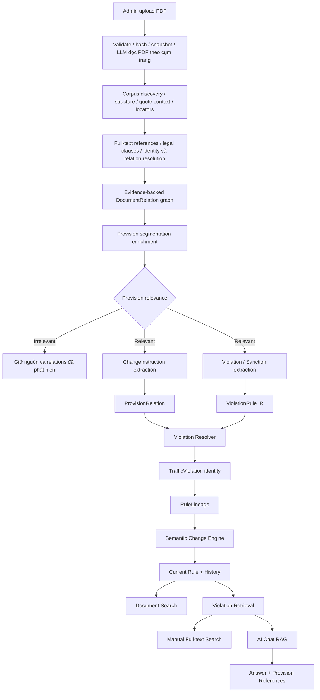

---

Corpus discovery và Document Graph Builder có vòng phản hồi: candidate từ văn bản mới được resolve/acquire; incoming links được tính từ graph và tìm kiếm ngược trong corpus, không chờ provider cung cấp. Provision parsing/evidence locators phục vụ graph building trước khi lọc relevance. Lược đồ nguồn chỉ đi vào nhánh observations tùy chọn.

Trong nhánh Violation/Sanction Extraction, LLM sử dụng Domain Vocabulary Registry qua MCP để retrieve canonical vocabulary trước khi classify/normalize structured fields. Chỉ khi snapshot từ `get_vocab_snapshot` không có candidate tương đương đủ mạnh mới được gọi `add_vocab`; server vẫn phải deduplicate và có quyền trả `EXISTING` hoặc `AMBIGUOUS`. MCP là interface truy cập registry, không phải nơi lưu canonical data.

### 5.4. Thiết kế lưu trữ và quyền sở hữu dữ liệu

| Nơi lưu | Nội dung | Quy tắc sử dụng |
| --- | --- | --- |
| R2 | PDF gốc, source snapshots, checkpoint LLM theo cụm trang, validated JSON và output cần tái lập. | Tham chiếu bằng storage key + hash; giữ page/region/offset và phương pháp trích text, không dùng tên file làm legal identity. |
| D1 | Canonical Document/Provision, relation candidates/evidence, TrafficViolation, RuleLineage, ViolationRule/Sanction, vocabulary và job/run metadata. | Là nguồn chuẩn của domain và trạng thái xử lý; constraints/transactions bảo vệ invariants tại NFR-06. |
| Queue | Tham chiếu job/task để consumer tiếp tục xử lý. | Không chứa toàn PDF hoặc toàn corpus; không dùng message làm nguồn chuẩn cho trạng thái/progress. |
| Search indexes | Projection từ văn bản, alias, rule/context và evidence đã được chấp nhận. | Có thể rebuild; hit phải resolve về canonical IDs và phiên bản dữ liệu tương ứng trước khi trả kết luận. |

Quan hệ lưu bằng relational tables trong MVP, không cần graph database. Document graph có thể có cycle/multi-edge hợp lệ; successor chain trong cùng RuleLineage phải được kiểm tra để không tạo cycle. Domain Vocabulary Registry sở hữu canonical vocab; MCP chỉ expose các tool tại mục 4.6.4 và kiểm soát truy cập (token đọc/ghi riêng) vào registry.

Kết quả extraction chưa được kiểm chứng đi vào candidate/run artifacts. Chỉ promote khi identity, locator, evidence và domain constraints đạt policy; giữ `UNRESOLVED / AMBIGUOUS / CONFLICT` riêng với accepted facts. Hash chống duplicate snapshot, còn legal identity cần đối chiếu loại, số/ký hiệu, cơ quan và ngày; hai khái niệm này không được thay thế cho nhau.

Reprocess tạo run có parser/model/vocabulary version và provenance riêng, không ghi đè bản gốc. Bước publish cập nhật dữ liệu được chấp nhận và đánh dấu index cần rebuild; read path dùng cùng generation/run đã publish hoặc báo index chưa sẵn sàng, tránh ghép rule mới với citations từ snapshot cũ. Generation/checkpoint là metadata kỹ thuật cần bổ sung khi triển khai, không phải khẳng định schema hiện tại đã có.

### 5.5. Luồng import, retry và publication

1. API kiểm tra quyền Admin và giới hạn upload, validate PDF, tính SHA-256, lưu snapshot R2 rồi ghi ImportJob trong D1. Job tham chiếu đầy đủ các phần/phụ lục nếu có.
2. Enqueue tham chiếu job; trả job ID để UI theo dõi qua API trạng thái. Không chờ toàn bộ LLM/Legal NLP trong HTTP upload request.
3. Consumer đọc snapshot và checkpoint, cho LLM đọc PDF theo cụm trang (checkpoint mỗi cụm), chạy quality/structure gate, parse cấu trúc và extract full-text references trước relevance filtering.
4. Discovery resolve/acquire candidates và tìm kiếm ngược theo policy; checkpoint giữ visited/frontier, cutoff, queries, gaps và lý do dừng. Văn bản mới quay lại bước text/parse/graph, giữ cạnh tới node đã visited.
5. Semantic processing dùng vocabulary retrieval, extract provision changes/rules/sanctions, resolve behavior và lineage; temporal engine tính history/current từ evidence đã xác minh.
6. Persist kết quả được chấp nhận, publish generation và cập nhật search index. Job chỉ đạt READY khi các bước bắt buộc hoàn thành trong policy/cutoff; báo PARTIAL hoặc FAILED theo FR-01, độc lập với phần trăm tiến độ.

R2, D1 và Queue không được giả định có một transaction chung. Thiết kế đích cần lưu enqueue intent/checkpoint bền vững để có thể gửi lại khi Queue lỗi; cleanup chỉ xóa object được xác định là không còn được job/snapshot nào tham chiếu. Không để job tiếp tục chạy với PDF đã bị xóa sau lỗi enqueue.

Consumer phải xử lý được message trùng và execution bị ngắt. Idempotency dựa trên job/run/stage cùng snapshot hash và phiên bản xử lý; canonical dedup dựa trên identity/constraints, không dựa riêng vào job ID. Claim/checkpoint phải ngăn hai consumer cùng publish một stage; retry tiếp tục từ bước bền vững gần nhất. Lỗi tạm thời dùng retry/backoff có giới hạn; dữ liệu không hợp lệ hoặc evidence mơ hồ được ghi thành lỗi/candidate tương ứng. Hết retry cần expose lỗi và cho Admin retry/resume, không bỏ job âm thầm.

### 5.6. Luồng search, current/as-of và AI chat

Manual search hoạt động độc lập với LLM: query → full-text/alias retrieval → structured context filters → canonical document/violation IDs → detail/history có references. Search hit không tự chứng minh rule đang có hiệu lực.

Current/as-of resolver nhận thời điểm T và vehicle/subject/context, lấy RuleLineage phù hợp, xét effective intervals và accepted provision relations theo FR-12. Thiếu context thì giữ nhiều rule hoặc yêu cầu làm rõ; thiếu incoming coverage hoặc có conflict trọng yếu thì trả UNCERTAIN thay vì suy CURRENT từ absence of edge. Ngày tra cứu pháp lý được tách khỏi thời điểm import/run.

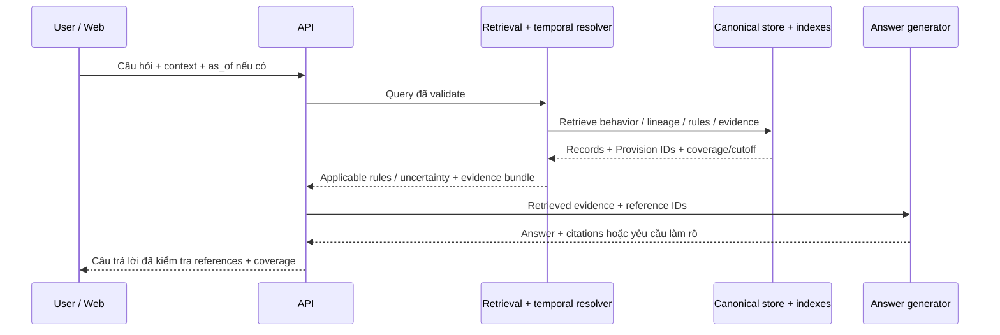

Evidence bundle gồm context, effective interval, sanction fields, history transitions, Provision IDs, snapshot locators và coverage/cutoff liên quan. Answer generator không được gọi tool ghi vocabulary/domain trong luồng chat. Backend kiểm tra reference ID thuộc evidence bundle và locator truy được về snapshot; kiểm tra ID hợp lệ chưa đủ chứng minh claim đúng, nên citation support/correctness vẫn phải được đánh giá theo mục 14. Thiếu căn cứ thì trả không đủ evidence; lỗi model không làm hỏng manual search hoặc dữ liệu canonical.

### 5.7. Bảo mật, khả năng vận hành và mở rộng

- **Authorization:** Admin-only cho import/retry/reprocess; kiểm tra quyền server-side với từng job/snapshot được client tham chiếu. LLM/source credentials chỉ nằm ở backend; user xem PDF/evidence qua đường truy cập được kiểm soát.
- **Validation:** Tệp upload, source responses và model/tool output đều là untrusted input. Text trong PDF chỉ là dữ liệu pháp lý, không được thay đổi system instructions hoặc cấp quyền gọi tool ngoài allowlist. `add_vocab` phải xác minh source provision/evidence và dedup tại server.
- **Bounded processing:** Giới hạn page/resource, discovery depth/document/request và model budget theo policy; task lớn được chia theo phase/document/page và resume từ checkpoint. Chạm cap phải ghi stop reason và coverage gap.
- **Observability:** Correlate log theo job/run/document/stage; lưu duration, retry/error, quality flags, candidate/accepted/conflict counts, frontier và index readiness. Không log credentials hoặc toàn bộ PDF/model payload mặc định.
- **Recovery:** Bản gốc và run provenance cho phép reprocess/rebuild index. Tách dữ liệu/config của local, test và remote; migration đi theo repository workflow. Khả năng phục hồi phải được kiểm tra trước khi coi pipeline là hoàn chỉnh.
- **Capacity:** Đo upload latency, queue backlog, stage duration và search/chat latency trên corpus MVP trước khi đặt SLA hoặc tách service. Không tuyên bố throughput, chất lượng đọc PDF hoặc legal accuracy khi chưa có evaluation.

### 5.8. Hiện trạng repository và lộ trình tới thiết kế đích

| Khía cạnh | Hiện có trong code | Thiết kế đích cần triển khai |
| --- | --- | --- |
| Upload | `POST /api/uploads`: kiểm tra `%PDF-`, parse được cấu trúc, không mã hóa, ≤ 50 MB và ≤ 300 trang; lưu snapshot R2, tạo `processing_jobs`, gửi `{ jobId }`. | Admin PDF import nhiều phần/phụ lục, hash dedup và provenance. |
| Job tracking | `GET /api/jobs`, `GET /api/jobs/:jobId`, `GET /api/jobs/:jobId/document`, `POST /api/jobs/:jobId/review` (duyệt văn bản `REVIEW_REQUIRED`, trang `/admin/review/[jobId]`); trạng thái `queued / processing / completed / needs_review / failed` (`failed` = lỗi tạm thời đang chờ retry). | ImportJob theo FR-01 với READY/PARTIAL/FAILED, coverage/cutoff, frontier và unresolved/conflict riêng. |
| Consumer | LLM đọc PDF theo cụm trang (checkpoint R2, retry/resume), ghép cây Phần→Điểm deterministic, kiểm tra số thứ tự/độ phủ trang/chất lượng, lưu `legal_documents` với `review_status` và run provenance ([chi tiết](pdf-upload-api.md)). | Discovery/graph, semantic extraction và publish/index thật. |
| Domain storage | `processing_jobs`, `legal_documents` (JSON contract v1 dạng blob), `vocab_entries`/`vocab_metadata`. | Schema domain theo mục 7–8 (Document/Provision tách bảng), constraints và indexes. |
| MCP | `POST /mcp`: `get_vocab_snapshot`, `add_vocab`, `search_legal_documents`; token đọc và token ghi riêng, fail closed ([chi tiết](mcp-server.md)). | Ghi `vocabulary_version` theo ExtractionRun khi có pipeline trích xuất hành vi. |
| Auth | `authPlugin` là placeholder, trả `user: null`; endpoint admin chưa được bảo vệ. | Xác thực session/token và authorization Admin ở backend. |
| Search / chat | Chưa triển khai knowledge base retrieval và grounded QA. | FTS trước; temporal/history APIs; AI retrieval/answers dùng chung evidence. |

Các route `/api/uploads` và `/api/jobs*` là hợp đồng hiện tại; `/admin/imports` và các read/chat API tại mục 11 là hợp đồng đích sơ bộ. Việc bổ sung tài liệu này không đổi endpoint hoặc runtime hiện có. Thứ tự triển khai: hoàn thiện authorization + PDF ingestion/job recovery → graph/provision/domain persistence → rule/history/FTS → grounded chat và evaluation. Mỗi bước phải đáp ứng acceptance criteria liên quan trước khi mở rộng.

---

## 6. Functional Requirements

<a id="fr-01--import-from-csdl-vbpl"></a>

## FR-01 — Import Legal Document PDF

Only Admin can initiate import. Input là tệp PDF, không phải URL.

System phải:

1. nhận multipart upload và tạo ImportJob;
2. kiểm tra magic bytes/MIME, cấu trúc PDF, khả năng đọc, dung lượng/page/resource limits theo cấu hình; reject file giả PDF/malformed/protected không xử lý được;
3. lưu PDF gốc, SHA-256, storage key, upload provenance và quan hệ giữa các phần/phụ lục;
4. đọc nội dung từng trang bằng LLM có năng lực đọc PDF/hình ảnh (áp dụng cho cả PDF có text layer lẫn bản scan; không có OCR engine riêng hay OCR fallback — quyết định tại [#33](https://github.com/NamPE286/INT3011E_6/issues/33)), xử lý theo cụm trang có checkpoint, ghi model/prompt/schema version, page locator và quality flags `GOOD / PARTIAL / UNREADABLE` theo trang;
5. parse metadata từ văn bản, phân biệt ngày ban hành với dấu đến/chữ ký số/thời điểm upload; metadata mơ hồ được giữ unresolved;
6. segment header/preamble/body/quote/effect/transition, extract references và action candidates từ **toàn văn**, trước relevance filtering;
7. resolve canonical identity, validate evidence và build graph; header không được coi là đầy đủ quan hệ;
8. acquire related documents theo discovery policy, giữ provenance nội bộ riêng với user PDF upload.

Lifecycle:

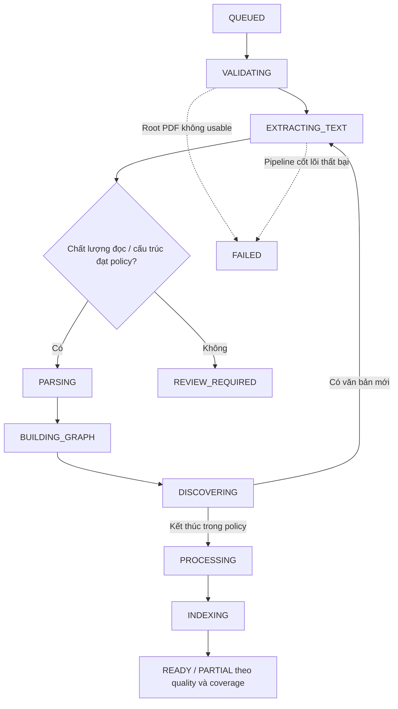

Các giai đoạn có thể lặp khi thêm related documents. `EXTRACTING_TEXT` là bước LLM chép nguyên văn từng trang; LLM không được tự điền nội dung từ trí nhớ: phần không đọc được phải đánh dấu `[không đọc được]` và hạ quality. Cấp Phần/Chương/Mục/Điều/Khoản/Điểm được backend suy ra từ ký hiệu đầu dòng in trên trang (không tin nhãn của model). Kết quả có lỗi validation mức ERROR được lưu để kiểm tra nhưng ở trạng thái review, không publish âm thầm.

READY chỉ nghĩa các bước bắt buộc đạt trong corpus/discovery policy/cutoff. PARTIAL khi còn phần PDF/phụ lục/trang chưa đọc được, frontier hoặc unresolved/conflict trọng yếu mà dữ liệu gốc vẫn usable; FAILED nếu root PDF hoặc pipeline cốt lõi không xử lý được. Job phải báo riêng file/text quality, part completeness, graph coverage và candidate/conflict.

Import cùng PDF/hash nhiều lần không tạo domain duplicate; hai bản PDF khác hash nhưng cùng legal document phải được đối chiếu identity và giữ source snapshots riêng. Không suy legal version/current status chỉ từ tên file hoặc PDF metadata.

Không hỗ trợ URL import hoặc DOCX trong MVP; source URL chỉ là metadata/provenance và acquisition nội bộ. [Kiểm chứng header/PDF trên chuỗi giao thông](research/traffic-header-completeness.md) cho thấy header-only bỏ sót quan hệ sửa đổi; full text, quality gates và corpus discovery là bắt buộc.

---

<a id="fr-02--recursive-related-document-crawl"></a>

## FR-02 — Incremental Corpus Discovery

Từ root document được upload PDF, system phải discover/acquire văn bản liên quan từ toàn văn PDF do LLM đọc, reverse corpus index/search và source observations tùy chọn. Hệ thống có thể crawl/scrape nguồn chính thức hoặc corpus data để lấy related documents; không giả định header hoặc graph nguồn đầy đủ.

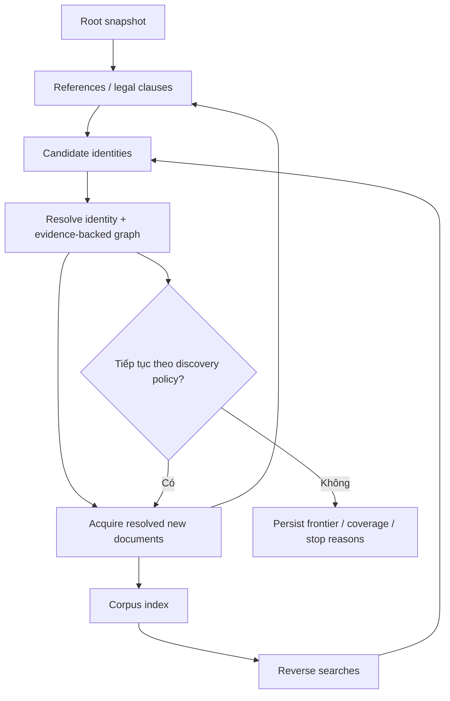

System phải:

- resolve document identity trước merge; metadata/URL là đầu mối, không tự merge chỉ bằng số hiệu;
- thu thập văn bản đích có ID đã resolve; giữ raw citation và lý do cho target chưa tìm được;
- tìm incoming bằng truy vấn vào corpus index/nguồn được hỗ trợ, lưu query, result pages, cutoff và provenance; nếu nguồn không hỗ trợ/đang lỗi thì ghi coverage gap;
- xử lý mọi reference phát hiện trong văn bản đã fetch, ghi rõ candidate outside discovery policy thay vì bỏ âm thầm;
- dùng visited/cache để ngăn refetch, giữ cycle/multi-edge và retry failed nodes;
- refresh incoming index khi thêm hoặc reprocess văn bản để graph cũ nhận được cạnh mới;
- stop theo policy có scope/date/depth/document/request limits; lưu frontier/checkpoint cho resume;
- ghi trạng thái PARTIAL khi khoảng thiếu ảnh hưởng kết quả; frontier rỗng và “không tìm thấy” không được hiểu là chứng minh không có incoming relation.

---

<a id="fr-03--vbpl-relationship-preservation"></a>

## FR-03 — Evidence-backed Document Graph

System phải tự build lược đồ quan hệ từ header và toàn văn PDF (do LLM đọc) của văn bản. Lược đồ/metadata nguồn được lưu như observations để phát hiện candidate, so sánh và bổ sung evidence; không phải ground truth hoặc input bắt buộc.

Pipeline phải:

1. lấy full text có snapshot và offsets/locator; đọc phần căn cứ, tiêu đề, nội dung, sửa đổi, hiệu lực/chuyển tiếp và hợp nhất;
2. extract document references và legal-action candidates trên toàn bộ văn bản, trước relevance gate;
3. resolve target theo số/ký hiệu, loại, ngày, cơ quan và alias; giữ ambiguity, không chọn top-1 nếu chưa đủ evidence;
4. classify action bằng câu chữ/ngữ cảnh, phân biệt nhắc tới với sửa/bãi bỏ thực tế, nội dung được trích dẫn và ngoại lệ;
5. xác minh evidence span, identity, direction, scope và effective/applicability conditions; promote thành ACCEPTED theo policy kiểm chứng;
6. derive incoming groups từ các cạnh đã nhận, giữ candidates/conflicts riêng và cập nhật tăng dần;
7. tổng hợp cạnh document-level từ ChangeInstruction/ProvisionRelation đã xác minh, dedup không mất multi-edge/evidence.

Rule/regex và deterministic resolver là baseline. LLM có thể hỗ trợ phần khó nhưng chỉ được dùng citation IDs/evidence spans được xác minh từ snapshot; schema validation/confidence không thay thế kiểm chứng nội dung. Có thể abstain UNRESOLVED/AMBIGUOUS/CONFLICT, không yêu cầu manual review cho mọi extraction.

Relation View dùng taxonomy nội bộ ở mục 4.3 và hỗ trợ inverse groups, evidence, scope, status và coverage. Không bắt buộc sao chép 21 nhóm của VBPL; source category/raw label được giữ trong observation khi có, kể cả UNKNOWN.

---

## FR-04 — Provision Segmentation

System phải parse hierarchy:

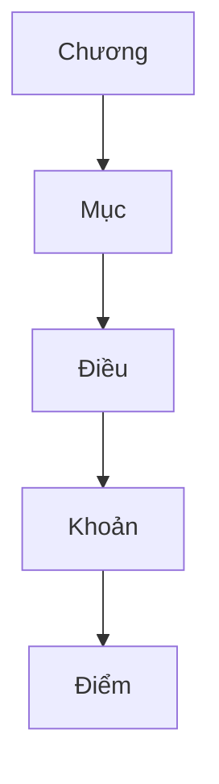

Mỗi Provision phải giữ:

- document_id;
- parent_id;
- article_no;
- paragraph_no;
- point_no;
- raw_text;
- PDF page/region và anchor nếu có;
- source_snapshot_id, original PDF hash, phương pháp đọc (LLM model/prompt/schema version) và page locator/source quote (offsets nếu được kiểm chứng từ nguồn) đủ để truy về evidence gốc sau normalize;
- quality flags và quote/structural context, không chỉ chuỗi text đã làm phẳng.

Mọi AI output downstream phải trace về Provision.

---

## FR-05 — Provision Relevance Classification

Mỗi provision phải được classify tối thiểu thành một trong:

~~~text
SANCTION_RULE
VIOLATION_RULE
AMENDMENT_INSTRUCTION
REPEAL_INSTRUCTION
REFERENCE
IRRELEVANT
UNCERTAIN
~~~

Chỉ provision liên quan tới traffic violation sanction hoặc legal change của sanction rule mới đi qua semantic pipeline đầy đủ.

---

## FR-06 — Change Instruction Extraction

Với provision sửa đổi / bổ sung / bãi bỏ / thay thế, system phải extract ChangeInstruction.

Ví dụ input:

~~~text
Sửa đổi điểm a khoản 2 Điều 6 như sau...
~~~

Output logic:

~~~json
{
    "operation": "AMEND",
    "target": {
        "article": "6",
        "paragraph": "2",
        "point": "a"
    }
}
~~~

Output phải có raw citation/target identity, source span, danh sách/range locator, scope, ngoại lệ và effective/applicability conditions; chưa xác định thì giữ null/unresolved. Phân biệt câu lệnh đang thực hiện với citation bên trong nội dung được thay thế hoặc câu mô tả thẩm quyền.

Các operation tối thiểu:

~~~text
AMEND
SUPPLEMENT
REPLACE
REPEAL
CORRECT
SUBSTITUTE_TEXT
~~~

---

## FR-07 — Provision Relation Resolution

System phải resolve ChangeInstruction thành edge giữa provision nguồn và provision bị tác động.

Ví dụ:

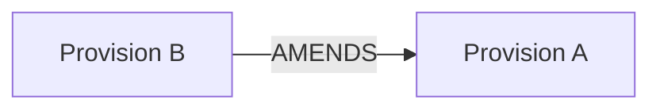

Mỗi edge phải lưu:

- relation_type;
- from_provision_id;
- to_provision_id;
- source_document_relation nếu có;
- evidence;
- evidence_level;
- resolution method;
- confidence.

ProvisionRelation là dữ liệu first-class, không được derive tạm thời chỉ khi render UI. Resolve trực tiếp từ legal text kể cả chưa có DocumentRelation nguồn; cạnh đã xác minh có thể bổ sung lại document graph. Candidate/unresolved targets không được apply vào history/current-rule như quan hệ chắc chắn. Khi bổ sung provision mới, giữ insertion locator thay vì buộc tồn tại target provision cũ.

---

## FR-08 — Traffic Violation Extraction

Provision liên quan phải được parse thành structured violation representation.

Các dimension chính:

~~~text
ACTION
SUBJECT
VEHICLE
TARGET
LOCATION
CONDITION
EXCEPTION
CONSEQUENCE
~~~

Ví dụ:

~~~json
{
    "action": "Đỗ xe",
    "vehicle": "Ô tô",
    "location": "Phần đường xe chạy",
    "conditions": [
        "Ngoài đô thị",
        "Có lề đường"
    ],
    "exceptions": []
}
~~~

Một Provision có thể:

- không tạo TrafficViolation;
- tạo một ViolationRule;
- tạo nhiều ViolationRule.

Không được giả định Provision = TrafficViolation.

### FR-08.1 — Vocabulary-guided LLM Extraction

Khi LLM được dùng trong import để extract/classify các dimension của ViolationRule, system phải cung cấp Domain Vocabulary qua MCP để giảm việc tạo label/concept trùng nghĩa.

Flow bắt buộc cho mỗi semantic candidate cần canonicalize:

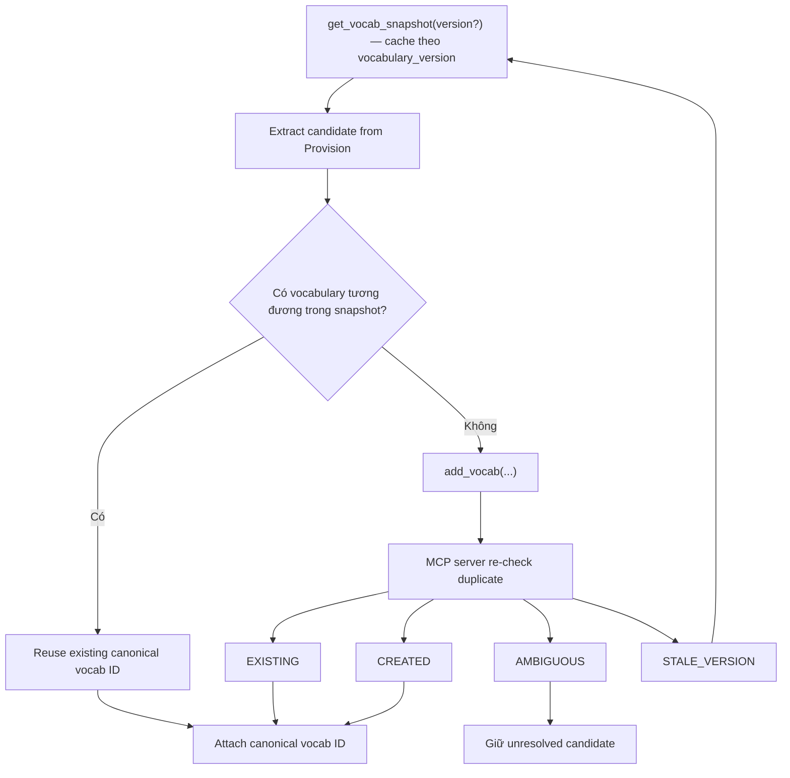

Yêu cầu cho `get_vocab_snapshot`:

- trả toàn bộ vocabulary dạng compact: canonical ID, type, canonical label, aliases, definition ngắn nếu cần;
- ordering deterministic và có `vocabulary_version`;
- caller truyền version đang cache thì nhận `NOT_MODIFIED`, không cần tải lại;
- không trả metadata nặng (provenance đầy đủ, history, embedding).

Yêu cầu cho `add_vocab`:

- chỉ được gọi sau khi đã nạp snapshot, tuần tự trong một run;
- input phải có `type`, `canonical_label`, legal evidence, `source_provision_id` (dạng `<document_id>:dieu_n_khoan_n_diem_x` hoặc kèm `source_document_id`) và `base_vocabulary_version`; aliases/definition là optional;
- server xác minh evidence có trong Điều/Khoản/Điểm nguồn (kể cả tên Điều); tham chiếu mơ hồ giữa nhiều văn bản bị từ chối;
- không tạo entry mới chỉ vì wording khác nếu semantic meaning đã có trong registry;
- server phải kiểm tra duplicate/alias/similarity trước khi insert;
- kết quả có thể là `EXISTING`, `CREATED`, `AMBIGUOUS` hoặc `STALE_VERSION`;
- chỉ caller có token ghi được gọi `add_vocab`; backend phải kiểm tra lại mọi canonical ID mà LLM trả về với registry;
- `AMBIGUOUS` không được tự động tạo canonical identity mới.

Mọi ExtractionRun phải ghi vocabulary version và các canonical vocab IDs đã sử dụng hoặc tạo để có thể reproduce và audit kết quả.

---

## FR-09 — Sanction Extraction

System phải extract sanction áp dụng cho từng ViolationRule dưới dạng structured fields.

Tối thiểu:

~~~text
fine_min
fine_max
currency

point_deduction_applicability
points_deducted

additional_sanctions[]
remedial_measures[]
~~~

`point_deduction_applicability` bắt buộc nhận một trong:

~~~text
APPLIES
NOT_APPLICABLE
UNKNOWN
~~~

Quy tắc consistency:

- `APPLIES` → phải có evidence cho cơ chế trừ điểm và `points_deducted > 0`;
- `NOT_APPLICABLE` → không được tạo `LICENSE_POINT_DEDUCTION`; `points_deducted` phải null;
- `UNKNOWN` → không được suy ra “không trừ điểm” chỉ từ field null hoặc absence của keyword;
- nếu evidence mâu thuẫn, giữ `UNKNOWN`/conflict thay vì chọn bằng confidence.

Additional sanction phải được normalize thành `SanctionEffect[]`, tối thiểu phân biệt:

~~~text
LICENSE_SUSPENSION
LICENSE_POINT_DEDUCTION
VEHICLE_CONFISCATION
OTHER
~~~

Mỗi effect phải giữ type, structured attributes phù hợp (ví dụ duration/target), raw text/evidence và source Provision. Tạm giữ phương tiện/GPLX mang tính thủ tục không được classify thành `VEHICLE_CONFISCATION` hoặc `LICENSE_SUSPENSION`.

Sanction phải gắn với ViolationRule, không gắn trực tiếp một mức phạt duy nhất vào TrafficViolation.

Cùng hành vi có thể có sanction khác nhau theo:

- subject;
- vehicle;
- location;
- condition;
- consequence;
- effective period.

History/as-of query phải trả được cả `point_deduction_applicability` để phân biệt rõ rule thời kỳ chưa áp dụng cơ chế trừ điểm, rule có trừ điểm và trường hợp chưa đủ evidence.

---

## FR-10 — Violation Identity Resolution

Đây là feature AI trung tâm.

Các ViolationRule từ nhiều văn bản phải được resolve về cùng một TrafficViolation khi chúng biểu diễn cùng hành vi pháp lý hoặc cùng lineage của hành vi.

Flow ưu tiên:

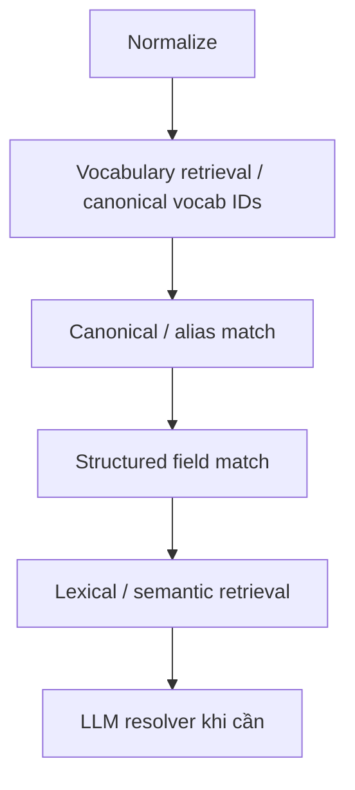

Ví dụ:

~~~text
"không chấp hành hiệu lệnh của đèn tín hiệu giao thông"
≈
"vượt đèn đỏ"
~~~

Việc map không chỉ dựa vào similarity text; phải xét structured context như vehicle, location, condition và exception.

Resolver không được ép merge khi không đủ evidence.

Output tối thiểu:

~~~text
MATCH_EXISTING
CREATE_NEW
AMBIGUOUS
~~~

Nếu AMBIGUOUS, rule vẫn được lưu nhưng không được dùng để tự động tạo history lineage chắc chắn.

---

## FR-11 — Behavior-centric Provision History

TrafficViolation là identity trung tâm của history.

System phải reconstruct:

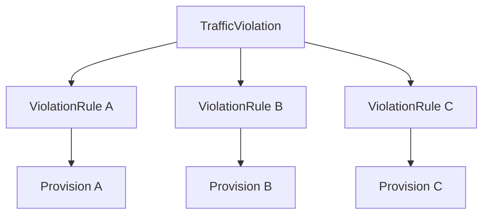

Provision graph phải cho biết:

~~~text
A --AMENDED_BY--> B --REPLACED_BY--> C
~~~

Behavior history phải cho biết theo từng RuleLineage:

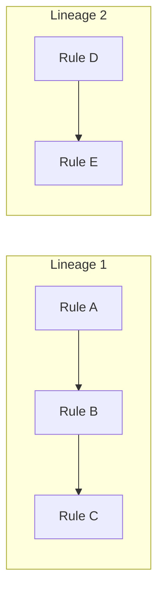

Hai graph phải liên kết được với nhau.

Không được nối hai ViolationRule chỉ vì chúng cùng TrafficViolation nếu không có legal / temporal / semantic evidence cho lineage đó.

---

## FR-12 — Current Rule Determination

Với mỗi TrafficViolation, system phải xác định những ViolationRule đang hiện hành dựa trên:

1. document effective status;
2. effective dates;
3. ACCEPTED DocumentRelation có legal-text evidence;
4. explicit ProvisionRelation;
5. ChangeInstruction;
6. semantic alignment.

Rule status tối thiểu:

~~~text
CURRENT
AMENDED
REPEALED
SUPERSEDED
UNCERTAIN
~~~

Không được đánh dấu CURRENT chỉ vì văn bản chứa provision còn hiệu lực nếu chính provision đã bị sửa hoặc bãi bỏ. Không suy “chưa từng bị sửa” từ việc graph không có cạnh. Candidate/conflict hoặc khoảng thiếu discovery ảnh hưởng đến lineage phải khiến kết luận UNCERTAIN; các kết luận hợp lệ khác phải nêu corpus/cutoff đã kiểm chứng.

### FR-12.1 — Deterministic Current-rule Resolution

Current-rule resolution phải ưu tiên deterministic legal evidence trước AI.

Với một RuleLineage và thời điểm T:

1. loại rule chưa có hiệu lực tại T;
2. loại rule đã hết hiệu lực tại T;
3. apply REPEALS / REPLACES / AMENDS từ ProvisionRelation;
4. xét document effective status;
5. nếu còn nhiều candidate hợp lệ do context khác nhau, giữ tất cả thay vì chọn tùy ý;
6. chỉ dùng semantic inference để resolve phần chưa rõ.

### FR-12.2 — As-of Query

System phải hỗ trợ xác định rule áp dụng tại một ngày cụ thể.

Ví dụ:

~~~text
Mức phạt vượt đèn đỏ ngày 01/06/2022 là bao nhiêu?
~~~

As-of query phải sử dụng effective interval của ViolationRule / source provision, không dùng trạng thái CURRENT hiện tại.

---

## FR-13 — Semantic Change Detection

Khi hai ViolationRule trong cùng history lineage khác nhau, system phải tạo semantic diff.

Các change type tối thiểu:

~~~text
NO_SEMANTIC_CHANGE

VIOLATION_ADDED
VIOLATION_REMOVED

CONDITION_ADDED
CONDITION_REMOVED
CONDITION_CHANGED

EXCEPTION_ADDED
EXCEPTION_REMOVED

SUBJECT_CHANGED
VEHICLE_SCOPE_CHANGED
LOCATION_SCOPE_CHANGED

SANCTION_INCREASE
SANCTION_DECREASE
SANCTION_CHANGED
POINT_DEDUCTION_APPLICABILITY_CHANGED
POINT_DEDUCTION_CHANGED
LICENSE_SUSPENSION_CHANGED
VEHICLE_CONFISCATION_CHANGED
ADDITIONAL_SANCTION_CHANGED

REPEALED
REPLACED
UNKNOWN
~~~

Một transition có thể có nhiều change type.

---

## FR-14 — Legal Document Search

User có thể search document bằng:

- số hiệu;
- tên;
- từ khóa;
- loại văn bản;
- cơ quan ban hành;
- trạng thái hiệu lực.

Kết quả dùng metadata đã đối chiếu theo provenance từng field; ưu tiên nguồn chính thức phù hợp, giữ conflicts thay vì mặc định VBPL luôn đúng.

---

## FR-15 — Legal Document View

Trang document có đúng hai tab chính.

### Tab 1 — Nội dung

Hiển thị:

- metadata;
- tình trạng hiệu lực;
- nội dung theo Điều / Khoản / Điểm;
- provision xử phạt bị tác động;
- trạng thái của relevant ViolationRule.

Relevant provision bị sửa đổi / thay thế / bãi bỏ phải được highlight.

User có thể mở history từ provision đó.

### Tab 2 — Quan hệ

Hiển thị lược đồ do hệ thống build theo taxonomy nội bộ, gồm incoming/outgoing, relation type, scope/ngoại lệ, evidence nguồn và trạng thái xác minh. Candidate/source observations được thể hiện riêng với cạnh ACCEPTED; không thể hiện một candidate như thay đổi pháp lý chắc chắn.

Phải hiển thị discovery scope/cutoff, coverage và các khoảng thiếu/conflict ảnh hưởng kết quả. Không có cạnh trong corpus không đồng nghĩa không có quan hệ pháp lý.

Mỗi related document có thể click để mở Document View nội bộ nếu đã crawl.

---

## FR-16 — Search by Traffic Violation

Hệ thống phải hỗ trợ hai chế độ tìm kiếm hành vi độc lập nhưng dùng chung TrafficViolation / ViolationRule knowledge base.

### FR-16.1 — Manual Full-text Search

User có thể nhập trực tiếp từ khóa hoặc mô tả hành vi:

~~~text
đỗ xe
vượt đèn đỏ
dừng xe ngoài đô thị
đi quá tốc độ 10 đến 20 km/h
~~~

Manual search không cần LLM để sinh câu trả lời.

Search phải hỗ trợ tối thiểu:

~~~text
full-text search trên canonical behavior
+ aliases
+ provision text
+ structured filtering nếu có
~~~

Kết quả trả về danh sách TrafficViolation / ViolationRule phù hợp, ưu tiên CURRENT rules.

Mỗi result tối thiểu hiển thị:

- hành vi;
- context chính;
- current sanction nếu có;
- current provision;
- source document;
- link tới detail/history.

### FR-16.2 — AI Chat Search

User có thể đặt câu hỏi tự nhiên thay vì tự chọn một hành vi cụ thể.

Ví dụ:

~~~text
Đỗ ô tô ngoài đô thị sai quy định thì bị phạt thế nào?
Vượt đèn đỏ hiện giờ phạt bao nhiêu và trước đây thay đổi ra sao?
Các lỗi liên quan đến dừng đỗ trên phần đường xe chạy là gì?
~~~

AI phải tự:

1. hiểu intent và context của câu hỏi;
2. tìm một hoặc nhiều TrafficViolation liên quan;
3. retrieve CURRENT ViolationRule và history cần thiết;
4. retrieve source Provision tương ứng;
5. tổng hợp câu trả lời;
6. đính kèm reference cho các claim pháp lý.

Pipeline:

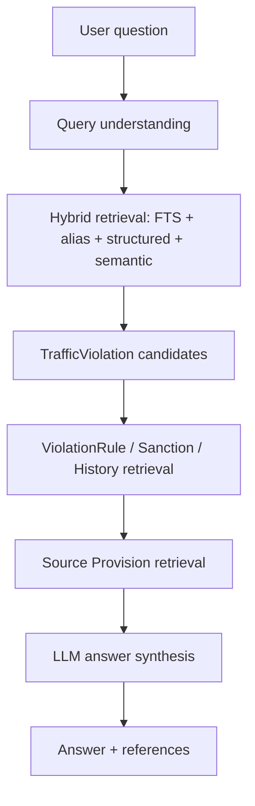

AI chat phải theo nguyên tắc **retrieval-first, answer-last**.

AI không được:

- tự invent hành vi;
- tự invent mức phạt;
- tự invent trạng thái hiệu lực;
- đưa ra claim pháp lý mà không có evidence trong corpus.

Nếu evidence không đủ hoặc các rule mâu thuẫn / UNCERTAIN, câu trả lời phải thể hiện uncertainty thay vì ép một kết luận.

### FR-16.3 — AI Answer References

Reference phải ở **claim-level**, không chỉ đặt một danh sách nguồn chung ở cuối câu trả lời.

Mỗi claim quan trọng về:

- mức phạt;
- rule hiện hành;
- Điều / Khoản / Điểm;
- trạng thái hiệu lực;
- lịch sử thay đổi;

phải reference về ít nhất một Provision nguồn.

Reference tối thiểu phải cho phép user mở:

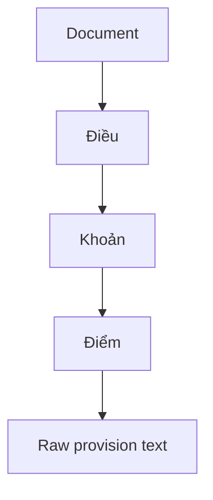

Ví dụ presentation:

~~~text
Phạt từ X đến Y đồng.
[Nghị định ..., Điều 6, Khoản 2, Điểm a]
~~~

Khi câu trả lời dựa trên history, AI phải có thể reference cả provision trước và provision sau của transition.

Mỗi reference phải mang stable Provision ID để UI có thể deep-link đúng Điều / Khoản / Điểm.

---

## FR-17 — Violation Detail

Khi user chọn một TrafficViolation, system phải hiển thị:

- canonical behavior;
- subject / vehicle;
- location / conditions / exceptions;
- current applicable sanction;
- current applicable provisions;
- effective period;
- source documents;
- confidence / uncertainty khi cần;
- link tới history.

Nếu có nhiều current rules do khác vehicle/context, UI phải hiển thị từng applicable rule riêng.

---

## FR-18 — Violation History

History phải hiển thị theo thời gian:

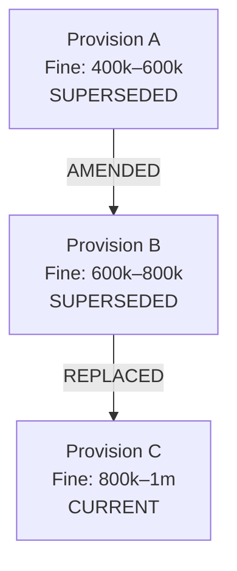

Mỗi transition phải cho biết:

- provision trước;
- provision sau;
- relation;
- effective date;
- semantic change;
- sanction before / after;
- source document;
- evidence.

---

## FR-19 — Search Index

System phải duy trì ít nhất:

### Document Index

Dùng cho search văn bản.

### Violation Index

Index:

- canonical behavior;
- aliases;
- structured dimensions;
- provision text;
- current / historical rule status;
- embeddings nếu sử dụng.

Manual search phải sử dụng full-text search làm retrieval chính.

AI chat có thể sử dụng hybrid retrieval:

~~~text
full-text
+ alias
+ structured filters
+ vector retrieval
+ reranking nếu cần
~~~

Retrieval result phải giữ stable IDs của TrafficViolation, ViolationRule và Provision để answer layer có thể tạo reference chính xác.

---

## FR-20 — AI Provenance

Mọi AI output quan trọng phải lưu:

- task type;
- model;
- prompt/schema version;
- timestamp;
- confidence;
- raw output;
- normalized output;
- evidence provision;
- extraction run.

Không có human_verified requirement bắt buộc trong MVP.

---

## 7. Data Model

Core model:

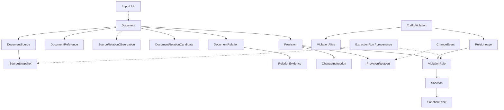

Hai graph quan trọng:

```mermaid
flowchart LR
    subgraph DG["Document Graph"]
        DA["Document nguồn"] -->|"Relation"| DB["Document đích"]
    end
    subgraph PG["Provision Graph"]
        PA["Provision tác động"] -->|"AMENDS / REPLACES / ..."| PB["Provision bị tác động"]
    end
```

TrafficViolation đóng vai trò semantic identity nối các ViolationRule thuộc nhiều provision khác nhau.

---

## 8. Core Tables

### document

~~~text
id
canonical_identity_status
document_number
title
document_type
issuer
issued_at
effective_from
effective_to
effective_status
source_url (nullable; primary provenance only)
created_at
~~~

### document_source

~~~text
id
document_id (nullable until identity resolved)
source (UPLOAD / VBPL / official source / declared archive)
source_item_id (string; upload dùng PDF hash/storage identity)
source_url (nullable)
canonical_source_url (nullable)
file_sha256 / file_storage_key / original_filename
source_snapshot_id
uploaded_at / fetched_at
~~~

### document_reference

~~~text
id
source_document_id
source_snapshot_id
source_locator / start_offset / end_offset
raw_citation
normalized_identifiers_json
context (PREAMBLE / OPERATIVE / QUOTED / FINAL / OTHER)
quote_depth / actor_context_json / target_context_json
resolved_document_id (nullable)
resolution_status
~~~

### source_relation_observation

~~~text
id
observed_document_source_id
source_snapshot_id
raw_category / raw_subtype / source_side
raw_target_reference
observed_at
availability_status
~~~

### document_relation_candidate

~~~text
id
observed_document_id
actor_document_id / actor_context_json (nullable until resolved)
raw_target_citation
resolved_target_document_id (nullable)
proposed_relation_type
status (CANDIDATE / UNRESOLVED / AMBIGUOUS / CONFLICT / ACCEPTED / REJECTED)
resolution_reason
document_reference_id / source_relation_observation_id (nullable)
method / extractor_version
confidence
source_snapshot_id
~~~

### document_relation

~~~text
id
from_document_id
to_document_id
relation_type
scope_json
exceptions_json
effective_from / effective_to (nullable)
applicability_conditions_json
verification_status
extraction_run_id
~~~

### relation_evidence

~~~text
id
document_relation_id / document_relation_candidate_id
source_document_id
source_provision_id (nullable)
source_snapshot_id
source_url (nullable for uploads)
source_locator / PDF page / region / start_offset / end_offset
quoted_text
content_role / legal_actor_context
evidence_level
method / extractor_version
observed_at
~~~

Source observations, candidates và accepted edges được giữ riêng về ý nghĩa. Uniqueness edge phải xét action/scope/time; same-pair multi-edge hợp lệ. Identity hai đầu của accepted edge là canonical Document ID; evidence giữ source record/snapshot. Absence/null không được biến thành negative legal assertion.

### provision

~~~text
id
document_id
parent_id
article_no
paragraph_no
point_no
provision_type
raw_text
source_anchor
source_snapshot_id
start_offset / end_offset
~~~

### change_instruction

~~~text
id
source_provision_id
source_snapshot_id
source_locator / evidence_span
operation
raw_target_citation
target_document_id (nullable until resolved)
target_locator_json (lists/ranges/insertion locator supported)
scope_json / exceptions_json
effective_from / applicability_conditions_json
resolution_status
raw_text
confidence
~~~

### provision_relation

~~~text
id
from_provision_id
to_provision_id
relation_type
change_instruction_id
verification_status
scope_json / exceptions_json
effective_from / applicability_conditions_json
evidence / evidence_level / source_snapshot_id
method / extractor_version
confidence
~~~

### traffic_violation

~~~text
id
canonical_name
semantic_ir
created_at
~~~

### violation_alias

~~~text
id
traffic_violation_id
alias
normalized_alias
embedding
~~~

### rule_lineage

~~~text
id
traffic_violation_id
lineage_key
context_ir
status
~~~

### violation_rule

~~~text
id
traffic_violation_id
rule_lineage_id
provision_id
semantic_ir
effective_from
effective_to
status
confidence
evidence_level
~~~

### sanction

~~~text
id
violation_rule_id
fine_min
fine_max
currency
point_deduction_applicability (APPLIES / NOT_APPLICABLE / UNKNOWN)
points_deducted (nullable)
remedial_measures_json
~~~

Không dùng `points_deducted IS NULL` như một negative fact. Trạng thái có/không áp dụng trừ điểm phải đọc từ `point_deduction_applicability`.

### sanction_effect

~~~text
id
sanction_id
effect_type (LICENSE_SUSPENSION / LICENSE_POINT_DEDUCTION / VEHICLE_CONFISCATION / OTHER)
duration_min (nullable)
duration_max (nullable)
duration_unit (nullable)
points (nullable)
target_json (nullable)
raw_text
source_provision_id
evidence_locator
confidence
~~~

`LICENSE_POINT_DEDUCTION` phải khớp với parent `sanction.point_deduction_applicability = APPLIES` và số điểm tương ứng. Additional effects dùng chung trạng thái point-deduction của parent Sanction thay vì duplicate một boolean riêng trên từng row.

### change_event

~~~text
id
traffic_violation_id
old_violation_rule_id
new_violation_rule_id
provision_relation_id
change_types
effective_at
confidence
~~~

### import_job

~~~text
id
root_document_id
file_storage_key / file_sha256 / original_filename
source_url (optional provenance)
pdf_page_count / file_validation_status
text_quality / extraction_model / prompt_version / schema_version / part_completeness
status
documents_discovered
documents_processed
documents_failed
relations_candidate / relations_accepted / relations_unresolved / relations_conflict
discovery_policy_json
corpus_cutoff
coverage_status / stop_reasons_json
frontier_checkpoint
source_snapshot_hash
started_at
finished_at
error
~~~

---

## 9. Processing Flow

### Phase 1 — Acquisition, corpus discovery và document graph

```mermaid
flowchart TB
    PDF["PDF upload"] --> Validate["Validate + ImportJob"]
    Validate --> Snapshot["Original file / hash snapshot"]
    Snapshot --> Text["LLM đọc PDF theo cụm trang (checkpoint)"]
    Text --> Quality{"Structure / coverage / quality check"}
    Quality -->|"Lỗi ERROR"| Review["Lưu để review, không publish"]
    Quality -->|"Đạt policy"| Locators["Metadata / header / full-text / quote / effect / transition locators"]
    Locators --> Extract["Whole-text reference / legal-clause extraction + structural locators"]
    Extract --> Identity["Identity resolution"]
    Identity --> Evidence["Evidence validation"]
    Evidence --> Graph["Own DocumentRelation graph"]
    Graph --> Discover["Acquire referenced documents + reverse searches into corpus"]
    Discover --> Policy{"Tiếp tục trong discovery policy?"}
    Policy -->|"Có văn bản mới"| Snapshot
    Policy -->|"Dừng"| Save["Persist frontier / coverage / candidates"]
```

Source diagrams là nhánh observations tùy chọn. Khi thêm văn bản, incoming index và graph được cập nhật từ evidence mới; không chờ provider có lược đồ. Stop/READY không khẳng định graph toàn cục đầy đủ.

### Phase 2 — Provision parsing

```mermaid
flowchart TB
    N0["Documents"]
    N1["Segment Điều / Khoản / Điểm"]
    N2["Classify relevance"]
    N0 --> N1
    N1 --> N2
```

### Phase 3 — Legal change graph

```mermaid
flowchart TB
    N0["Amendment / repeal provisions"]
    N1["Extract ChangeInstruction"]
    N2["Resolve target provision"]
    N3["Create ProvisionRelation"]
    N0 --> N1
    N1 --> N2
    N2 --> N3
```

### Phase 4 — Traffic violation extraction

```mermaid
flowchart TB
    N0["Relevant sanction provisions"]
    N1["Extract ViolationRule"]
    N2["Extract Sanction"]
    N0 --> N1
    N1 --> N2
```

### Phase 5 — Behavior resolution

```mermaid
flowchart TB
    N0["ViolationRule"]
    N1["Normalize"]
    N2["Retrieve candidate TrafficViolation"]
    N3["Resolve identity"]
    N4["Attach rule"]
    N5["Resolve RuleLineage"]
    N0 --> N1
    N1 --> N2
    N2 --> N3
    N3 --> N4
    N4 --> N5
```

### Phase 6 — History reconstruction

```mermaid
flowchart TB
    PR["ProvisionRelation"] --> History["Violation history"]
    V["TrafficViolation identity"] --> History
    Dates["Effective dates"] --> History
    History --> Diff["Semantic diff"]
    Diff --> Current["Current rule"]
```

---

## 10. Change Resolution Priority

Khi xác định legal change, evidence được ưu tiên:

~~~text
1. Explicit amendment/repeal wording cùng scope/ngoại lệ/ngày pháp lý
2. Verified ChangeInstruction / ProvisionRelation trace về legal text
3. ACCEPTED DocumentRelation và evidence của cạnh
4. Effective date/status metadata đã đối chiếu
5. Source relationship observations để tìm candidate/đối chiếu
6. Semantic inference để đề xuất phần chưa rõ
~~~

Đây là các bước đối chiếu evidence, không phải bỏ qua conflict khi hai văn bản pháp lý explicit mâu thuẫn. Semantic inference hoặc provider diagram không được override legal text. Candidate chưa xác minh không được apply vào current rule/history; thiếu ngày/scope/evidence ảnh hưởng đến kết luận phải giữ UNCERTAIN và chỉ rõ lý do.

Không có incoming edge trong graph hoặc frontier rỗng không chứng minh một provision chưa bị tác động. Kết luận phải xét coverage/cutoff và candidate đang mở trong lineage.

---

## 11. API sơ bộ

### Public — Documents

~~~http
GET /documents/search?q=
GET /documents/:id
GET /documents/:id/content
GET /documents/:id/relations
~~~

Relation response phải có accepted edges, candidates/status, evidence, incoming/outgoing, scope và coverage/cutoff; client không được tự xem mọi candidate là accepted.

### Public — Provisions

~~~http
GET /provisions/:id
GET /provisions/:id/history
GET /provisions/:id/relations
~~~

### Public — Violations

~~~http
GET  /violations/search?q=
GET  /violations/:id
GET  /violations/:id/rules?as_of=
GET  /violations/:id/history
POST /violations/chat
~~~

### Admin

~~~http
POST /admin/imports  (multipart/form-data: PDF files + optional metadata)
GET  /admin/imports
GET  /admin/imports/:id
POST /admin/imports/:id/retry
POST /admin/imports/:id/review  { decision: "accept" }  (chỉ khi REVIEW_REQUIRED; 409 nếu không)
~~~

Import payload: multipart PDF upload. `files` chứa các PDF của văn bản/phụ lục, `metadata` tùy chọn; không có trường URL làm input import. URLs nếu có chỉ ghi trong source provenance.

~~~text
files: [document.pdf, appendix.pdf]
metadata: { declared_document_number?, part_labels?, source_provenance? }
~~~

---

## 12. UI Requirements

### 12.1. Document Search

Search box + filters.

Result hiển thị:

- số hiệu;
- tên;
- loại;
- ngày hiệu lực;
- tình trạng hiệu lực.

### 12.2. Document View — Nội dung

```mermaid
flowchart TB
    Metadata["Document metadata"] --> Content["Tab: Nội dung"]
    Metadata --> Relations["Tab: Quan hệ"]
    Content --> Articles["Điều 1 / Điều 2 / ..."]
    Articles --> Point["Điểm a Khoản 2 Điều 6<br/>SUPERSEDED<br/>Hành vi: Đỗ xe ngoài đô thị"]
    Point --> History["View history"]
    Point --> Date["View rule at date"]
```

### 12.3. Document View — Quan hệ

Render graph do hệ thống build theo relation type và chiều. Hiển thị evidence/scope/status từng cạnh; source observations và candidate chưa xác minh tách khỏi accepted graph. Giữ hai tab chính, bổ sung scope/cutoff/coverage và unknown targets trong tab Quan hệ.

```mermaid
flowchart TB
    Document["VĂN BẢN ĐANG XEM"] --> Guided["Văn bản được hướng dẫn áp dụng"]
    Document --> Detailed["Văn bản được quy định chi tiết / hướng dẫn thi hành"]
    Document --> Partial["Văn bản bị tác động hiệu lực một phần"]
    Document --> Full["Văn bản bị tác động hiệu lực toàn bộ"]
    Incoming["Các văn bản tác động / hướng dẫn / thay thế"] --> Document
    Document -.-> Candidates["Candidate chưa xác minh / target chưa resolve"]
    Document -.-> Coverage["Corpus scope / cutoff / stop reasons"]
```

### 12.4. Violation Search

UI phải cho phép user chọn giữa hai mode:

```mermaid
flowchart LR
    Mode{"Chọn mode"} --> Search["Search"]
    Mode --> AI["Ask AI"]
```

Manual Search:

```mermaid
flowchart TB
    N0["Search: vượt đèn đỏ"]
    N1["Results: Không chấp hành hiệu lệnh của đèn tín hiệu giao thông"]
    N2["Current sanction + source"]
    N0 --> N1
    N1 --> N2
```

Ask AI:

```mermaid
flowchart TB
    User["User: Vượt đèn đỏ hiện giờ phạt bao nhiêu và trước đây thay đổi thế nào?"] --> AI["AI: Answer tổng hợp từ retrieved rules"]
    AI --> R1["Reference 1: Nghị định / Điều / Khoản / Điểm"]
    AI --> R2["Reference 2: Nghị định / Điều / Khoản / Điểm"]
```

Reference phải click được để mở đúng provision trong Document View.

### 12.5. Violation Detail

```mermaid
flowchart TB
    V["Không chấp hành hiệu lệnh của đèn tín hiệu giao thông"] --> Sanction["Current sanction"]
    V --> Provisions["Current provisions"]
    V --> History["View history"]
```

### 12.6. Violation History

```mermaid
flowchart LR
    A["2019 — Rule A<br/>6–8m"] -->|"AMENDED"| B["2021 — Rule B<br/>8–10m"]
    B -->|"REPLACED"| C["2025–Current — Rule C<br/>18–20m"]
```

Click một transition hiển thị provision relation và semantic diff.

---

## 13. Non-functional Requirements

### NFR-01 — Traceability

DocumentRelation phải trace về raw text/source snapshot và locator; evidence ở phần căn cứ hoặc tiêu đề không nhất thiết có Provision ID. Candidate/observation phải trace về nguồn của chính nó và không được hiển thị như legal-effect claim đã xác minh.

100% kết luận về:

- TrafficViolation;
- Sanction;
- current rule;
- legal change;
- history transition;

phải trace được về ít nhất một Provision nguồn.

Vocabulary entry được tạo trong import phải trace được về evidence span/Provision làm phát sinh candidate và extraction run đã tạo hoặc reuse entry đó.

### NFR-02 — Explainability

System không được chỉ trả:

~~~text
Rule này đã hết hiệu lực.
~~~

Mà phải chỉ được:

- provision bị tác động;
- provision tác động;
- relation;
- source document;
- effective date;
- semantic change nếu có.

### NFR-03 — Reproducibility

Source HTML / extracted source snapshot cần được lưu đủ để evaluation có thể tái lập. Graph run phải giữ corpus/search snapshot, discovery policy/cutoff, extractor/resolver/model versions, evidence locators và quyết định accept/reject; không chỉ lưu graph cuối. Extraction run dùng Domain Vocabulary phải giữ vocabulary version cùng vocab IDs/result status (`EXISTING` / `CREATED` / `AMBIGUOUS`) cần thiết để tái lập quyết định canonicalization.

### NFR-04 — AI Failure Safety

Nếu không đủ evidence:

~~~text
UNCERTAIN
~~~

thay vì ép một mapping hoặc legal status.

Nếu snapshot có nhiều candidate không phân biệt được hoặc `add_vocab` phát hiện ambiguity, system phải giữ `AMBIGUOUS`/unresolved thay vì để LLM tự tạo canonical vocab mới.

### NFR-05 — Source Respect

Crawler phải có throttling, retry/backoff và cache phù hợp.

### NFR-06 — Data Consistency

System phải enforce:

- unique source identity cho DocumentSource và canonical identity merge có evidence;
- accepted document edges có identity/evidence đã xác minh; multi-edge/cycle hợp lệ không bị xóa;
- incoming groups là projection từ canonical edges; source observations không bị ép thành accepted edges;
- không duplicate Provision trong cùng snapshot;
- không tạo duplicate canonical vocabulary chỉ do wording/alias khác; `add_vocab` phải re-check existing entries trước insert;
- không tạo cyclic successor chain trong cùng RuleLineage;
- effective_from <= effective_to khi effective_to tồn tại;
- `point_deduction_applicability = APPLIES` yêu cầu `points_deducted > 0` và effect/evidence nhất quán;
- `point_deduction_applicability = NOT_APPLICABLE` yêu cầu `points_deducted = null` và không có `LICENSE_POINT_DEDUCTION`;
- `UNKNOWN` không được materialize thành negative fact “không trừ điểm”;
- CURRENT rules trong cùng lineage không được overlap nếu context giống nhau, trừ khi trạng thái UNCERTAIN được ghi rõ.

### NFR-07 — Grounded AI Answers

AI chat chỉ được trả lời từ evidence đã retrieve trong corpus.

Các claim pháp lý quan trọng phải có reference tới Provision nguồn.

Nếu không retrieve được evidence đủ mạnh, system phải trả lời theo trạng thái không đủ căn cứ thay vì hallucinate.

Answer generation không được thay đổi dữ liệu canonical trong TrafficViolation / ViolationRule / Sanction.

### NFR-08 — Processing Observability

Mỗi ImportJob phải expose đủ trạng thái để xác định document nào:

- discovered;
- fetched;
- parsed;
- processed;
- indexed;
- failed.

Mỗi ExtractionRun phải trace được model / parser version và source snapshot hash để reproduce kết quả. ImportJob phải expose relation candidate/accepted/unresolved/conflict counts, corpus scope/cutoff, search gaps, frontier và stop reasons; processing status và coverage được báo riêng.

---

## 14. Evaluation

Dataset evaluation tập trung vào các chuỗi quy định xử phạt giao thông có amendment / replacement thực tế.

| Task | Metric |
|---|---|
| Document Citation Extraction | Span / identity Precision, Recall, F1 |
| Document Identity Resolution | Accuracy / ambiguous-target error rate |
| Document Relation Extraction | Type + direction + target Precision, Recall, F1 |
| Document Relation Scope / Time | Field F1 / evidence-span validity |
| Corpus Discovery | Recall trên corpus/chain đã gán nhãn; incoming discovery coverage |
| Relevant Provision Classification | Precision / Recall / F1 |
| Change Instruction Extraction | Field F1 / Exact Match |
| Provision Relation Resolution | Precision / Recall / F1 |
| Violation Extraction | Field Precision / Recall / F1 |
| Vocabulary Resolution | Existing-vocab reuse accuracy / new-vocab precision / duplicate-creation rate |
| Sanction / Point-deduction Extraction | Field F1 / Whole-record Exact Match / point-applicability accuracy |
| Violation Identity Resolution | Accuracy / Macro F1 |
| Semantic Change Detection | Precision / Recall / F1 |
| Critical Change Detection | Critical-change Recall |
| Current Rule Determination | Accuracy |
| Manual Violation Search | Recall@K / MRR |
| AI Chat Retrieval | Recall@K / nDCG@K |
| AI Answer Correctness | Accuracy / task-specific QA score |
| AI Citation Coverage | % legal claims with valid Provision reference |
| AI Citation Precision | % references that actually support the claim |
| History Reconstruction | Edge / Timeline Accuracy |
| End-to-end Current Sanction QA | Exact / Structured Answer Accuracy |
| As-of Rule QA | Accuracy |

### Dataset split policy

Train / development / test split không được random theo từng provision nếu các provision cùng một legal lineage có thể rơi vào nhiều split.

Ưu tiên split theo:

~~~text
document lineage / amendment chain
~~~

để tránh leakage giữa rule cũ và rule sửa đổi.

Evaluation report phải có error analysis tối thiểu theo nhóm:

~~~text
crawler/source failure
corpus discovery / missing incoming candidates
document citation / identity resolution
document relation type / direction / scope / time / evidence
provision segmentation
change-target resolution
vocabulary resolution / duplicate vocab
violation identity
rule-lineage resolution
sanction extraction
current-rule resolution
retrieval
answer synthesis
citation
~~~

Gold document graph phải được gán nhãn/đối chiếu từ nội dung pháp lý và bản gốc, độc lập với lược đồ provider. Bộ kiểm thử phải có source diagram thiếu/sai/null, citation không phải amendment, quoted replacement text, identity mơ hồ, exception và unresolved target. Report nêu corpus scope/cutoff, abstention/conflict rate, precision/recall của accepted edges và candidate coverage riêng; không công bố recall toàn pháp luật hoặc target số liệu chưa đo.

### Primary research metrics

~~~text
Document Relation F1
Provision Relation F1
Critical Change Recall
Current Rule Accuracy
~~~

Bốn metric này phản ánh trực tiếp khả năng:

1. tự xác định quan hệ văn bản từ evidence;
2. track Điều/Khoản/Điểm nào tác động tới nhau;
3. detect thay đổi quan trọng;
4. xác định rule hiện hành cho một hành vi.

---

## 15. Baselines

### Document graph construction

```mermaid
flowchart TB
    Compare["So sánh baseline"]
    Compare --- B0["source diagram only (comparison baseline, not ground truth)"]
    Compare --- B1["rule-based citations + legal actions + deterministic identity resolution"]
    Compare --- B2["rules + retrieval + constrained structured LLM + evidence validation"]
```

Ablation phải đo tác động của reverse discovery, identity resolution và source observations trên cùng gold corpus; graph frontier rỗng không phải metric completeness pháp lý.

### Provision relation resolution

```mermaid
flowchart TB
    Compare["So sánh baseline"]
    Compare --- B0["explicit locator / regex only"]
    Compare --- B1["text retrieval"]
    Compare --- B2["structured extraction + resolver"]
```

### Violation extraction

```mermaid
flowchart TB
    Compare["So sánh baseline"]
    Compare --- B0["regex / keyword"]
    Compare --- B1["LLM zero-shot"]
    Compare --- B2["structured parser"]
```

### Violation identity resolution

```mermaid
flowchart TB
    Compare["So sánh baseline"]
    Compare --- B0["exact match"]
    Compare --- B1["embedding Top-1"]
    Compare --- B2["structured retrieval + LLM"]
    Compare --- B3["structured retrieval + LLM + MCP vocabulary reuse"]
```

Ablation cho MCP vocabulary phải tách ít nhất: existing-vocab reuse accuracy, duplicate-vocab creation rate và precision của vocab mới được tạo.

### Change detection

```mermaid
flowchart TB
    Compare["So sánh baseline"]
    Compare --- B0["raw text diff"]
    Compare --- B1["sanction-field diff"]
    Compare --- B2["ViolationRule structural semantic diff"]
```

### Current rule determination

```mermaid
flowchart TB
    Compare["So sánh baseline"]
    Compare --- B0["document effective status only"]
    Compare --- B1["document relation graph"]
    Compare --- B2["document + provision relation + behavior history"]
```

### AI chat retrieval / QA

```mermaid
flowchart TB
    Compare["So sánh baseline"]
    Compare --- B0["FTS Top-K + template answer"]
    Compare --- B1["vector retrieval + LLM"]
    Compare --- B2["hybrid retrieval + structured legal context + LLM"]
```

AI QA evaluation phải tách retrieval quality khỏi answer quality để phân biệt lỗi tìm sai evidence và lỗi sinh câu trả lời.

### End-to-end current sanction QA

```mermaid
flowchart TB
    Compare["So sánh baseline"]
    Compare --- B0["direct LLM over raw provision corpus"]
    Compare --- B1["RAG over provision text"]
    Compare --- B2["behavior-centric knowledge base + provision lineage + grounded answer"]
```

---

## 16. MVP Acceptance Criteria

MVP hoàn thành khi:

1. Admin import được PDF hợp lệ; PDF scan được LLM đọc trực tiếp với quality handling, file giả hoặc không đọc được bị reject rõ ràng.
2. System discover/acquire được văn bản từ toàn văn và reverse search theo policy, chống refetch duplicate/cycle, báo coverage/frontier/gaps.
3. System tự build, lưu và hiển thị DocumentRelation có identity/evidence/type/direction/scope, tách candidates khỏi accepted graph; hoạt động khi nguồn không có lược đồ.
4. System parse được Điều / Khoản / Điểm.
5. System classify được provision liên quan tới xử phạt hành vi giao thông.
6. System extract được amendment / repeal instruction.
7. System tạo được ProvisionRelation giữa các điều khoản ở cùng hoặc khác văn bản.
8. System extract được TrafficViolation từ provision.
9. System extract được sanction dạng tiền phạt và lưu explicit `point_deduction_applicability` cho ViolationRule/Sanction; không suy “không trừ điểm” chỉ từ null.
10. Nhiều ViolationRule cùng hành vi được map về một TrafficViolation identity.
11. System xác định được current ViolationRule.
12. User search được văn bản.
13. Document View có đúng hai tab chính: Nội dung và Quan hệ.
14. Provision bị sửa / thay thế / bãi bỏ được highlight và mở được history.
15. User search thủ công được hành vi bằng full-text search.
16. User có thể hỏi bằng AI chat; system tự retrieve hành vi / rule liên quan.
17. AI chat trả lời current sanction / history khi corpus có đủ evidence.
18. Mọi claim pháp lý quan trọng trong AI answer có reference tới source Provision.
19. Violation Detail hiển thị current sanction và current provisions.
20. Violation History hiển thị chuỗi provision relations và semantic changes.
21. Mọi result quan trọng trace được về raw source provision.
22. System hỗ trợ as-of query cho ít nhất một historical violation lineage.
23. System không merge các rule context khác nhau vào cùng history lineage nếu không có evidence.
24. AI xử lý được query thiếu context bằng cách trả nhiều applicable rule hoặc yêu cầu làm rõ.
25. Import cùng PDF/hash nhiều lần không tạo duplicate domain entities; PDF khác nhau cùng legal identity giữ source snapshots riêng.
26. Có evaluation dataset độc lập, gồm cả query / QA cases và split tránh lineage leakage.
27. Có baseline cho các task AI chính, bao gồm retrieval / QA.
28. Có ít nhất một end-to-end evaluation từ câu hỏi → current/as-of sanction → supporting Provision reference.
29. Document graph được đánh giá trên gold corpus từ legal text, có case thiếu incoming/source diagram sai/null; không giả định đủ graph hoặc CURRENT chỉ từ absence of edge.
30. Import-time LLM phải nạp `get_vocab_snapshot` trước khi `add_vocab`; vocabulary mới có provenance/evidence/Provision nguồn, được server deduplicate và có thể giữ `AMBIGUOUS` thay vì ép tạo canonical entry.
31. Additional sanction được lưu thành typed `SanctionEffect`; tối thiểu phân biệt tước GPLX, trừ điểm GPLX và tịch thu phương tiện.
32. History/as-of query thể hiện được trạng thái `APPLIES / NOT_APPLICABLE / UNKNOWN` của cơ chế trừ điểm và semantic diff khi trạng thái này thay đổi.

---

## 17. Demo Scenario

1. Admin upload PDF văn bản giao thông, gồm đủ phần/phụ lục. System cho LLM đọc PDF (kể cả bản scan) và hiển thị quality/coverage.

2. System discover corpus từ toàn văn/reverse searches và tự build document graph; lược đồ nguồn có thể thiếu hoặc không có.

3. System parse provisions.

4. System phát hiện từ toàn văn, kể cả khi lược đồ nguồn không có cạnh:
   Document B sửa Document A.
   Evidence span + identity + scope được kiểm chứng; ambiguous giữ candidate.

5. System resolve xuống:
   Provision B AMENDS Provision A.

6. Cả Provision A và B được map vào:
   TrafficViolation "Đỗ xe ngoài đô thị".

7. System extract:
   Rule A:
     Fine: 400k–600k
     Point deduction: NOT_APPLICABLE
     Additional effect: LICENSE_SUSPENSION 1–3 tháng

   Rule B:
     Fine: 800k–1m
     Point deduction: APPLIES, 4 điểm
     Additional effect: LICENSE_POINT_DEDUCTION

8. Semantic diff:
   SANCTION_INCREASE
   POINT_DEDUCTION_APPLICABILITY_CHANGED
   POINT_DEDUCTION_CHANGED
   LICENSE_SUSPENSION_CHANGED.

9. User dùng Manual Search:
   "đỗ xe ngoài đô thị"

10. System trả:
    matching TrafficViolation;
    current sanction;
    current provision;
    current source document.

11. User mở History.

12. System hiển thị:
    Chuỗi kế thừa provision như sơ đồ dưới đây:
    cùng relation, effective date và mức phạt từng thời kỳ.

13. User chuyển sang Ask AI:
    "Đỗ xe ngoài đô thị hiện bị phạt bao nhiêu và mức phạt đã thay đổi thế nào?"

14. AI retrieve TrafficViolation + current rule + history và trả lời kèm references tới từng Provision liên quan.

15. User click reference để mở đúng Điều / Khoản / Điểm trong Document View.

16. Tab Nội dung highlight provision cũ là SUPERSEDED.

17. Tab Quan hệ hiển thị graph hệ thống tự build, evidence, candidates và scope/cutoff/coverage của document.

18. User hỏi:
    "Mức phạt hành vi này năm 2022 là bao nhiêu?"

19. System sử dụng as-of resolution để trả historical rule và reference đúng provision tại thời điểm đó.

20. Với câu hỏi thiếu vehicle/context, AI hiển thị nhiều applicable rules hoặc yêu cầu bổ sung context thay vì tự chọn một rule.

```mermaid
flowchart LR
    A["Provision A"] --> B["Provision B"] --> Next["Các provision kế tiếp"]
```

---

## 18. Research Contribution

Project không chỉ scrape hoặc hiển thị dữ liệu VBPL.

VBPL và nguồn chính thức bổ trợ cung cấp văn bản/metadata; quan hệ nguồn có thể thiếu/sai hoặc không có. Hệ thống tự dựng document graph từ nội dung, resolve identity và kiểm chứng evidence; đây là một phần của đóng góp nghiên cứu.

Contribution của hệ thống nằm ở việc tự động:

1. build và đánh giá document graph từ references/legal clauses, gồm discovery incoming và evidence-backed identity/action resolution;
2. resolve thay đổi xuống cấp Điều / Khoản / Điểm;
3. tạo ProvisionRelation graph;
4. extract TrafficViolation và Sanction;
5. nhận diện cùng một hành vi qua nhiều wording / provision;
6. dùng hành vi làm identity để nối rule qua thời gian;
7. semantic-diff các rule;
8. xác định rule hiện hành và reconstruct legal history có traceability;
9. tách TrafficViolation identity khỏi RuleLineage để không trộn các rule context song song;
10. hỗ trợ temporal/as-of legal QA;
11. cung cấp cited AI retrieval/QA trên cùng behavior-centric knowledge base.

Core research pipeline:

```mermaid
flowchart TB
    N0["Full text + references + legal actions + identity resolution"]
    N1["Evidence-backed Document relationship"]
    N2["Provision relationship"]
    N3["TrafficViolation identity"]
    N4["Semantic rule change"]
    N5["Current sanction + legal history"]
    N6["Manual search + grounded AI QA"]
    N0 --> N1
    N1 --> N2
    N2 --> N3
    N3 --> N4
    N4 --> N5
    N5 --> N6
```

---

## 19. Technical Direction

Hệ thống tách PDF ingestion khỏi external acquisition và graph domain:

~~~text
PDFIngestionAdapter: validatePdf(), storeSnapshot(), splitPageRanges(), transcribeWithLlm(), assembleAndValidate()
SourceAcquisitionAdapter: getDocument(), getContent(), getMetadata(), searchDocuments()
Optional: getSourceRelationObservations()
DocumentGraphBuilder: extractReferences(), extractRelationCandidates(), resolveDocumentIdentity(), validateEvidence(), buildRelations()
VocabularyRegistry: searchVocab(), resolveExisting(), addVocab(), version()
VocabularyMCPServer: get_vocab_snapshot(), add_vocab(), search_legal_documents()
~~~

PDF adapter phải giữ page/region/hash và model/prompt/schema provenance; model LLM có thể khác theo môi trường nhưng không bỏ quality policy và không dùng OCR engine riêng. Nguồn scrape/JSON phục vụ acquisition/corpus enrichment, không trở thành URL import UI hoặc canonical relation provider. Corpus thu thập lưu ở `data/` với source/snapshot/hash/status/coverage manifests; không gọi snapshot/keyword matches là toàn bộ pháp luật hiện tại.

Dữ liệu domain phù hợp với relational database.

Raw HTML / snapshots có thể lưu object storage.

Manual behavior search dùng full-text search.

AI chat dùng retrieval layer tách biệt với answer generation; có thể kết hợp full-text, alias, structured filters và embedding. Answer generator chỉ nhận retrieved legal evidence và phải giữ reference IDs tới Provision.

Domain Vocabulary Registry là canonical store cho vocabulary; MCP server chỉ là adapter để LLM trong import pipeline truy cập registry. MCP expose `get_vocab_snapshot`, `add_vocab` (vocabulary) và `search_legal_documents` (document discovery). Backend/resolver có thể gọi VocabularyRegistry trực tiếp; canonical state không phụ thuộc vào transport/protocol MCP.

Không cần graph database trong MVP; DocumentRelation và ProvisionRelation có thể model bằng relational tables.

---

## 20. Nguyên tắc thiết kế cốt lõi

1. **Behavior-centric**  
   TrafficViolation là semantic identity xuyên suốt history.

2. **Provision relations are first-class**  
   Hệ thống phải biết Điều/Khoản/Điểm nào sửa, bổ sung, thay thế hoặc bãi bỏ Điều/Khoản/Điểm nào.

3. **Document relations guide, provision relations explain**  
   Document graph giúp discover và contextualize; provision graph giải thích thay đổi pháp lý cụ thể.

4. **Provision is not Behavior**  
   Một provision có thể chứa 0, 1 hoặc nhiều ViolationRule.

5. **Explicit legal evidence first**  
   Nội dung pháp lý explicit và derivation được kiểm chứng có precedence cao hơn source relationship metadata/semantic inference; conflicting evidence được giữ rõ.

6. **Semantic diff over text diff**  
   Mục tiêu là phát hiện thay đổi về hành vi, phạm vi và sanction chứ không chỉ text.

7. **Every important result is traceable**  
   Không có current sanction hoặc history transition nào không có source provision.

8. **Narrow legal scope, deep change tracking**  
   MVP chỉ tập trung vào xử phạt hành vi giao thông nhưng track sâu document → provision → behavior → sanction.

9. **Search and answer are separate**  
   Manual search phải hoạt động độc lập bằng full-text retrieval; AI chat là lớp grounded QA dùng cùng knowledge base.

10. **No citation, no legal claim**  
    AI answer về mức phạt, hiệu lực hoặc lịch sử phải reference về Provision nguồn.

11. **Same behavior does not imply same lineage**  
    Rule cho ô tô, xe máy hoặc context khác nhau có thể cùng TrafficViolation nhưng phải nằm ở lineage riêng nếu chúng không trực tiếp kế thừa nhau.

12. **Temporal correctness is first-class**  
    CURRENT chỉ là trường hợp đặc biệt của query theo thời gian; mọi rule phải có effective interval rõ nhất có thể. Trạng thái áp dụng cơ chế trừ điểm cũng là temporal data và phải được lưu explicit cho từng rule/effective period.

13. **Prefer ambiguity over false certainty**  
    Khi context hoặc evidence chưa đủ, hệ thống giữ AMBIGUOUS / UNCERTAIN thay vì ép merge, ép lineage hoặc chọn một sanction tùy ý.

14. **Evaluation must avoid legal-lineage leakage**  
    Dataset split phải tránh việc amendment chain gần như giống nhau xuất hiện ở cả train/dev và test.

15. **Reuse vocabulary before creation**  
    Import-time LLM phải retrieve canonical vocabulary trước khi đề xuất vocabulary mới; khác wording không đồng nghĩa concept mới. Canonical vocab mới chỉ được tạo khi server không resolve được entry tương đương và phải giữ provenance/evidence.

---

## 21. Alignment with Course Requirements

SRS giữ nguyên các yêu cầu chính của project **Legal Document Change Detection**:

- working prototype;
- real legal documents;
- deterministic/full-text retrieval;
- AI retrieval / grounded question answering;
- LLM / Legal NLP;
- knowledge representation;
- legal change detection;
- baseline comparison;
- quantitative evaluation;
- temporal/as-of legal reasoning;
- end-to-end QA evaluation;
- traceability;
- hallucination awareness;
- reproducible methodology.

Việc giới hạn domain vào xử phạt hành vi giao thông là scope reduction, không thay đổi bài toán nghiên cứu cốt lõi.

Điểm nhấn học thuật của project là:

> Từ toàn văn và bằng chứng pháp lý, tự build document graph, resolve provision-level changes, dùng traffic-violation identity để reconstruct semantic sanction history, sau đó hỗ trợ full-text retrieval và grounded AI question answering có source references cùng coverage được khai báo.
