# SRS — Soạn Luật Studio: Nền tảng Soạn thảo Luật, Soát Logic Luật & Phân tích Phạm vi Tác động

**Version:** 1.0  
**Product:** Soạn Luật Studio (Legislative Drafting, Logic Auditing & Impact Scope Analysis)  
**MVP Reference Corpus:** Quy định xử phạt vi phạm hành chính giao thông đường bộ Việt Nam (NĐ 100/2019, NĐ 123/2021, NĐ 168/2024, TT 73/2024, Dự thảo 2026)  
**Project type:** Legal AI / Engineering + R&D  
**Base foundation:** Legal Document Change Detection & Behavior-Centric Sanction Knowledge Graph

---

## 1. Mục tiêu hệ thống

Hệ thống là **ứng dụng soạn thảo văn bản quy phạm pháp luật (dự thảo Luật, Nghị định, Thông tư)** dành cho nhà soạn luật / chuyên viên pháp chế, tích hợp sẵn hai năng lực kiểm định cốt lõi:

1. **Soát logic luật (Legal Logic Checking / Consistency Audit):** Tự động phát hiện lỗi kết cấu/đánh số, sai thứ tự hiệu lực theo thời gian, sửa đổi văn bản đã hết hiệu lực, chu trình mâu thuẫn, dẫn chiếu nội/ngoại văn bản bị treo, khung chế tài bất hợp lý và nguy cơ xung đột quy phạm ngầm với hệ thống văn bản hiện hành.
2. **Phân tích phạm vi tác động (Impact Scope Analysis):** Xác định rõ một dự thảo hoặc điều khoản mới sẽ tác động **trực tiếp** (tầng 1) tới văn bản/Điều/Khoản/Điểm nào, lan truyền **gián tiếp / dây chuyền** (đa tầng) tới các văn bản hướng dẫn/quy định chi tiết/viện dẫn nào, làm biến động khung xử phạt và nhóm đối tượng chịu tác động ra sao, đồng thời sinh danh mục văn bản cần sửa đổi đồng bộ.

Để phục vụ hai năng lực này trên dữ liệu pháp luật thực tế (khởi đầu bằng corpus mẫu **xử phạt vi phạm giao thông đường bộ Việt Nam** từ CSDL VBPL), hệ thống kết hợp:
- **Soạn thảo cấu trúc thủ công (Manual Mode)** theo từng Workspace cô lập; và
- **Pipeline Legal AI tự động** đọc PDF văn bản hiện hành, tự xây dựng lược đồ quan hệ văn bản/điều khoản có bằng chứng pháp lý, trích xuất khung xử phạt và lịch sử biến động (as-of).

North-star question:

> Khi soạn thảo một dự thảo văn bản pháp luật (hoặc sửa đổi một Điều/Khoản/Điểm), dự thảo đó có mâu thuẫn logic nội tại hay chồng chéo với luật hiện hành không, phạm vi tác động trực tiếp và dây chuyền lan tới những văn bản/điều khoản/đối tượng nào, và khung xử phạt thay đổi ra sao theo thời gian?

---

## 2. Phạm vi

### 2.1. In scope

Hệ thống bao gồm 5 trụ cột nghiệp vụ gắn kết trong một nền tảng thống nhất:

1. **Quản lý tài khoản & Đa không gian làm việc (Multi-Workspace Isolation):**
   - Đăng ký / đăng nhập bằng Better Auth (`email + password`);
   - Mỗi nhà soạn luật quản lý nhiều Workspace độc lập (mỗi Workspace ứng với một dự án luật/chuyên đề riêng), cô lập hoàn toàn bộ dự thảo, văn bản hiện hành, kết quả soát logic và lược đồ tác động.

2. **Soạn thảo văn bản quy phạm có cấu trúc (Structured Legal Drafting):**
   - Khởi tạo dự thảo (số hiệu, trích yếu, loại văn bản, cơ quan chủ trì, ngày ban hành, ngày dự kiến có hiệu lực);
   - Chèn, chỉnh sửa, xóa cây cấu trúc **Chương → Mục → Điều → Khoản → Điểm** chuẩn thể thức và xem trước bản in;
   - Nối quan hệ tác động thủ công (Chế độ 1: biến động mức xử lý hành vi; Chế độ 2: ảnh hưởng văn bản/điều khoản) kết hợp dữ liệu AI trích xuất từ PDF hiện hành.

3. **Soát logic luật tự động (Legal Logic Checking — 16 quy tắc tất định thuộc 5 nhóm):**
   - **Kết cấu & đánh số:** trùng số hiệu cùng cấp, nhảy cóc số Điều/Khoản/Điểm, sai thứ bậc cha–con (VD: Điểm nằm trực tiếp dưới Điều), điều khoản rỗng;
   - **Hiệu lực & thời gian:** ngày hiệu lực sớm hơn ngày ban hành, hiệu lực sửa đổi sớm hơn văn bản gốc, văn bản tự tác động chính nó, chu trình sửa đổi mâu thuẫn, sửa đổi văn bản đã bị thay thế/bãi bỏ toàn bộ;
   - **Dẫn chiếu & mục tiêu:** dẫn chiếu nội văn bản tới Điều/Khoản không tồn tại, dẫn chiếu tới số hiệu văn bản chưa có trong Workspace (frontier), điều khoản có câu lệnh sửa đổi/bãi bỏ nhưng chưa nối quan hệ tác động;
   - **Chế tài & xung đột quy phạm:** khung phạt đảo ngược (`fine_min > fine_max`), mức trừ điểm GPLX vượt khung luật định (ngoài 1–12 điểm), nguy cơ xung đột quy phạm ngầm (hai mức phạt khác nhau cho cùng hành vi với văn bản đang có hiệu lực mà chưa có quan hệ sửa đổi/bãi bỏ);
   - **Kỹ thuật lập pháp:** thiếu ngày dự kiến có hiệu lực.

4. **Phân tích phạm vi tác động (Impact Scope Analysis):**
   - **Tác động trực tiếp (tầng 1):** văn bản và Điều/Khoản/Điểm bị dự thảo trực tiếp `AMENDS / SUPPLEMENTS / REPLACES / REPEALS / SUSPENDS`;
   - **Tác động gián tiếp / dây chuyền (tầng 2..5):** duyệt đồ thị phụ thuộc ngược (`GUIDES / DETAILS / EXPLAINS / LEGAL_BASIS / REFERENCES / AMENDS`) để phát hiện thông tư hướng dẫn, nghị định chi tiết hoặc văn bản viện dẫn cần rà soát đồng bộ kèm chuỗi lan truyền;
   - **Phạm vi chế tài & đối tượng chịu tác động:** thống kê tăng nặng/giảm nhẹ/bổ sung/bãi bỏ chế tài (% biến động), nhóm đối tượng/phương tiện chịu tác động;
   - **Khoảng trống đối chiếu (Frontier) & Danh mục khuyến nghị đồng bộ hóa (Synchronization Checklist)** kèm mức độ rủi ro (`LOW / MEDIUM / HIGH`).

5. **Nền tảng tri thức văn bản hiện hành & AI có căn cứ (MVP corpus: Xử phạt giao thông đường bộ):**
   - Nhập PDF văn bản pháp luật (kể cả bản scan) bằng LLM, phân tách Điều/Khoản/Điểm, tự xây dựng DocumentRelation & ProvisionRelation có evidence;
   - Trích xuất hành vi vi phạm, khung phạt tiền, trạng thái trừ điểm GPLX (`APPLIES / NOT_APPLICABLE / UNKNOWN`), xử phạt bổ sung có kiểu, biện pháp khắc phục;
   - Tái dựng `RuleLineage`, truy vấn hiệu lực tại mốc thời gian (`as-of`), lược đồ tác động 2 chế độ và trợ lý AI rà soát có dẫn chiếu nguồn tới từng Provision.

Nguồn dữ liệu văn bản hiện hành tham chiếu cho corpus MVP:

~~~text
https://vbpl.vn/
~~~

Người dùng / Admin có thể vừa tự soạn dự thảo trong Workspace vừa import một hoặc nhiều tệp PDF văn bản hiện hành làm nền đối chiếu; URL không phải input import bắt buộc. Header và toàn văn PDF là evidence chính; lược đồ nguồn là observations tùy chọn.

### 2.2. Corpus discovery và graph scope

Khi import một văn bản hiện hành hoặc soạn dự thảo, hệ thống đọc toàn văn để phát hiện dẫn chiếu và câu lệnh pháp lý, resolve identity văn bản đích, rồi xây dựng DocumentRelation có evidence trong phạm vi Workspace. Discovery và graph building chạy tăng dần: văn bản mới có thể bổ sung cạnh tới văn bản đã xử lý. Metadata/lược đồ nguồn chỉ cung cấp candidate để đối chiếu.

Corpus discovery phải:

- thu thập văn bản được nhắc trong toàn văn, phần căn cứ, điều khoản sửa đổi/hiệu lực/chuyển tiếp và bản hợp nhất;
- tìm kiếm ngược theo số hiệu, tên, cơ quan và ngày để tìm văn bản sửa đổi/thay thế/bãi bỏ root, kể cả khi nguồn bỏ sót incoming links;
- phân biệt canonical Document với source identity `(source, source_item_id)`; hỗ trợ ID số/UUID và alias đã xác minh;
- lưu snapshot, search query, pagination, thời điểm/cutoff, candidate chưa resolve và lý do dừng;
- chống refetch cycle bằng visited set nhưng vẫn giữ mọi cạnh tới node đã visited;
- có retry, cache, checkpoint và safety limit theo discovery policy đã khai báo.

Frontier rỗng chỉ nghĩa là đã xử lý hết candidate trong phạm vi Workspace/lần chạy, không chứng minh tìm thấy tất cả văn bản pháp luật. Safety cap hoặc khoảng thiếu (văn bản được trích dẫn chưa có trong Workspace) ảnh hưởng đến chuỗi đang xét phải được thể hiện rõ qua `PARTIAL / UNCERTAIN` và mục `unresolvedFrontier` trong báo cáo phạm vi tác động.

Document reference/relation extraction chạy trên toàn bộ văn bản trước relevance filtering. Semantic processing chuyên sâu tập trung vào provision định nghĩa hành vi, chế tài hoặc tác động tới sanction rule. Giữ các relation ngoài traffic relevance đã phát hiện để không làm mất căn cứ và đường lan truyền tác động.

---

### 2.3. Out of scope

MVP không nhằm:

- thay thế quy trình thẩm định/ban hành pháp lý chính thức của Quốc hội, Chính phủ hay Bộ Tư pháp;
- tư vấn pháp lý cho một vụ việc tranh chấp cụ thể hoặc tự kết luận cá nhân có vi phạm hay không;
- bao phủ tự động toàn bộ hệ thống pháp luật ngoài các văn bản đã soạn hoặc nhập vào Workspace;
- xử lý quy định hình sự, dân sự hoặc bồi thường thiệt hại trong bộ trích xuất hành vi mặc định (tập trung xử phạt hành chính giao thông đường bộ cho pipeline AI tự động, trong khi chế độ soạn thảo thủ công và soát logic/phạm vi tác động hỗ trợ mọi chuyên đề văn bản quy phạm);
- hỗ trợ upload DOCX hoặc định dạng tùy ý ngoài PDF cho luồng nhập AI;
- train foundation model riêng;
- yêu cầu human review bắt buộc cho mỗi extraction.

---

## 3. Actors

### 3.1. Nhà soạn luật / Chuyên viên pháp chế (Lawmaker / Drafter — Actor chính)

Nhà soạn luật (đã xác thực qua Better Auth) có thể:

- quản lý nhiều Workspace độc lập cho từng dự án luật/nghị định;
- tạo, chỉnh sửa, xóa văn bản dự thảo và cây cấu trúc Chương / Mục / Điều / Khoản / Điểm, cập nhật ngày ban hành/ngày dự kiến có hiệu lực và xem trước bản thể thức;
- chạy **Soát logic luật** trực tiếp trong bàn soạn thảo hoặc tại Trung tâm Soát Logic (`/audit`), lọc lỗi theo mức độ/nhóm quy tắc và nhảy thẳng tới điều khoản lỗi để sửa;
- chạy **Phân tích phạm vi tác động** (cấu hình độ sâu lan truyền 1–5 tầng) để xem văn bản/điều khoản chịu tác động trực tiếp, tác động dây chuyền sang thông tư/văn bản hướng dẫn, biến động mức phạt, đối tượng chịu tác động, frontier thiếu dữ liệu và danh mục khuyến nghị đồng bộ hóa;
- sử dụng **Lược đồ tác động 2 chế độ** (`/graph`: Biến động mức xử lý & Ảnh hưởng văn bản), nối/xóa cạnh thủ công kết hợp cạnh do AI tạo;
- tra cứu văn bản hiện hành, xem lịch sử thay đổi khung phạt theo mốc thời gian (`as-of`) và hỏi trợ lý AI rà soát chồng chéo/căn cứ có dẫn chiếu tới từng Provision.

Khách chưa đăng nhập có thể xem ở chế độ chỉ đọc trên dữ liệu mặc định, nhưng mọi thao tác tạo Workspace, soạn thảo và nối cạnh thủ công yêu cầu đăng nhập.

### 3.2. Quản trị viên / Kiểm duyệt viên (Admin / Reviewer)

Quản trị viên (có thể kiêm Nhà soạn luật quản lý kho văn bản nền) có thể:

- upload PDF văn bản pháp luật hiện hành (gồm các phần/phụ lục) để AI bóc tách và nạp vào Workspace;
- xem trạng thái xử lý job, kiểm tra lỗi/cảnh báo validation và danh sách Điều đã đọc đối chiếu với PDF gốc;
- duyệt công bố văn bản ở trạng thái `REVIEW_REQUIRED` (`ACCEPTED`), chạy lại các bước tiền xử lý còn thiếu trong checklist (`PROVISIONS → DOCUMENT_GRAPH → CHANGE_GRAPH → VIOLATION_RULES → IDENTITY → HISTORY`);
- retry import thất bại hoặc trigger reprocess khi cần.

MVP gộp Admin và Reviewer thành một role; văn bản `REVIEW_REQUIRED` không chặn các văn bản khác và chỉ được đưa vào soát logic, phân tích tác động, tra cứu và hỏi đáp sau khi duyệt `ACCEPTED`.

### 3.3. System

System tự động:

- cô lập dữ liệu theo `workspace_id` và kiểm tra quyền sở hữu Workspace ở backend cho mọi thao tác đọc/ghi;
- chạy bộ 16 quy tắc **Soát logic luật tất định** trên dự thảo và tập văn bản hiện hành trong Workspace;
- chạy bộ **Phân tích phạm vi tác động** (1-hop trực tiếp + BFS đa tầng dây chuyền + đối tượng/chế tài + frontier + danh mục đồng bộ hóa);
- đọc PDF bằng LLM theo cụm trang có checkpoint, phân tách Điều / Khoản / Điểm và phân loại relevance;
- trích xuất dẫn chiếu, câu lệnh sửa đổi (`ChangeInstruction`), xây dựng `DocumentRelation` và `ProvisionRelation` có bằng chứng;
- trích xuất hành vi vi phạm, chế tài có cấu trúc (dùng Vocabulary MCP), xác định danh tính hành vi, tái dựng `RuleLineage` / lịch sử `as-of` / `change_events`;
- cung cấp tìm kiếm văn bản/hành vi và câu trả lời AI có dẫn chiếu chặt chẽ về Provision nguồn.

---

## 4. Domain Definitions

### 4.1. Document

Một văn bản pháp lý có canonical identity nội bộ, có thể có nhiều bản ghi nguồn VBPL/Công báo hoặc nguồn chính thức khác. Source ID không đồng nghĩa domain ID; số hiệu một mình không đủ để merge. Matching phải đối chiếu loại, số/ký hiệu, cơ quan, ngày ban hành và evidence; chưa phân biệt được thì giữ candidate/AMBIGUOUS. Content hash nhận diện snapshot, không thay thế legal identity.

Ví dụ:

~~~text
Nghị định 36/CP
Nghị định 75/1998/NĐ-CP
Nghị định 36/2001/NĐ-CP
~~~

Một văn bản sửa đổi hoặc thay thế được model thành một Document riêng, không phải version của cùng một Document.

### 4.2. Provision

Đơn vị pháp lý có thể tham chiếu:

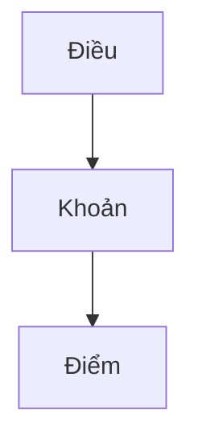

Ví dụ:

~~~text
Điểm a Khoản 2 Điều 6
~~~

Provision là node chính trong provision change graph.

### 4.3. Document Relation

Quan hệ có hướng giữa hai văn bản do hệ thống tự xây dựng từ toàn văn và bằng chứng pháp lý. Cạnh tác động chuẩn hóa từ văn bản tác động → văn bản bị tác động; REFERENCES và LEGAL_BASIS từ văn bản đang đọc → văn bản được dẫn chiếu/làm căn cứ. Quan hệ inverse để hiển thị được suy từ cùng cạnh, không tạo một cạnh trùng khác.

Taxonomy tối thiểu:

~~~text
AMENDS
SUPPLEMENTS
AMENDS_OR_SUPPLEMENTS
PARTIALLY_REPLACES
FULLY_REPLACES
PARTIALLY_REPEALS
FULLY_REPEALS
CORRECTS
REFERENCES
LEGAL_BASIS
GUIDES
DETAILS
EXPLAINS
SUSPENDS
EXTENDS_EFFECT
RESUMES_EFFECT
CONTINUES_APPLICATION
CONSOLIDATES
UNKNOWN
~~~

AMENDS_OR_SUPPLEMENTS giữ action kết hợp khi evidence chưa tách được sửa/bổ sung; CONTINUES_APPLICATION giữ ngoại lệ tiếp tục áp dụng, khác RESUMES_EFFECT sau đình chỉ. UNKNOWN bảo toàn action chưa phân loại ở candidate, không dùng làm legal effect chắc chắn.

Mỗi candidate giữ raw citation, câu/đoạn evidence, source snapshot/locator, method/version, scope và ngày tác động nếu xác định được. Trạng thái CANDIDATE / UNRESOLVED / AMBIGUOUS / CONFLICT / ACCEPTED / REJECTED tách khỏi confidence và evidence_level. Confidence của model không tự xác nhận một cạnh.

ACCEPTED yêu cầu identity hai đầu đã xác minh và evidence hỗ trợ đúng loại/chiều. Scope, ngoại lệ hoặc ngày tác động chưa đủ evidence phải giữ UNKNOWN/null và giới hạn sử dụng; không được lan truyền legal effect khi thông tin cần thiết còn thiếu. Candidate chỉ từ lược đồ nguồn hoặc semantic similarity không được tự dùng để quyết định hiệu lực hoặc tạo legal history chắc chắn.

Một cặp văn bản có thể có nhiều loại/scope quan hệ. Hợp nhất là CONSOLIDATES riêng, không tự coi là văn bản sửa đổi/thay thế. Scope một phần, ngoại lệ, điều kiện áp dụng và ngày pháp lý phải được giữ; không suy scope từ tên văn bản hoặc ngày ban hành.

Document Relation dùng để discover corpus và hỗ trợ resolve thay đổi, nhưng không thay thế Provision Relation. Có thể tổng hợp DocumentRelation từ ChangeInstruction/ProvisionRelation đã xác minh; không tự tạo correspondence giữa tất cả provisions khi có quan hệ thay thế cấp văn bản.

---

### 4.4. Provision Relation

Quan hệ có hướng giữa hai Điều / Khoản / Điểm.

Các relation quan trọng:

~~~text
AMENDS
SUPPLEMENTS
REPLACES
REPEALS
REFERENCES
SPLITS_INTO
MERGES_INTO
~~~

Ví dụ:

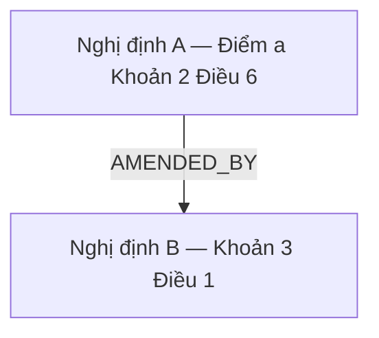

Hệ thống phải lưu evidence chỉ ra vì sao hai provision được nối.

### 4.5. Traffic Violation

Canonical identity của một hành vi vi phạm giao thông.

Một TrafficViolation không đồng nhất với một Provision.

Một hành vi có thể được quy định bởi nhiều provision qua thời gian.

Ví dụ:

~~~text
ACTION:
    Đỗ xe

VEHICLE:
    Ô tô

LOCATION:
    Phần đường xe chạy

CONDITIONS:
    Ngoài đô thị
~~~

### 4.6. Violation Rule

Một rule cụ thể gắn TrafficViolation với một Provision trong một context pháp lý nhất định.

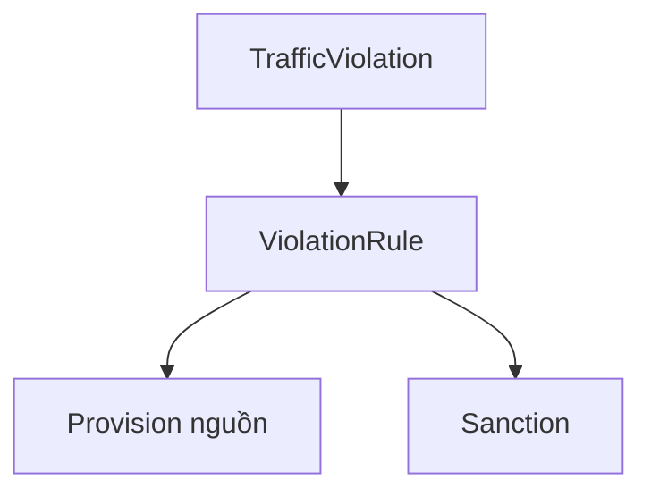

### 4.6.1. Rule Lineage

TrafficViolation là identity của **hành vi**, nhưng một hành vi có thể có nhiều rule song song theo vehicle / subject / context.

Vì vậy history không được tạo bằng cách nối tất cả ViolationRule của cùng một TrafficViolation vào một timeline duy nhất.

System phải duy trì **RuleLineage** để biểu diễn một chuỗi rule mà trong đó rule sau thực sự sửa đổi, thay thế hoặc kế thừa rule trước.

Ví dụ:

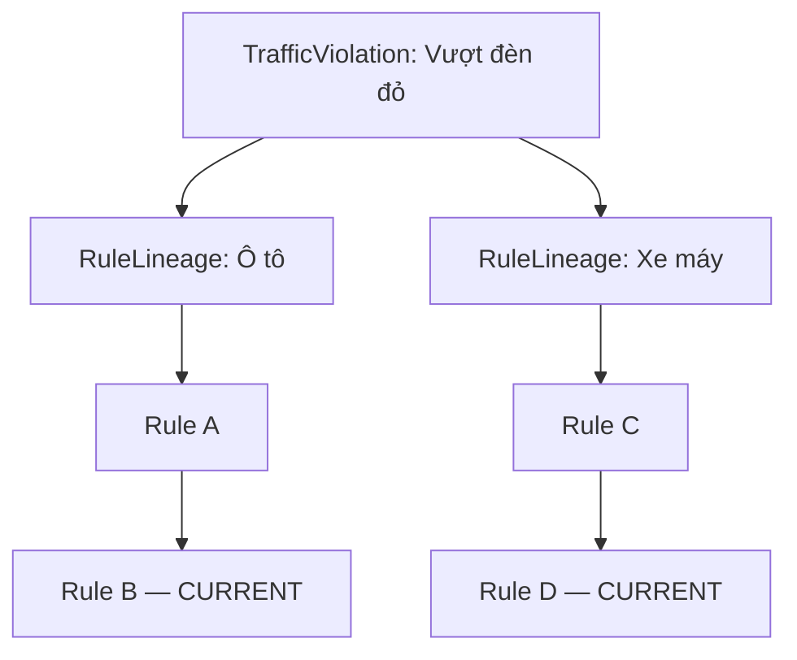

Semantic diff chỉ được thực hiện giữa các rule thuộc cùng lineage hoặc có ProvisionRelation / legal evidence chứng minh quan hệ kế thừa.

### 4.6.2. Behavior Signature

Mỗi TrafficViolation phải có một semantic signature ổn định dùng cho resolution và deduplication.

Signature không chứa sanction hoặc effective date.

Tối thiểu có thể gồm:

~~~text
action
polarity
target
location
core conditions
~~~

Subject / vehicle / context có thể thuộc ViolationRule nếu chúng tạo ra các rule áp dụng song song thay vì một hành vi hoàn toàn khác.

### 4.6.3. Evidence Level

Mọi relation / mapping quan trọng phải ghi nhận evidence level:

~~~text
SOURCE_METADATA
EXPLICIT_LEGAL_TEXT
STRUCTURED_DERIVATION
SEMANTIC_INFERENCE
~~~

Evidence pháp lý explicit được ưu tiên; structured derivation phải trace về evidence đó. SOURCE_METADATA là observation/đầu mối đối chiếu, không cao hơn nội dung pháp lý và không chứng minh nguồn có đủ cạnh. Semantic inference không được override evidence pháp lý; mâu thuẫn giữa nguồn hoặc câu chữ phải được giữ CONFLICT, không chọn chỉ bằng confidence.

### 4.6.4. Domain Vocabulary

Domain Vocabulary là registry có version dùng để chuẩn hóa các giá trị semantic được LLM/extractor sử dụng khi tạo Behavior Signature và ViolationRule IR.

Vocabulary tối thiểu có thể phân loại theo:

~~~text
ACTION
SUBJECT
VEHICLE
TARGET
LOCATION
CONDITION
EXCEPTION
~~~

Mỗi vocabulary entry phải có canonical ID, type, canonical label, aliases nếu có, provenance, thời điểm tạo và vocabulary version/run có liên quan. Vocabulary là knowledge dùng lại qua nhiều import, không đồng nhất với TrafficViolation; nhiều TrafficViolation/ViolationRule có thể tham chiếu cùng vocabulary entry.

Trong import pipeline, LLM phải ưu tiên reuse vocabulary hiện có trước khi đề xuất tạo vocabulary mới. Vocabulary được expose cho LLM qua MCP server nội bộ ([#36](https://github.com/NamPE286/INT3011E_6/issues/36), [hướng dẫn kết nối](mcp-server.md)):

~~~text
get_vocab_snapshot(version?)
add_vocab(type, canonical_label, aliases?, definition?, evidence, source_provision_id, source_document_id?, base_vocabulary_version)
~~~

Vocabulary MVP nhỏ nên `get_vocab_snapshot` trả **toàn bộ** registry dạng compact (canonical ID, type, label, aliases, definition ngắn), thứ tự deterministic và có `vocabulary_version`; caller cache theo version, truyền lại version đang có để nhận `NOT_MODIFIED`. Khi registry lớn tới mức snapshot không còn hợp lý về token, có thể bổ sung retrieval theo type/query mà không đổi canonical store. `add_vocab` chỉ được gọi sau khi đã nạp snapshot và chỉ khi candidate biểu diễn một semantic value thực sự mới, không chỉ khác wording.

`add_vocab` phải xác minh evidence thuộc Provision nguồn, re-check duplicate/alias/similarity ở server và có thể trả:

~~~text
EXISTING
CREATED
AMBIGUOUS
STALE_VERSION
~~~

`STALE_VERSION` nghĩa registry đã đổi kể từ `base_vocabulary_version` của caller; caller phải nạp lại snapshot trước khi thử lại. Các lời gọi `add_vocab` trong một run phải tuần tự.

Cùng MCP server còn có tool `search_legal_documents` phục vụ document discovery/identity resolution (FR-02/FR-03), không thuộc behavior labeling; kết quả chỉ là candidate, rỗng không chứng minh văn bản không tồn tại.

LLM không được tự tạo canonical vocabulary vô điều kiện. `AMBIGUOUS` phải giữ candidate/chờ resolver thay vì ép tạo entry mới. Mọi entry mới phải trace được về legal evidence và Provision nguồn đã làm phát sinh candidate.

### 4.7. Sanction

Chế tài áp dụng cho ViolationRule.

Sanction phải lưu có cấu trúc, không dùng một chuỗi `additional_sanction` duy nhất để biểu diễn mọi hình thức xử phạt bổ sung.

Tối thiểu hỗ trợ:

~~~text
fine_min
fine_max
currency

point_deduction_applicability:
    APPLIES
    NOT_APPLICABLE
    UNKNOWN

points_deducted

additional_sanctions[]
remedial_measures[]
~~~

`point_deduction_applicability` là trạng thái pháp lý explicit của rule tại effective period tương ứng:

- `APPLIES`: provision quy định áp dụng trừ điểm GPLX; `points_deducted` phải có giá trị dương;
- `NOT_APPLICABLE`: rule không áp dụng cơ chế trừ điểm GPLX trong context/effective period đó;
- `UNKNOWN`: evidence chưa đủ để kết luận có hay không áp dụng trừ điểm.

Không được suy `NOT_APPLICABLE` chỉ vì `points_deducted = null`. Null có thể là dữ liệu chưa extract được hoặc evidence chưa đủ.

Hình thức xử phạt bổ sung được lưu thành các `SanctionEffect` typed. Taxonomy tối thiểu:

~~~text
LICENSE_SUSPENSION
LICENSE_POINT_DEDUCTION
VEHICLE_CONFISCATION
OTHER
~~~

`LICENSE_POINT_DEDUCTION` phải nhất quán với `point_deduction_applicability = APPLIES` và `points_deducted`. `LICENSE_SUSPENSION` phải lưu được khoảng thời gian tước quyền sử dụng GPLX; `VEHICLE_CONFISCATION` phải phân biệt với tạm giữ phương tiện.

Tạm giữ phương tiện/GPLX để xác minh hoặc bảo đảm thi hành là biện pháp thủ tục/ngăn chặn, không được tự map thành `SanctionEffect` hoặc `remedial_measure` trong MVP.

Mọi additional sanction/effect phải truy vấn được trạng thái `point_deduction_applicability` của parent Sanction để UI/history thể hiện rõ rule đó thuộc cơ chế trừ điểm, không trừ điểm hay chưa xác định. Không duplicate trạng thái này xuống từng effect nếu có thể suy duy nhất từ parent Sanction.

### 4.8. Change Instruction

Biểu diễn có cấu trúc của một câu lệnh sửa đổi pháp luật.

Ví dụ:

~~~text
Sửa đổi điểm a khoản 2 Điều 6 như sau...
Bãi bỏ khoản 3 Điều 5.
Bổ sung điểm c vào khoản 4 Điều 7.
~~~

ChangeInstruction là bridge giữa raw amendment text và ProvisionRelation, đồng thời cung cấp evidence để tự build DocumentRelation. Phải giữ raw target citation, danh sách/range locator, scope, ngoại lệ, câu chữ được trích dẫn và thời điểm/điều kiện áp dụng. Target mơ hồ/không tìm được được giữ unresolved; bổ sung một provision mới không bắt buộc resolve tới provision cũ chưa tồn tại.

### 4.9. Workspace (Không gian dự án luật)

Mỗi tài khoản nhà soạn luật sở hữu một hoặc nhiều `Workspace` tách biệt hoàn toàn về:
- danh sách dự thảo soạn thủ công và văn bản hiện hành nhập qua AI (`legal_documents.workspace_id`, `processing_jobs.workspace_id`);
- lược đồ quan hệ văn bản, điều khoản và biến động chế tài (`document_relations.workspace_id`, `provision_relations.workspace_id`, `sanction_change_edges.workspace_id`);
- kết quả soát logic và báo cáo phạm vi tác động.

Mọi truy vấn có `X-Workspace-Id` đều phải xác thực quyền sở hữu phía server (trả `401`/`403` nếu không hợp lệ).

### 4.10. Logic Audit Finding (Phát hiện lỗi logic luật)

Kết quả của bộ máy **Soát logic luật tất định** (`LogicAuditReport`) gồm điểm nhất quán (`0–100`), trạng thái sẵn sàng (`PASS / WARNING / FAIL`) và danh sách `LogicAuditFinding`:

- `code`: mã quy tắc máy đọc được (16 quy tắc chuẩn);
- `category`: `STRUCTURE` | `TEMPORAL` | `REFERENCE` | `SANCTION_CONFLICT` | `DRAFTING_TECHNIQUE`;
- `severity`: `ERROR` | `WARNING` | `INFO`;
- `provisionId` / `relatedDocumentId` / `relatedProvisionId`: định danh chính xác để nhảy thẳng tới Điều/Khoản/Điểm gây lỗi;
- `evidence`: trích đoạn hoặc cặp dữ liệu chứng minh lỗi;
- `suggestion`: hướng dẫn khắc phục cụ thể cho nhà soạn luật.

### 4.11. Impact Scope Report (Báo cáo phạm vi tác động)

Báo cáo định lượng phạm vi ảnh hưởng của một dự thảo/văn bản trước khi ban hành:

- `directImpacts`: các văn bản chịu tác động trực tiếp (tầng 1) qua `AMENDS / SUPPLEMENTS / REPLACES / REPEALS / SUSPENDS`, kèm phạm vi `FULL / PARTIAL` và số điều khoản nối;
- `indirectImpacts`: các văn bản chịu tác động dây chuyền (tầng 2..`maxDepth`) thu được bằng duyệt BFS ngược trên đồ thị phụ thuộc (`GUIDES / DETAILS / EXPLAINS / LEGAL_BASIS / REFERENCES / AMENDS`), kèm `impactPath` và lý do lan truyền;
- `affectedProvisions`: từng Điều/Khoản/Điểm bị tác động kèm căn cứ;
- `sanctionShifts` & `affectedSubjects`: các cạnh tăng nặng/giảm nhẹ/bổ sung/bãi bỏ khung phạt (% biến động) và nhóm đối tượng/lĩnh vực chịu ảnh hưởng;
- `unresolvedFrontier`: các số hiệu văn bản được dẫn chiếu trong dự thảo nhưng chưa có trong Workspace;
- `synchronizationChecklist`: danh sách hành động ưu tiên (`HIGH / MEDIUM / LOW`) để sửa đổi đồng bộ hệ thống văn bản và điều khoản chuyển tiếp.

---

<a id="5-high-level-architecture"></a>
<a id="5-system-design"></a>

## 5. System Design — Thiết kế hệ thống

Chương này mô tả kiến trúc của nền tảng **Soạn Luật Studio**, đặt trước functional requirements để người đọc hiểu cách các thành phần phối hợp giữa luồng soạn thảo thủ công, bộ máy soát logic/phạm vi tác động và pipeline Legal AI.

### 5.1. System context và ranh giới

Hệ thống gồm 3 luồng tương tác chính: (1) **Nhà soạn luật** tạo Workspace, soạn thảo dự thảo, chạy soát logic luật, phân tích phạm vi tác động và nối lược đồ 2 chế độ; (2) **Admin/Reviewer** nhập PDF văn bản hiện hành bằng AI và duyệt công bố làm nền đối chiếu; (3) **Tra cứu & Trợ lý AI** kiểm chứng căn cứ, lịch sử `as-of` trên cùng kho tri thức.

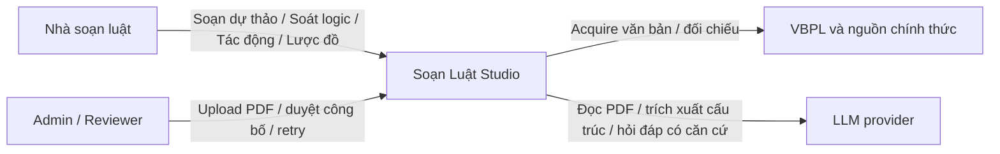

PDF là đầu vào chuẩn cho văn bản hiện hành nhập tự động; văn bản dự thảo được soạn trực tiếp qua Manual Studio. Bộ máy **Soát logic luật** và **Phân tích phạm vi tác động** chạy **tất định 100%** trên dữ liệu có cấu trúc trong D1 (không phụ thuộc LLM), đảm bảo giải thích được, tái lập được và không hallucinate.

### 5.2. Kiến trúc thành phần và triển khai

Backend tổ chức theo module trong cùng codebase Elysia trên Cloudflare Worker, tách HTTP request khỏi xử lý PDF nền bằng Cloudflare Queues. Frontend SvelteKit gọi API kèm cookie phiên Better Auth và header `X-Workspace-Id`; Worker dùng D1 cho dữ liệu có cấu trúc + auth + workspace, R2 cho PDF/snapshots và Queues cho pipeline AI.

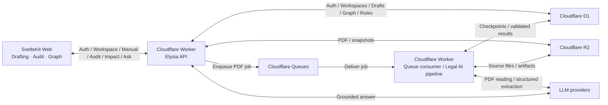

| Thành phần | Trách nhiệm và đầu ra | Yêu cầu liên quan |
| --- | --- | --- |
| Web UI | Bàn soạn thảo (`/drafting`), Trung tâm Soát logic & Tác động (`/audit`), Lược đồ 2 chế độ (`/graph`), Quản lý Workspace (`/workspaces`), Đăng nhập (`/login`), Kho văn bản, Khung xử phạt, Trợ lý AI và Nhập AI (`/admin`). | FR-01, FR-14–18, FR-21–25 |
| Auth & Multi-Workspace | Better Auth (`email + password`), cookie phiên, quản lý Workspace và kiểm tra quyền sở hữu server-side (`X-Workspace-Id`). | FR-21, mục 3 và 11 |
| Manual Drafting Studio | CRUD văn bản dự thảo, cây Chương/Mục/Điều/Khoản/Điểm, nối cạnh ảnh hưởng văn bản/điều khoản và cạnh biến động xử phạt. | FR-22, FR-25 |
| Legal Logic Audit Engine | 16 quy tắc tất định kiểm tra kết cấu, hiệu lực/thời gian, dẫn chiếu, chế tài/xung đột quy phạm và kỹ thuật lập pháp. | FR-23 |
| Impact Scope Engine | Tính phạm vi tác động trực tiếp (tầng 1), dây chuyền đa tầng (BFS 2–5 tầng), điều khoản, biến động chế tài, đối tượng, frontier và checklist đồng bộ. | FR-24 |
| Dual-Mode Graph | Hợp nhất dữ liệu AI + Manual thành 2 chế độ cạnh: Biến động mức xử lý & Ảnh hưởng văn bản/điều khoản. | FR-03, FR-07, FR-25 |
| PDF Ingestion & Preprocessing | Validate/hash/R2 snapshot, LLM đọc PDF theo cụm trang, phân tách Provision, graph, ChangeInstruction, ViolationRule/Sanction, Identity và History. | FR-01–13 |
| Vocabulary Registry / MCP | Canonical vocab có version, retrieve trước create, server dedup và ambiguity. | FR-08.1, NFR-03/06 |
| Search & Grounded AI | Tìm văn bản/hành vi, truy vấn `as-of` và sinh câu trả lời chỉ từ retrieved evidence kèm trích dẫn Provision. | FR-14, FR-16–20, NFR-07 |

### 5.3. Pipeline nghiệp vụ

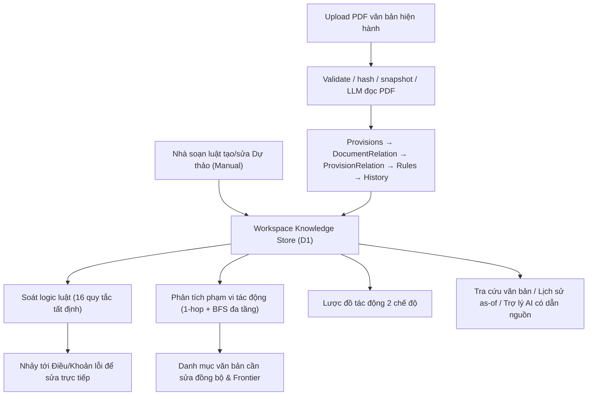

---

Corpus discovery và Document Graph Builder có vòng phản hồi: candidate từ văn bản mới được resolve; incoming links được tính từ graph trong Workspace. Trong nhánh Violation/Sanction Extraction, LLM sử dụng Domain Vocabulary Registry qua MCP để retrieve canonical vocabulary trước khi classify/normalize structured fields.

### 5.4. Thiết kế lưu trữ và quyền sở hữu dữ liệu

| Nơi lưu | Nội dung | Quy tắc sử dụng |
| --- | --- | --- |
| R2 | PDF gốc, source snapshots, checkpoint LLM theo cụm trang, validated JSON và output cần tái lập. | Tham chiếu bằng storage key + hash; giữ page/region/offset và phương pháp trích text, không dùng tên file làm legal identity. |
| D1 | `user`, `session`, `account`, `verification`, `workspaces`, `legal_documents`, `document_metadata`, `provisions`, `document_relations`, `provision_relations`, `sanction_change_edges`, `change_instructions`, `violation_rules`, `sanctions`, `traffic_violations`, `rule_lineages`, `change_events`, `vocab_entries`, `processing_jobs`. | Là nguồn chuẩn của domain, auth và trạng thái xử lý; mọi bảng dữ liệu chính đều cô lập theo `workspace_id`. |
| Queue | Tham chiếu `{ jobId, stage }` để consumer xử lý bất đồng bộ từng bước. | Không chứa toàn PDF; không dùng message làm nguồn chuẩn cho trạng thái/progress. |
| Search indexes | Projection từ văn bản, alias, rule/context và evidence đã được chấp nhận. | Có thể rebuild; hit phải resolve về canonical IDs trong cùng Workspace. |

Quan hệ lưu bằng relational tables trong MVP, không cần graph database. Document graph có thể có multi-edge hợp lệ; chu trình sửa đổi mâu thuẫn được phát hiện bởi bộ máy Soát logic luật (`TEMP_RELATION_CYCLE`).

### 5.5. Luồng import, retry và publication

1. API validate PDF, tính SHA-256 (dedup theo `(workspace_id, pdf_sha256)`), lưu snapshot R2 rồi ghi `processing_jobs` trong D1.
2. Enqueue tham chiếu job; trả job ID để UI theo dõi qua API trạng thái.
3. Consumer đọc snapshot và checkpoint, cho LLM đọc PDF theo cụm trang, chạy quality/structure gate, lưu `legal_documents` (`ACCEPTED` hoặc `REVIEW_REQUIRED`).
4. Khi văn bản được công bố (`ACCEPTED`), checklist tiền xử lý chạy tuần tự từng stage qua queue (`PROVISIONS → DOCUMENT_GRAPH → CHANGE_GRAPH → VIOLATION_RULES → IDENTITY → HISTORY`).
5. Dữ liệu sau công bố lập tức có mặt trong Workspace để phục vụ **Soát logic luật**, **Phân tích phạm vi tác động**, **Lược đồ 2 chế độ** và **Trợ lý AI**.

### 5.6. Luồng soát logic, phạm vi tác động, tra cứu as-of và AI chat

- **Soát logic luật (`GET /api/documents/:id/audit`):** Đọc snapshot Workspace từ D1 → chạy 16 quy tắc tất định trên 5 nhóm → trả `score`, `status`, `findings[]` kèm `provisionId`, `evidence`, `suggestion`.
- **Phân tích phạm vi tác động (`GET /api/documents/:id/impact?max_depth=`):** Đọc snapshot Workspace từ D1 → gom cạnh tác động trực tiếp (tầng 1) → duyệt BFS ngược trên đồ thị phụ thuộc (tầng 2..`max_depth`) → tổng hợp điều khoản, biến động chế tài, đối tượng chịu tác động, `unresolvedFrontier` và `synchronizationChecklist`.
- **Tra cứu `as-of` & AI chat (`POST /api/ask`):** Retrieval lấy rule hiện hành + lịch sử theo `RuleLineage`; trạng thái và claim lập từ evidence trước khi LLM diễn đạt; claim không có dẫn chiếu hợp lệ bị loại bỏ.

### 5.7. Bảo mật, khả năng vận hành và mở rộng

- **Authentication & Workspace Authorization:** Better Auth quản lý phiên bằng cookie HttpOnly; mọi endpoint tạo/sửa/xóa thủ công và quản lý Workspace yêu cầu đăng nhập; mọi truy vấn có `X-Workspace-Id` kiểm tra `workspaces.owner_user_id = session.user.id` phía server (fail closed `401`/`403`).
- **Validation:** Tệp upload, API request và output LLM đều được validate ở ranh giới (Elysia TypeBox phía server và runtime parser phía client).
- **Bounded processing:** Giới hạn PDF ≤ 50 MB / ≤ 300 trang, đồ thị ≤ 500 văn bản / 2.000 cạnh điều khoản, độ sâu lan truyền tác động `max_depth` từ 1 đến 5.
- **Observability:** Log JSON theo job/stage, checklist tiền xử lý và điểm nhất quán toàn Workspace (`/api/workspace/audit-summary`).

### 5.8. Hiện trạng repository và lộ trình tới thiết kế đích

| Khía cạnh | Hiện có trong code | Thiết kế đích / phần mở rộng |
| --- | --- | --- |
| Auth & Multi-Workspace | Better Auth (`email + password`), bảng `user`/`session`/`account`/`workspaces` (migration `0014`), cô lập `workspace_id`, tự khởi tạo Workspace mẫu có NĐ 100/123/168, TT 73 và Dự thảo 2026. | Chia sẻ Workspace đa thành viên / phân quyền vai trò (owner/editor/reviewer) và áp dụng auth bắt buộc cho cả route `/api/uploads`, `/api/jobs*`. |
| Soạn thảo thủ công | `/drafting` + `/api/manual/*`: CRUD văn bản, cập nhật metadata/ngày hiệu lực, chèn/sửa/xóa cây Chương/Mục/Điều/Khoản/Điểm, xem trước bản in. | Lịch sử phiên bản dự thảo (draft versioning/diff) và xuất DOCX/PDF chuẩn Nghị định 30/2020/NĐ-CP. |
| Soát logic luật | `/api/documents/:id/audit`, `/api/workspace/audit-summary`, tích hợp live trong `/drafting` (nhảy thẳng tới điều khoản lỗi) và trang `/audit` (16 quy tắc tất định thuộc 5 nhóm). | Bổ sung lớp soát ngữ nghĩa sâu bằng LLM (kiểm tra mâu thuẫn câu chữ phức tạp ngoài regex/khung phạt) có trích dẫn bắt buộc. |
| Phân tích phạm vi tác động | `/api/documents/:id/impact?max_depth=`, tích hợp trong `/drafting` và `/audit`: tác động trực tiếp tầng 1, lan truyền dây chuyền đa tầng (BFS), điều khoản, biến động chế tài, đối tượng, frontier và danh mục đồng bộ hóa. | Mô phỏng tác động theo kịch bản "what-if" chưa lưu và biểu đồ cây lan truyền tương tác trực tiếp trên `/graph`. |
| Lược đồ 2 chế độ | `/graph` + `GET /api/graph`: Chế độ 1 (Biến động mức xử lý hành vi) & Chế độ 2 (Ảnh hưởng văn bản/điều khoản), hợp nhất cạnh AI + thủ công. | Bộ lọc đánh dấu nút theo mức độ rủi ro tác động và lỗi logic. |
| PDF AI Pipeline | `POST /api/uploads` (dedup theo `(workspace_id, pdf_sha256)`), R2 snapshot, Queue consumer đọc PDF theo cụm trang, review `/admin/review/[jobId]`, checklist 6 bước tiền xử lý. | Nhập nhiều phần/phụ lục trong một job, corpus discovery/acquisition tự động từ VBPL (FR-02). |
| Search, As-of & AI Chat | `/documents`, `/violations` (as-of + lịch sử), `/ask` (grounded answer + citations), MCP nội bộ `/mcp`. | FTS5 index (FR-19), bộ đánh giá held-out QA và kiểm định logic trên tập dự thảo thực tế (#29). |

---

## 6. Functional Requirements

<a id="fr-01--import-from-csdl-vbpl"></a>

## FR-01 — Import Legal Document PDF

Only Admin can initiate import. Input là tệp PDF, không phải URL.

System phải:

1. nhận multipart upload và tạo ImportJob;
2. kiểm tra magic bytes/MIME, cấu trúc PDF, khả năng đọc, dung lượng/page/resource limits theo cấu hình; reject file giả PDF/malformed/protected không xử lý được;
3. lưu PDF gốc, SHA-256, storage key, upload provenance và quan hệ giữa các phần/phụ lục;
4. đọc nội dung từng trang bằng LLM có năng lực đọc PDF/hình ảnh (áp dụng cho cả PDF có text layer lẫn bản scan; không có OCR engine riêng hay OCR fallback — quyết định tại [#33](https://github.com/NamPE286/INT3011E_6/issues/33)), xử lý theo cụm trang có checkpoint, ghi model/prompt/schema version, page locator và quality flags `GOOD / PARTIAL / UNREADABLE` theo trang;
5. parse metadata từ văn bản, phân biệt ngày ban hành với dấu đến/chữ ký số/thời điểm upload; metadata mơ hồ được giữ unresolved;
6. segment header/preamble/body/quote/effect/transition, extract references và action candidates từ **toàn văn**, trước relevance filtering;
7. resolve canonical identity, validate evidence và build graph; header không được coi là đầy đủ quan hệ;
8. acquire related documents theo discovery policy, giữ provenance nội bộ riêng với user PDF upload.

Lifecycle:

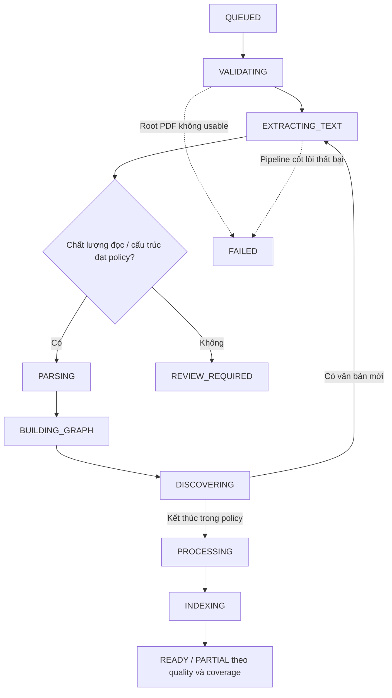

Các giai đoạn có thể lặp khi thêm related documents. `EXTRACTING_TEXT` là bước LLM chép nguyên văn từng trang; LLM không được tự điền nội dung từ trí nhớ: phần không đọc được phải đánh dấu `[không đọc được]` và hạ quality. Cấp Phần/Chương/Mục/Điều/Khoản/Điểm được backend suy ra từ ký hiệu đầu dòng in trên trang (không tin nhãn của model). Kết quả có lỗi validation mức ERROR được lưu để kiểm tra nhưng ở trạng thái review, không publish âm thầm.

READY chỉ nghĩa các bước bắt buộc đạt trong corpus/discovery policy/cutoff. PARTIAL khi còn phần PDF/phụ lục/trang chưa đọc được, frontier hoặc unresolved/conflict trọng yếu mà dữ liệu gốc vẫn usable; FAILED nếu root PDF hoặc pipeline cốt lõi không xử lý được. Job phải báo riêng file/text quality, part completeness, graph coverage và candidate/conflict.

Import cùng PDF/hash nhiều lần không tạo domain duplicate; hai bản PDF khác hash nhưng cùng legal document phải được đối chiếu identity và giữ source snapshots riêng. Không suy legal version/current status chỉ từ tên file hoặc PDF metadata.

Không hỗ trợ URL import hoặc DOCX trong MVP; source URL chỉ là metadata/provenance và acquisition nội bộ. [Kiểm chứng header/PDF trên chuỗi giao thông](research/traffic-header-completeness.md) cho thấy header-only bỏ sót quan hệ sửa đổi; full text, quality gates và corpus discovery là bắt buộc.

---

<a id="fr-02--recursive-related-document-crawl"></a>

## FR-02 — Incremental Corpus Discovery

Từ root document được upload PDF, system phải discover/acquire văn bản liên quan từ toàn văn PDF do LLM đọc, reverse corpus index/search và source observations tùy chọn. Hệ thống có thể crawl/scrape nguồn chính thức hoặc corpus data để lấy related documents; không giả định header hoặc graph nguồn đầy đủ.

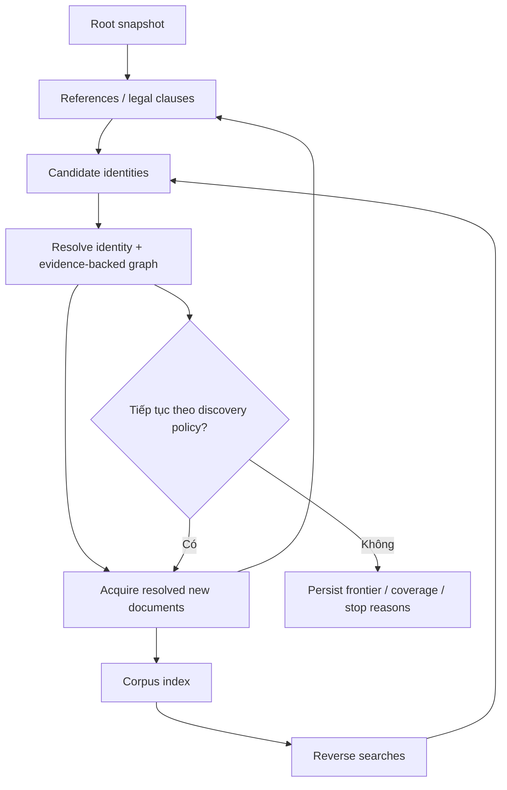

System phải:

- resolve document identity trước merge; metadata/URL là đầu mối, không tự merge chỉ bằng số hiệu;
- thu thập văn bản đích có ID đã resolve; giữ raw citation và lý do cho target chưa tìm được;
- tìm incoming bằng truy vấn vào corpus index/nguồn được hỗ trợ, lưu query, result pages, cutoff và provenance; nếu nguồn không hỗ trợ/đang lỗi thì ghi coverage gap;
- xử lý mọi reference phát hiện trong văn bản đã fetch, ghi rõ candidate outside discovery policy thay vì bỏ âm thầm;
- dùng visited/cache để ngăn refetch, giữ cycle/multi-edge và retry failed nodes;
- refresh incoming index khi thêm hoặc reprocess văn bản để graph cũ nhận được cạnh mới;
- stop theo policy có scope/date/depth/document/request limits; lưu frontier/checkpoint cho resume;
- ghi trạng thái PARTIAL khi khoảng thiếu ảnh hưởng kết quả; frontier rỗng và “không tìm thấy” không được hiểu là chứng minh không có incoming relation.

---

<a id="fr-03--vbpl-relationship-preservation"></a>

## FR-03 — Evidence-backed Document Graph

System phải tự build lược đồ quan hệ từ header và toàn văn PDF (do LLM đọc) của văn bản. Lược đồ/metadata nguồn được lưu như observations để phát hiện candidate, so sánh và bổ sung evidence; không phải ground truth hoặc input bắt buộc.

Pipeline phải:

1. lấy full text có snapshot và offsets/locator; đọc phần căn cứ, tiêu đề, nội dung, sửa đổi, hiệu lực/chuyển tiếp và hợp nhất;
2. extract document references và legal-action candidates trên toàn bộ văn bản, trước relevance gate;
3. resolve target theo số/ký hiệu, loại, ngày, cơ quan và alias; giữ ambiguity, không chọn top-1 nếu chưa đủ evidence;
4. classify action bằng câu chữ/ngữ cảnh, phân biệt nhắc tới với sửa/bãi bỏ thực tế, nội dung được trích dẫn và ngoại lệ;
5. xác minh evidence span, identity, direction, scope và effective/applicability conditions; promote thành ACCEPTED theo policy kiểm chứng;
6. derive incoming groups từ các cạnh đã nhận, giữ candidates/conflicts riêng và cập nhật tăng dần;
7. tổng hợp cạnh document-level từ ChangeInstruction/ProvisionRelation đã xác minh, dedup không mất multi-edge/evidence.

Rule/regex và deterministic resolver là baseline. LLM có thể hỗ trợ phần khó nhưng chỉ được dùng citation IDs/evidence spans được xác minh từ snapshot; schema validation/confidence không thay thế kiểm chứng nội dung. Có thể abstain UNRESOLVED/AMBIGUOUS/CONFLICT, không yêu cầu manual review cho mọi extraction.

Relation View dùng taxonomy nội bộ ở mục 4.3 và hỗ trợ inverse groups, evidence, scope, status và coverage. Không bắt buộc sao chép 21 nhóm của VBPL; source category/raw label được giữ trong observation khi có, kể cả UNKNOWN.

---

## FR-04 — Provision Segmentation

System phải parse hierarchy:

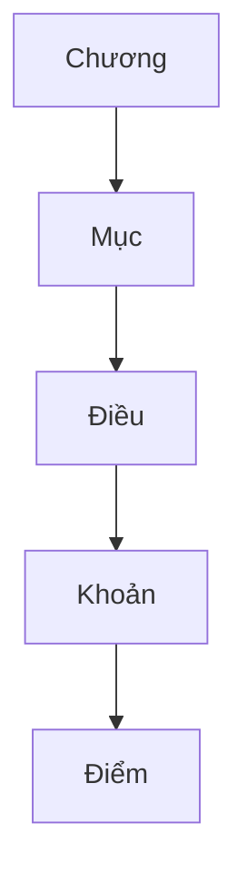

Mỗi Provision phải giữ:

- document_id;
- parent_id;
- article_no;
- paragraph_no;
- point_no;
- raw_text;
- PDF page/region và anchor nếu có;
- source_snapshot_id, original PDF hash, phương pháp đọc (LLM model/prompt/schema version) và page locator/source quote (offsets nếu được kiểm chứng từ nguồn) đủ để truy về evidence gốc sau normalize;
- quality flags và quote/structural context, không chỉ chuỗi text đã làm phẳng.

Mọi AI output downstream phải trace về Provision.

---

## FR-05 — Provision Relevance Classification

Mỗi provision phải được classify tối thiểu thành một trong:

~~~text
SANCTION_RULE
VIOLATION_RULE
AMENDMENT_INSTRUCTION
REPEAL_INSTRUCTION
REFERENCE
IRRELEVANT
UNCERTAIN
~~~

Chỉ provision liên quan tới traffic violation sanction hoặc legal change của sanction rule mới đi qua semantic pipeline đầy đủ.

---

## FR-06 — Change Instruction Extraction

Với provision sửa đổi / bổ sung / bãi bỏ / thay thế, system phải extract ChangeInstruction.

Ví dụ input:

~~~text
Sửa đổi điểm a khoản 2 Điều 6 như sau...
~~~

Output logic:

~~~json
{
    "operation": "AMEND",
    "target": {
        "article": "6",
        "paragraph": "2",
        "point": "a"
    }
}
~~~

Output phải có raw citation/target identity, source span, danh sách/range locator, scope, ngoại lệ và effective/applicability conditions; chưa xác định thì giữ null/unresolved. Phân biệt câu lệnh đang thực hiện với citation bên trong nội dung được thay thế hoặc câu mô tả thẩm quyền.

Các operation tối thiểu:

~~~text
AMEND
SUPPLEMENT
REPLACE
REPEAL
CORRECT
SUBSTITUTE_TEXT
~~~

---

## FR-07 — Provision Relation Resolution

System phải resolve ChangeInstruction thành edge giữa provision nguồn và provision bị tác động.

Ví dụ:

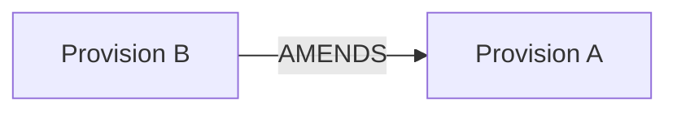

Mỗi edge phải lưu:

- relation_type;
- from_provision_id;
- to_provision_id;
- source_document_relation nếu có;
- evidence;
- evidence_level;
- resolution method;
- confidence.

ProvisionRelation là dữ liệu first-class, không được derive tạm thời chỉ khi render UI. Resolve trực tiếp từ legal text kể cả chưa có DocumentRelation nguồn; cạnh đã xác minh có thể bổ sung lại document graph. Candidate/unresolved targets không được apply vào history/current-rule như quan hệ chắc chắn. Khi bổ sung provision mới, giữ insertion locator thay vì buộc tồn tại target provision cũ.

---

## FR-08 — Traffic Violation Extraction

Provision liên quan phải được parse thành structured violation representation.

Các dimension chính:

~~~text
ACTION
SUBJECT
VEHICLE
TARGET
LOCATION
CONDITION
EXCEPTION
CONSEQUENCE
~~~

Ví dụ:

~~~json
{
    "action": "Đỗ xe",
    "vehicle": "Ô tô",
    "location": "Phần đường xe chạy",
    "conditions": [
        "Ngoài đô thị",
        "Có lề đường"
    ],
    "exceptions": []
}
~~~

Một Provision có thể:

- không tạo TrafficViolation;
- tạo một ViolationRule;
- tạo nhiều ViolationRule.

Không được giả định Provision = TrafficViolation.

### FR-08.1 — Vocabulary-guided LLM Extraction

Khi LLM được dùng trong import để extract/classify các dimension của ViolationRule, system phải cung cấp Domain Vocabulary qua MCP để giảm việc tạo label/concept trùng nghĩa.

Flow bắt buộc cho mỗi semantic candidate cần canonicalize:

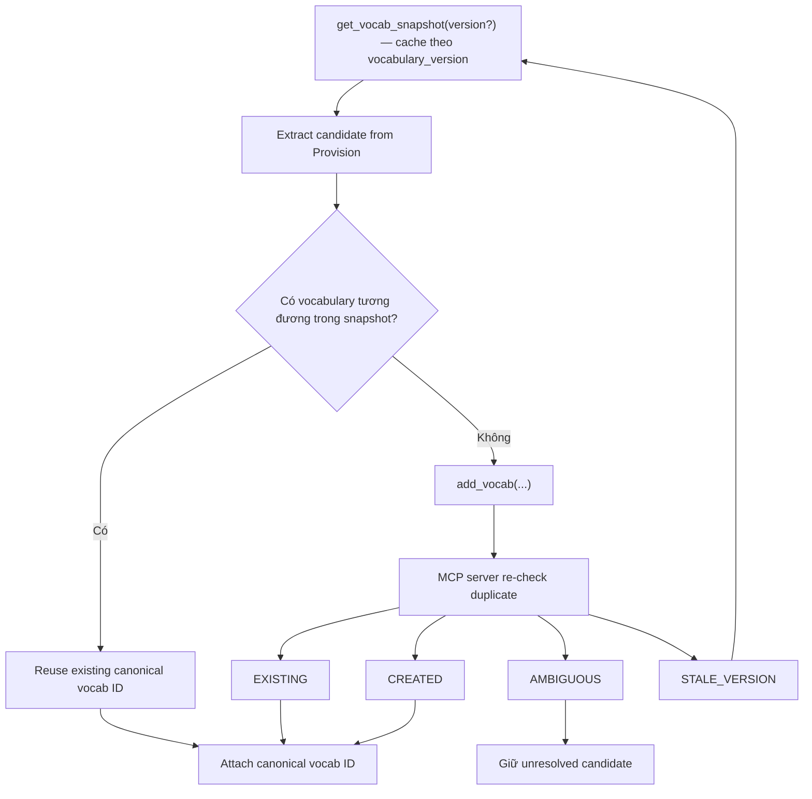

Yêu cầu cho `get_vocab_snapshot`:

- trả toàn bộ vocabulary dạng compact: canonical ID, type, canonical label, aliases, definition ngắn nếu cần;
- ordering deterministic và có `vocabulary_version`;
- caller truyền version đang cache thì nhận `NOT_MODIFIED`, không cần tải lại;
- không trả metadata nặng (provenance đầy đủ, history, embedding).

Yêu cầu cho `add_vocab`:

- chỉ được gọi sau khi đã nạp snapshot, tuần tự trong một run;
- input phải có `type`, `canonical_label`, legal evidence, `source_provision_id` (dạng `<document_id>:dieu_n_khoan_n_diem_x` hoặc kèm `source_document_id`) và `base_vocabulary_version`; aliases/definition là optional;
- server xác minh evidence có trong Điều/Khoản/Điểm nguồn (kể cả tên Điều); tham chiếu mơ hồ giữa nhiều văn bản bị từ chối;
- không tạo entry mới chỉ vì wording khác nếu semantic meaning đã có trong registry;
- server phải kiểm tra duplicate/alias/similarity trước khi insert;
- kết quả có thể là `EXISTING`, `CREATED`, `AMBIGUOUS` hoặc `STALE_VERSION`;
- chỉ caller có token ghi được gọi `add_vocab`; backend phải kiểm tra lại mọi canonical ID mà LLM trả về với registry;
- `AMBIGUOUS` không được tự động tạo canonical identity mới.

Mọi ExtractionRun phải ghi vocabulary version và các canonical vocab IDs đã sử dụng hoặc tạo để có thể reproduce và audit kết quả.

---

## FR-09 — Sanction Extraction

System phải extract sanction áp dụng cho từng ViolationRule dưới dạng structured fields.

Tối thiểu:

~~~text
fine_min
fine_max
currency

point_deduction_applicability
points_deducted

additional_sanctions[]
remedial_measures[]
~~~

`point_deduction_applicability` bắt buộc nhận một trong:

~~~text
APPLIES
NOT_APPLICABLE
UNKNOWN
~~~

Quy tắc consistency:

- `APPLIES` → phải có evidence cho cơ chế trừ điểm và `points_deducted > 0`;
- `NOT_APPLICABLE` → không được tạo `LICENSE_POINT_DEDUCTION`; `points_deducted` phải null;
- `UNKNOWN` → không được suy ra “không trừ điểm” chỉ từ field null hoặc absence của keyword;
- nếu evidence mâu thuẫn, giữ `UNKNOWN`/conflict thay vì chọn bằng confidence.

Additional sanction phải được normalize thành `SanctionEffect[]`, tối thiểu phân biệt:

~~~text
LICENSE_SUSPENSION
LICENSE_POINT_DEDUCTION
VEHICLE_CONFISCATION
OTHER
~~~

Mỗi effect phải giữ type, structured attributes phù hợp (ví dụ duration/target), raw text/evidence và source Provision. Tạm giữ phương tiện/GPLX mang tính thủ tục không được classify thành `VEHICLE_CONFISCATION` hoặc `LICENSE_SUSPENSION`.

Sanction phải gắn với ViolationRule, không gắn trực tiếp một mức phạt duy nhất vào TrafficViolation.

Cùng hành vi có thể có sanction khác nhau theo:

- subject;
- vehicle;
- location;
- condition;
- consequence;
- effective period.

History/as-of query phải trả được cả `point_deduction_applicability` để phân biệt rõ rule thời kỳ chưa áp dụng cơ chế trừ điểm, rule có trừ điểm và trường hợp chưa đủ evidence.

---

## FR-10 — Violation Identity Resolution

Đây là feature AI trung tâm.

Các ViolationRule từ nhiều văn bản phải được resolve về cùng một TrafficViolation khi chúng biểu diễn cùng hành vi pháp lý hoặc cùng lineage của hành vi.

Flow ưu tiên:

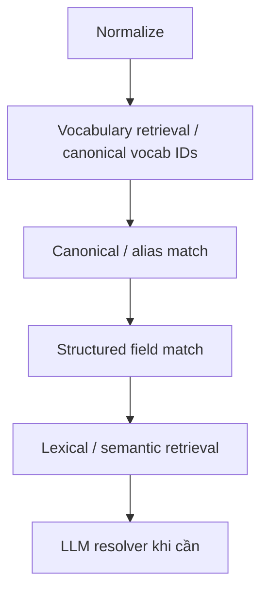

Ví dụ:

~~~text
"không chấp hành hiệu lệnh của đèn tín hiệu giao thông"
≈
"vượt đèn đỏ"
~~~

Việc map không chỉ dựa vào similarity text; phải xét structured context như vehicle, location, condition và exception.

Resolver không được ép merge khi không đủ evidence.

Output tối thiểu:

~~~text
MATCH_EXISTING
CREATE_NEW
AMBIGUOUS
~~~

Nếu AMBIGUOUS, rule vẫn được lưu nhưng không được dùng để tự động tạo history lineage chắc chắn.

---

## FR-11 — Behavior-centric Provision History

TrafficViolation là identity trung tâm của history.

System phải reconstruct:

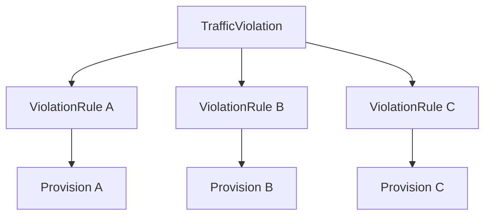

Provision graph phải cho biết:

~~~text
A --AMENDED_BY--> B --REPLACED_BY--> C
~~~

Behavior history phải cho biết theo từng RuleLineage:

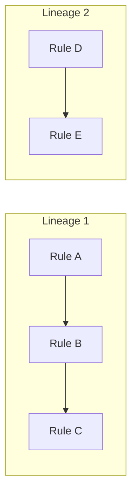

Hai graph phải liên kết được với nhau.

Không được nối hai ViolationRule chỉ vì chúng cùng TrafficViolation nếu không có legal / temporal / semantic evidence cho lineage đó.

---

## FR-12 — Current Rule Determination

Với mỗi TrafficViolation, system phải xác định những ViolationRule đang hiện hành dựa trên:

1. document effective status;
2. effective dates;
3. ACCEPTED DocumentRelation có legal-text evidence;
4. explicit ProvisionRelation;
5. ChangeInstruction;
6. semantic alignment.

Rule status tối thiểu:

~~~text
CURRENT
AMENDED
REPEALED
SUPERSEDED
UNCERTAIN
~~~

Không được đánh dấu CURRENT chỉ vì văn bản chứa provision còn hiệu lực nếu chính provision đã bị sửa hoặc bãi bỏ. Không suy “chưa từng bị sửa” từ việc graph không có cạnh. Candidate/conflict hoặc khoảng thiếu discovery ảnh hưởng đến lineage phải khiến kết luận UNCERTAIN; các kết luận hợp lệ khác phải nêu corpus/cutoff đã kiểm chứng.

### FR-12.1 — Deterministic Current-rule Resolution

Current-rule resolution phải ưu tiên deterministic legal evidence trước AI.

Với một RuleLineage và thời điểm T:

1. loại rule chưa có hiệu lực tại T;
2. loại rule đã hết hiệu lực tại T;
3. apply REPEALS / REPLACES / AMENDS từ ProvisionRelation;
4. xét document effective status;
5. nếu còn nhiều candidate hợp lệ do context khác nhau, giữ tất cả thay vì chọn tùy ý;
6. chỉ dùng semantic inference để resolve phần chưa rõ.

### FR-12.2 — As-of Query

System phải hỗ trợ xác định rule áp dụng tại một ngày cụ thể.

Ví dụ:

~~~text
Mức phạt vượt đèn đỏ ngày 01/06/2022 là bao nhiêu?
~~~

As-of query phải sử dụng effective interval của ViolationRule / source provision, không dùng trạng thái CURRENT hiện tại.

---

## FR-13 — Semantic Change Detection

Khi hai ViolationRule trong cùng history lineage khác nhau, system phải tạo semantic diff.

Các change type tối thiểu:

~~~text
NO_SEMANTIC_CHANGE

VIOLATION_ADDED
VIOLATION_REMOVED

CONDITION_ADDED
CONDITION_REMOVED
CONDITION_CHANGED

EXCEPTION_ADDED
EXCEPTION_REMOVED

SUBJECT_CHANGED
VEHICLE_SCOPE_CHANGED
LOCATION_SCOPE_CHANGED

SANCTION_INCREASE
SANCTION_DECREASE
SANCTION_CHANGED
POINT_DEDUCTION_APPLICABILITY_CHANGED
POINT_DEDUCTION_CHANGED
LICENSE_SUSPENSION_CHANGED
VEHICLE_CONFISCATION_CHANGED
ADDITIONAL_SANCTION_CHANGED

REPEALED
REPLACED
UNKNOWN
~~~

Một transition có thể có nhiều change type.

---

## FR-14 — Legal Document Search

User có thể search document bằng:

- số hiệu;
- tên;
- từ khóa;
- loại văn bản;
- cơ quan ban hành;
- trạng thái hiệu lực.

Kết quả dùng metadata đã đối chiếu theo provenance từng field; ưu tiên nguồn chính thức phù hợp, giữ conflicts thay vì mặc định VBPL luôn đúng.

---

## FR-15 — Legal Document View

Trang document có đúng hai tab chính.

### Tab 1 — Nội dung

Hiển thị:

- metadata;
- tình trạng hiệu lực;
- nội dung theo Điều / Khoản / Điểm;
- provision xử phạt bị tác động;
- trạng thái của relevant ViolationRule.

Relevant provision bị sửa đổi / thay thế / bãi bỏ phải được highlight.

User có thể mở history từ provision đó.

### Tab 2 — Quan hệ

Hiển thị lược đồ do hệ thống build theo taxonomy nội bộ, gồm incoming/outgoing, relation type, scope/ngoại lệ, evidence nguồn và trạng thái xác minh. Candidate/source observations được thể hiện riêng với cạnh ACCEPTED; không thể hiện một candidate như thay đổi pháp lý chắc chắn.

Phải hiển thị discovery scope/cutoff, coverage và các khoảng thiếu/conflict ảnh hưởng kết quả. Không có cạnh trong corpus không đồng nghĩa không có quan hệ pháp lý.

Mỗi related document có thể click để mở Document View nội bộ nếu đã crawl.

---

## FR-16 — Search by Traffic Violation

Hệ thống phải hỗ trợ hai chế độ tìm kiếm hành vi độc lập nhưng dùng chung TrafficViolation / ViolationRule knowledge base.

### FR-16.1 — Manual Full-text Search

User có thể nhập trực tiếp từ khóa hoặc mô tả hành vi:

~~~text
đỗ xe
vượt đèn đỏ
dừng xe ngoài đô thị
đi quá tốc độ 10 đến 20 km/h
~~~

Manual search không cần LLM để sinh câu trả lời.

Search phải hỗ trợ tối thiểu:

~~~text
full-text search trên canonical behavior
+ aliases
+ provision text
+ structured filtering nếu có
~~~

Kết quả trả về danh sách TrafficViolation / ViolationRule phù hợp, ưu tiên CURRENT rules.

Mỗi result tối thiểu hiển thị:

- hành vi;
- context chính;
- current sanction nếu có;
- current provision;
- source document;
- link tới detail/history.

### FR-16.2 — AI Chat Search

User có thể đặt câu hỏi tự nhiên thay vì tự chọn một hành vi cụ thể.

Ví dụ:

~~~text
Đỗ ô tô ngoài đô thị sai quy định thì bị phạt thế nào?
Vượt đèn đỏ hiện giờ phạt bao nhiêu và trước đây thay đổi ra sao?
Các lỗi liên quan đến dừng đỗ trên phần đường xe chạy là gì?
~~~

AI phải tự:

1. hiểu intent và context của câu hỏi;
2. tìm một hoặc nhiều TrafficViolation liên quan;
3. retrieve CURRENT ViolationRule và history cần thiết;
4. retrieve source Provision tương ứng;
5. tổng hợp câu trả lời;
6. đính kèm reference cho các claim pháp lý.

Pipeline:

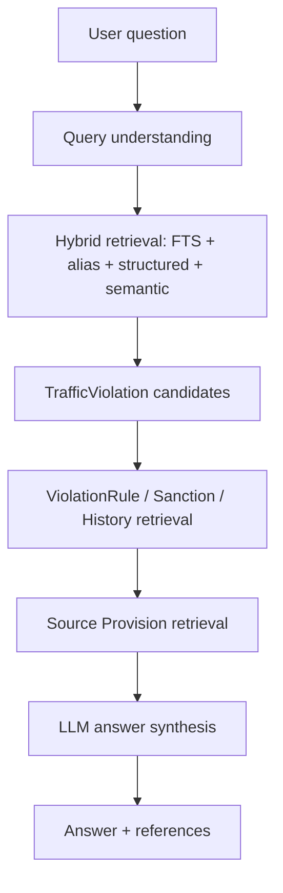

AI chat phải theo nguyên tắc **retrieval-first, answer-last**.

AI không được:

- tự invent hành vi;
- tự invent mức phạt;
- tự invent trạng thái hiệu lực;
- đưa ra claim pháp lý mà không có evidence trong corpus.

Nếu evidence không đủ hoặc các rule mâu thuẫn / UNCERTAIN, câu trả lời phải thể hiện uncertainty thay vì ép một kết luận.

### FR-16.3 — AI Answer References

Reference phải ở **claim-level**, không chỉ đặt một danh sách nguồn chung ở cuối câu trả lời.

Mỗi claim quan trọng về:

- mức phạt;
- rule hiện hành;
- Điều / Khoản / Điểm;
- trạng thái hiệu lực;
- lịch sử thay đổi;

phải reference về ít nhất một Provision nguồn.

Reference tối thiểu phải cho phép user mở:

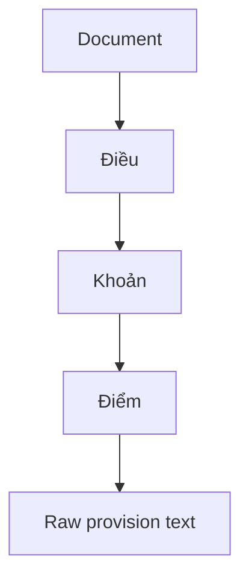

Ví dụ presentation:

~~~text
Phạt từ X đến Y đồng.
[Nghị định ..., Điều 6, Khoản 2, Điểm a]
~~~

Khi câu trả lời dựa trên history, AI phải có thể reference cả provision trước và provision sau của transition.

Mỗi reference phải mang stable Provision ID để UI có thể deep-link đúng Điều / Khoản / Điểm.

---

## FR-17 — Violation Detail

Khi user chọn một TrafficViolation, system phải hiển thị:

- canonical behavior;
- subject / vehicle;
- location / conditions / exceptions;
- current applicable sanction;
- current applicable provisions;
- effective period;
- source documents;
- confidence / uncertainty khi cần;
- link tới history.

Nếu có nhiều current rules do khác vehicle/context, UI phải hiển thị từng applicable rule riêng.

---

## FR-18 — Violation History

History phải hiển thị theo thời gian:

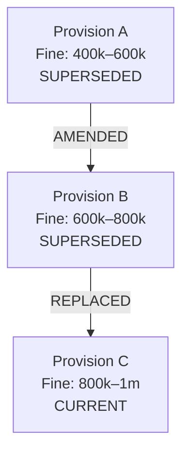

Mỗi transition phải cho biết:

- provision trước;
- provision sau;
- relation;
- effective date;
- semantic change;
- sanction before / after;
- source document;
- evidence.

---

## FR-19 — Search Index

System phải duy trì ít nhất:

### Document Index

Dùng cho search văn bản.

### Violation Index

Index:

- canonical behavior;
- aliases;
- structured dimensions;
- provision text;
- current / historical rule status;
- embeddings nếu sử dụng.

Manual search phải sử dụng full-text search làm retrieval chính.

AI chat có thể sử dụng hybrid retrieval:

~~~text
full-text
+ alias
+ structured filters
+ vector retrieval
+ reranking nếu cần
~~~

Retrieval result phải giữ stable IDs của TrafficViolation, ViolationRule và Provision để answer layer có thể tạo reference chính xác.

---

## FR-20 — AI Provenance

Mọi AI output quan trọng phải lưu:

- task type;
- model;
- prompt/schema version;
- timestamp;
- confidence;
- raw output;
- normalized output;
- evidence provision;
- extraction run.

Không có human_verified requirement bắt buộc trong MVP.

---

## FR-21 — Tài khoản & Không gian làm việc độc lập (Auth & Multi-Workspace Isolation)

System phải:

1. hỗ trợ đăng ký, đăng nhập, đọc phiên và đăng xuất bằng Better Auth (`email + password`, cookie phiên HttpOnly);
2. cho phép mỗi tài khoản tạo, đổi tên, cập nhật mô tả/lĩnh vực và xóa nhiều `Workspace` độc lập (mỗi Workspace cô lập hoàn toàn văn bản, điều khoản, quan hệ, cạnh biến động chế tài và báo cáo rà soát);
3. tự động khởi tạo một Workspace mẫu kèm dữ liệu pháp luật giao thông mẫu (NĐ 100/2019, NĐ 123/2021, NĐ 168/2024, TT 73/2024 và Dự thảo 2026) khi người dùng mới đăng nhập lần đầu;
4. kiểm tra quyền sở hữu Workspace server-side cho mọi yêu cầu mang `X-Workspace-Id` (trả `401` nếu chưa đăng nhập, `403` nếu truy cập Workspace của tài khoản khác).

---

## FR-22 — Soạn thảo văn bản quy phạm pháp luật có cấu trúc (Structured Drafting Studio)

Nhà soạn luật đã đăng nhập phải có thể:

1. khởi tạo văn bản dự thảo mới với số hiệu, trích yếu, loại văn bản (`Dự thảo`, `Luật`, `Nghị định`, `Thông tư`, `Nghị quyết`), cơ quan chủ trì, ngày ban hành và ngày dự kiến có hiệu lực;
2. cập nhật thông tin định danh & ngày hiệu lực của văn bản trực tiếp trong bàn soạn thảo;
3. chèn, sửa nội dung, đổi số hiệu/tiêu đề và xóa cây điều khoản **Chương → Mục → Điều → Khoản → Điểm** theo đúng thứ bậc cha–con (tự gợi ý số thứ tự tiếp theo và xóa cascade mục con khi xóa mục cha);
4. chuyển đổi giữa chế độ **Soạn thảo**, **Soát logic**, **Phạm vi tác động** và **Xem trước** bản thể thức văn bản quy phạm ngay trên cùng một màn hình;
5. mỗi thay đổi trên dự thảo phải tự động làm mới kết quả soát logic và phạm vi tác động.

---

## FR-23 — Soát logic luật tự động (Deterministic Legal Logic Checking)

System phải cung cấp bộ kiểm định logic luật tất định (`GET /api/documents/:documentId/audit` và tổng quan toàn Workspace `GET /api/workspace/audit-summary`) gồm tối thiểu 16 quy tắc thuộc 5 nhóm:

1. **Kết cấu & đánh số (`STRUCTURE`):**
   - `STRUCT_DUPLICATE_NUMBER` (`ERROR`): trùng số hiệu cùng cấp dưới cùng mục cha;
   - `STRUCT_NUMBERING_GAP` (`WARNING`): đánh số Điều/Khoản/Điểm bị nhảy cóc;
   - `STRUCT_INVALID_HIERARCHY` (`ERROR`): sai thứ bậc cha–con (VD: Điểm đặt trực tiếp dưới Điều không qua Khoản);
   - `STRUCT_EMPTY_PROVISION` (`WARNING`): điều khoản không có nội dung và không có mục con.
2. **Hiệu lực & thời gian (`TEMPORAL`):**
   - `TEMP_EFFECTIVE_BEFORE_ISSUED` (`ERROR`): ngày có hiệu lực sớm hơn ngày ban hành;
   - `TEMP_AMEND_BEFORE_TARGET_EFFECTIVE` (`ERROR`): ngày hiệu lực của văn bản sửa đổi/bãi bỏ sớm hơn ngày hiệu lực của văn bản bị tác động;
   - `TEMP_SELF_RELATION` (`ERROR`): văn bản tự tác động lên chính nó;
   - `TEMP_RELATION_CYCLE` (`ERROR`): chu trình mâu thuẫn trong đồ thị quan hệ sửa đổi/thay thế/bãi bỏ;
   - `TEMP_AMEND_REPEALED_TARGET` (`ERROR`): dự thảo sửa đổi/bổ sung một văn bản đã bị văn bản khác thay thế hoặc bãi bỏ toàn bộ trước đó.
3. **Dẫn chiếu & mục tiêu (`REFERENCE`):**
   - `REF_BROKEN_INTERNAL_CITATION` (`ERROR`): viện dẫn tới Điều hoặc "khoản X Điều này" không tồn tại trong văn bản;
   - `REF_UNRESOLVED_EXTERNAL_DOCUMENT` (`WARNING`): trích dẫn số hiệu văn bản chưa có trong Workspace;
   - `REF_UNLINKED_AMENDMENT_CLAUSE` (`WARNING`): điều khoản chứa câu lệnh sửa đổi/bổ sung/bãi bỏ/thay thế nhưng chưa có cạnh quan hệ tác động tương ứng.
4. **Chế tài & xung đột quy phạm (`SANCTION_CONFLICT`):**
   - `SANC_INVERTED_FINE_RANGE` (`ERROR`): khung phạt tiền có mức tối thiểu lớn hơn tối đa (trong câu chữ hoặc cạnh biến động xử phạt);
   - `SANC_INVALID_POINT_DEDUCTION` (`ERROR`): số điểm trừ GPLX ≤ 0 hoặc > 12 điểm;
   - `SANC_IMPLICIT_NORM_CONFLICT` (`WARNING`): điều khoản dự thảo quy định khung phạt khác cho hành vi tương tự một văn bản đang có hiệu lực khác trong Workspace nhưng chưa khai báo quan hệ sửa đổi/thay thế/bãi bỏ.
5. **Kỹ thuật lập pháp (`DRAFTING_TECHNIQUE`):**
   - `DRAFT_MISSING_EFFECTIVE_DATE` (`INFO`): chưa khai báo ngày dự kiến có hiệu lực.

Mỗi phát hiện (`LogicAuditFinding`) phải trả đủ `code`, `category`, `severity`, `title`, `message`, `evidence`, `suggestion` và `provisionId`/`relatedDocumentId` để giao diện nhảy trực tiếp tới điều khoản lỗi. Điểm nhất quán (`0–100`) và trạng thái (`PASS / WARNING / FAIL`) được tính minh bạch, kèm disclaimer giới hạn phạm vi Workspace.

---

## FR-24 — Phân tích phạm vi tác động (Direct & Cascading Impact Scope Analysis)

System phải cung cấp API và giao diện phân tích phạm vi tác động (`GET /api/documents/:documentId/impact?max_depth=1..5`) cho mọi dự thảo hoặc văn bản trong Workspace:

1. **Tác động trực tiếp (tầng 1):** liệt kê toàn bộ văn bản bị tác động trực tiếp qua `AMENDS / SUPPLEMENTS / REPLACES / REPEALS / SUSPENDS`, phạm vi `FULL / PARTIAL`, nguồn (`AI / MANUAL`) và số lượng điều khoản nối;
2. **Tác động gián tiếp / dây chuyền (tầng 2..`max_depth`):** duyệt BFS ngược trên đồ thị phụ thuộc (`GUIDES / DETAILS / EXPLAINS / LEGAL_BASIS / REFERENCES / AMENDS / SUPPLEMENTS`) để phát hiện các thông tư hướng dẫn, văn bản quy định chi tiết hoặc văn bản viện dẫn bị ảnh hưởng dây chuyền, hiển thị rõ tầng (`depth`), chuỗi đường đi (`impactPath`) và lý do;
3. **Tác động cấp Điều/Khoản/Điểm:** liệt kê từng `ProvisionRelation` xuất phát từ dự thảo kèm trích đoạn căn cứ và link mở thẳng tới điều khoản bị tác động;
4. **Phạm vi chế tài & đối tượng chịu tác động:** tổng hợp số hành vi tăng nặng/giảm nhẹ/bổ sung/bãi bỏ (% biến động mức phạt) và nhận diện các nhóm đối tượng/lĩnh vực chịu tác động;
5. **Khoảng trống đối chiếu (Frontier) & Danh mục khuyến nghị đồng bộ hóa:** trích xuất mọi số hiệu văn bản được dẫn chiếu nhưng chưa có trong Workspace (`unresolvedFrontier`), tính mức độ rủi ro (`LOW / MEDIUM / HIGH`) và sinh danh mục hành động ưu tiên (`HIGH / MEDIUM / LOW`) cho cơ quan soạn thảo.

---

## FR-25 — Lược đồ tác động 2 chế độ (Dual-Mode Legal Graph)

Trang `/graph` và API `GET /api/graph` phải hợp nhất dữ liệu AI trích xuất và dữ liệu soạn thảo thủ công trong cùng Workspace thành hai chế độ cạnh chuyển đổi được:

1. **Chế độ 1 — Biến động mức xử lý hành vi (`sanction_change`):** hiển thị cạnh tăng nặng, giảm nhẹ, thay đổi trừ điểm/tước GPLX, bổ sung/bãi bỏ chế tài kèm phần trăm biến động (`severityDeltaPercent`), mức phạt cũ → mới và hỗ trợ nối/xóa cạnh thủ công (`/api/manual/graph/sanction-edges`);
2. **Chế độ 2 — Quan hệ ảnh hưởng văn bản & điều khoản (`document_influence`):** hiển thị văn bản nào sửa đổi, bổ sung, thay thế, bãi bỏ, hướng dẫn hay làm căn cứ cho văn bản nào ở cả cấp văn bản và cấp Điều/Khoản/Điểm, phân biệt nhãn `AI tự nối` vs `Thủ công` và hỗ trợ nối/xóa cạnh thủ công (`/api/manual/graph/document-relations`, `/api/manual/graph/provision-relations`).

---

## 7. Data Model

Core model:

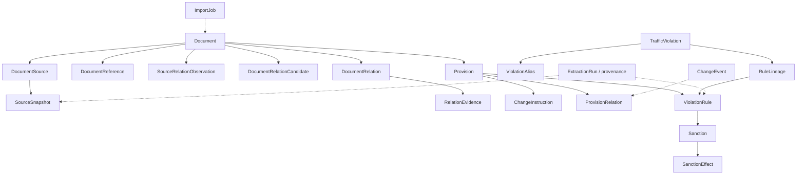

Hai graph quan trọng:

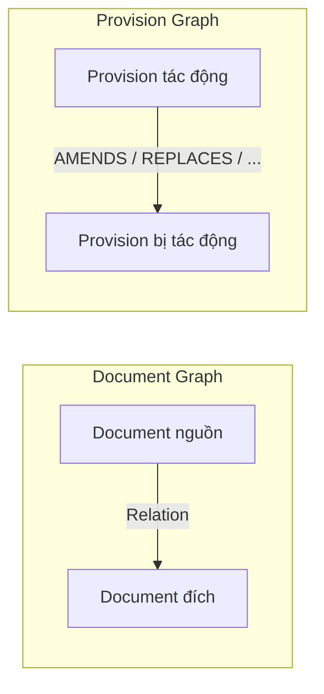

TrafficViolation đóng vai trò semantic identity nối các ViolationRule thuộc nhiều provision khác nhau.

---

## 8. Core Tables

### document

~~~text
id
canonical_identity_status
document_number
title
document_type
issuer
issued_at
effective_from
effective_to
effective_status
source_url (nullable; primary provenance only)
created_at
~~~

### document_source

~~~text
id
document_id (nullable until identity resolved)
source (UPLOAD / VBPL / official source / declared archive)
source_item_id (string; upload dùng PDF hash/storage identity)
source_url (nullable)
canonical_source_url (nullable)
file_sha256 / file_storage_key / original_filename
source_snapshot_id
uploaded_at / fetched_at
~~~

### document_reference

~~~text
id
source_document_id
source_snapshot_id
source_locator / start_offset / end_offset
raw_citation
normalized_identifiers_json
context (PREAMBLE / OPERATIVE / QUOTED / FINAL / OTHER)
quote_depth / actor_context_json / target_context_json
resolved_document_id (nullable)
resolution_status
~~~

### source_relation_observation

~~~text
id
observed_document_source_id
source_snapshot_id
raw_category / raw_subtype / source_side
raw_target_reference
observed_at
availability_status
~~~

### document_relation_candidate

~~~text
id
observed_document_id
actor_document_id / actor_context_json (nullable until resolved)
raw_target_citation
resolved_target_document_id (nullable)
proposed_relation_type
status (CANDIDATE / UNRESOLVED / AMBIGUOUS / CONFLICT / ACCEPTED / REJECTED)
resolution_reason
document_reference_id / source_relation_observation_id (nullable)
method / extractor_version
confidence
source_snapshot_id
~~~

### document_relation

~~~text
id
from_document_id
to_document_id
relation_type
scope_json
exceptions_json
effective_from / effective_to (nullable)
applicability_conditions_json
verification_status
extraction_run_id
~~~

### relation_evidence

~~~text
id
document_relation_id / document_relation_candidate_id
source_document_id
source_provision_id (nullable)
source_snapshot_id
source_url (nullable for uploads)
source_locator / PDF page / region / start_offset / end_offset
quoted_text
content_role / legal_actor_context
evidence_level
method / extractor_version
observed_at
~~~

Source observations, candidates và accepted edges được giữ riêng về ý nghĩa. Uniqueness edge phải xét action/scope/time; same-pair multi-edge hợp lệ. Identity hai đầu của accepted edge là canonical Document ID; evidence giữ source record/snapshot. Absence/null không được biến thành negative legal assertion.

### provision

~~~text
id
document_id
parent_id
article_no
paragraph_no
point_no
provision_type
raw_text
source_anchor
source_snapshot_id
start_offset / end_offset
~~~

### change_instruction

~~~text
id
source_provision_id
source_snapshot_id
source_locator / evidence_span
operation
raw_target_citation
target_document_id (nullable until resolved)
target_locator_json (lists/ranges/insertion locator supported)
scope_json / exceptions_json
effective_from / applicability_conditions_json
resolution_status
raw_text
confidence
~~~

### provision_relation

~~~text
id
from_provision_id
to_provision_id
relation_type
change_instruction_id
verification_status
scope_json / exceptions_json
effective_from / applicability_conditions_json
evidence / evidence_level / source_snapshot_id
method / extractor_version
confidence
~~~

### traffic_violation

~~~text
id
canonical_name
semantic_ir
created_at
~~~

### violation_alias

~~~text
id
traffic_violation_id
alias
normalized_alias
embedding
~~~

### rule_lineage

~~~text
id
traffic_violation_id
lineage_key
context_ir
status
~~~

### violation_rule

~~~text
id
traffic_violation_id
rule_lineage_id
provision_id
semantic_ir
effective_from
effective_to
status
confidence
evidence_level
~~~

### sanction

~~~text
id
violation_rule_id
fine_min
fine_max
currency
point_deduction_applicability (APPLIES / NOT_APPLICABLE / UNKNOWN)
points_deducted (nullable)
remedial_measures_json
~~~

Không dùng `points_deducted IS NULL` như một negative fact. Trạng thái có/không áp dụng trừ điểm phải đọc từ `point_deduction_applicability`.

### sanction_effect

~~~text
id
sanction_id
effect_type (LICENSE_SUSPENSION / LICENSE_POINT_DEDUCTION / VEHICLE_CONFISCATION / OTHER)
duration_min (nullable)
duration_max (nullable)
duration_unit (nullable)
points (nullable)
target_json (nullable)
raw_text
source_provision_id
evidence_locator
confidence
~~~

`LICENSE_POINT_DEDUCTION` phải khớp với parent `sanction.point_deduction_applicability = APPLIES` và số điểm tương ứng. Additional effects dùng chung trạng thái point-deduction của parent Sanction thay vì duplicate một boolean riêng trên từng row.

### change_event

~~~text
id
traffic_violation_id
old_violation_rule_id
new_violation_rule_id
provision_relation_id
change_types
effective_at
confidence
~~~

### import_job

~~~text
id
root_document_id
file_storage_key / file_sha256 / original_filename
source_url (optional provenance)
pdf_page_count / file_validation_status
text_quality / extraction_model / prompt_version / schema_version / part_completeness
status
documents_discovered
documents_processed
documents_failed
relations_candidate / relations_accepted / relations_unresolved / relations_conflict
discovery_policy_json
corpus_cutoff
coverage_status / stop_reasons_json
frontier_checkpoint
source_snapshot_hash
started_at
finished_at
error
~~~

---

## 9. Processing Flow

### Phase 1 — Acquisition, corpus discovery và document graph

```mermaid
flowchart TB
    PDF["PDF upload"] --> Validate["Validate + ImportJob"]
    Validate --> Snapshot["Original file / hash snapshot"]
    Snapshot --> Text["LLM đọc PDF theo cụm trang (checkpoint)"]
    Text --> Quality{"Structure / coverage / quality check"}
    Quality -->|"Lỗi ERROR"| Review["Lưu để review, không publish"]
    Quality -->|"Đạt policy"| Locators["Metadata / header / full-text / quote / effect / transition locators"]
    Locators --> Extract["Whole-text reference / legal-clause extraction + structural locators"]
    Extract --> Identity["Identity resolution"]
    Identity --> Evidence["Evidence validation"]
    Evidence --> Graph["Own DocumentRelation graph"]
    Graph --> Discover["Acquire referenced documents + reverse searches into corpus"]
    Discover --> Policy{"Tiếp tục trong discovery policy?"}
    Policy -->|"Có văn bản mới"| Snapshot
    Policy -->|"Dừng"| Save["Persist frontier / coverage / candidates"]
```

Source diagrams là nhánh observations tùy chọn. Khi thêm văn bản, incoming index và graph được cập nhật từ evidence mới; không chờ provider có lược đồ. Stop/READY không khẳng định graph toàn cục đầy đủ.

### Phase 2 — Provision parsing

```mermaid
flowchart TB
    N0["Documents"]
    N1["Segment Điều / Khoản / Điểm"]
    N2["Classify relevance"]
    N0 --> N1
    N1 --> N2
```

### Phase 3 — Legal change graph

```mermaid
flowchart TB
    N0["Amendment / repeal provisions"]
    N1["Extract ChangeInstruction"]
    N2["Resolve target provision"]
    N3["Create ProvisionRelation"]
    N0 --> N1
    N1 --> N2
    N2 --> N3
```

### Phase 4 — Traffic violation extraction

```mermaid
flowchart TB
    N0["Relevant sanction provisions"]
    N1["Extract ViolationRule"]
    N2["Extract Sanction"]
    N0 --> N1
    N1 --> N2
```

### Phase 5 — Behavior resolution

```mermaid
flowchart TB
    N0["ViolationRule"]
    N1["Normalize"]
    N2["Retrieve candidate TrafficViolation"]
    N3["Resolve identity"]
    N4["Attach rule"]
    N5["Resolve RuleLineage"]
    N0 --> N1
    N1 --> N2
    N2 --> N3
    N3 --> N4
    N4 --> N5
```

### Phase 6 — History reconstruction

```mermaid
flowchart TB
    PR["ProvisionRelation"] --> History["Violation history"]
    V["TrafficViolation identity"] --> History
    Dates["Effective dates"] --> History
    History --> Diff["Semantic diff"]
    Diff --> Current["Current rule"]
```

---

## 10. Change Resolution Priority

Khi xác định legal change, evidence được ưu tiên:

~~~text
1. Explicit amendment/repeal wording cùng scope/ngoại lệ/ngày pháp lý
2. Verified ChangeInstruction / ProvisionRelation trace về legal text
3. ACCEPTED DocumentRelation và evidence của cạnh
4. Effective date/status metadata đã đối chiếu
5. Source relationship observations để tìm candidate/đối chiếu
6. Semantic inference để đề xuất phần chưa rõ
~~~

Đây là các bước đối chiếu evidence, không phải bỏ qua conflict khi hai văn bản pháp lý explicit mâu thuẫn. Semantic inference hoặc provider diagram không được override legal text. Candidate chưa xác minh không được apply vào current rule/history; thiếu ngày/scope/evidence ảnh hưởng đến kết luận phải giữ UNCERTAIN và chỉ rõ lý do.

Không có incoming edge trong graph hoặc frontier rỗng không chứng minh một provision chưa bị tác động. Kết luận phải xét coverage/cutoff và candidate đang mở trong lineage.

---

## 11. API sơ bộ

Mọi endpoint đọc/ghi theo Workspace chấp nhận header `X-Workspace-Id` (xác thực quyền sở hữu qua cookie phiên Better Auth).

### Auth & Workspaces

~~~http
POST /api/auth/sign-up/email
POST /api/auth/sign-in/email
POST /api/auth/sign-out
GET  /api/auth/get-session

GET    /api/workspaces
POST   /api/workspaces
PATCH  /api/workspaces/:workspaceId
DELETE /api/workspaces/:workspaceId
~~~

### Manual Drafting & Dual-Mode Graph Authoring (yêu cầu đăng nhập)

~~~http
POST   /api/manual/documents
PATCH  /api/manual/documents/:documentId
DELETE /api/manual/documents/:documentId

POST   /api/manual/documents/:documentId/provisions
PATCH  /api/manual/documents/:documentId/provisions/:provisionId
DELETE /api/manual/documents/:documentId/provisions/:provisionId

POST   /api/manual/graph/document-relations
DELETE /api/manual/graph/document-relations/:relationId
POST   /api/manual/graph/provision-relations
DELETE /api/manual/graph/provision-relations/:relationId
POST   /api/manual/graph/sanction-edges
DELETE /api/manual/graph/sanction-edges/:edgeId
~~~

### Soát Logic Luật & Phân tích Phạm vi Tác động

~~~http
GET /api/documents/:documentId/audit
GET /api/documents/:documentId/impact?max_depth=1..5
GET /api/workspace/audit-summary
GET /api/graph
~~~

### Documents, Provisions, Violations & AI Chat

~~~http
GET  /api/documents?q=&document_type=&agency=&limit=
GET  /api/documents/:documentId
GET  /api/documents/:documentId/relations
GET  /api/documents/:documentId/changes
GET  /api/provisions/:provisionId/relations

GET  /api/violations?q=&limit=
GET  /api/violations/:violationId
GET  /api/violations/:violationId/rules?as_of=
GET  /api/violations/:violationId/history
GET  /api/violations/:violationId/changes
POST /api/ask
~~~

Relation response phải có accepted edges, candidates/status, evidence, incoming/outgoing, scope và coverage/cutoff; client không được tự xem mọi candidate là accepted.

### PDF Ingestion & Review (Admin / AI Pipeline)

~~~http
POST /api/uploads  (multipart/form-data: PDF file)
GET  /api/jobs
GET  /api/jobs/:jobId
GET  /api/jobs/:jobId/document
POST /api/jobs/:jobId/review  { decision: "accept" }  (chỉ khi REVIEW_REQUIRED; 409 nếu không)
GET  /api/jobs/:jobId/preprocessing
POST /api/jobs/:jobId/preprocessing
~~~

---

## 12. UI Requirements

### 12.0. Soạn thảo, Soát Logic Luật, Phạm vi Tác động & Lược đồ 2 chế độ

- **Bàn soạn thảo (`/drafting`):** Danh sách văn bản trong Workspace bên trái; vùng soạn thảo chính hỗ trợ 4 tab **Soạn thảo** (cây Chương/Mục/Điều/Khoản/Điểm + chỉnh sửa thông tin văn bản & ngày hiệu lực), **Soát logic** (badge số lỗi live, bấm "Sửa điều khoản" nhảy thẳng về điều khoản lỗi), **Phạm vi tác động** (cấu hình độ sâu 1–5 tầng) và **Xem trước** (thể thức bản in).
- **Trung tâm Soát Logic & Phạm vi Tác động (`/audit`):** KPI tổng quan toàn Workspace (tổng văn bản, lỗi, cảnh báo, văn bản rủi ro cao), danh sách văn bản kèm điểm nhất quán `0–100`, chuyển tab xem chi tiết 5 nhóm quy tắc soát logic và báo cáo phạm vi tác động trực tiếp + dây chuyền + danh mục khuyến nghị đồng bộ hóa.
- **Lược đồ tác động 2 chế độ (`/graph`):** Chuyển đổi giữa **Chế độ 1 (Biến động mức xử lý hành vi)** và **Chế độ 2 (Quan hệ ảnh hưởng văn bản & điều khoản)**, kèm bảng nối cạnh thủ công và gắn nhãn rõ `AI tự nối` vs `Thủ công`.
- **Quản lý Workspace (`/workspaces`) & Đăng nhập (`/login`):** Tạo/sửa/xóa Workspace độc lập (có tùy chọn nạp dữ liệu lập pháp mẫu) và thanh chuyển Workspace ngay trên header.

### 12.1. Document Search

Search box + filters.

Result hiển thị:

- số hiệu;
- tên;
- loại;
- ngày hiệu lực;
- tình trạng hiệu lực.

### 12.2. Document View — Nội dung

```mermaid
flowchart TB
    Metadata["Document metadata"] --> Content["Tab: Nội dung"]
    Metadata --> Relations["Tab: Quan hệ"]
    Content --> Articles["Điều 1 / Điều 2 / ..."]
    Articles --> Point["Điểm a Khoản 2 Điều 6<br/>SUPERSEDED<br/>Hành vi: Đỗ xe ngoài đô thị"]
    Point --> History["View history"]
    Point --> Date["View rule at date"]
```

### 12.3. Document View — Quan hệ

Render graph do hệ thống build theo relation type và chiều. Hiển thị evidence/scope/status từng cạnh; source observations và candidate chưa xác minh tách khỏi accepted graph. Giữ hai tab chính, bổ sung scope/cutoff/coverage và unknown targets trong tab Quan hệ.

```mermaid
flowchart TB
    Document["VĂN BẢN ĐANG XEM"] --> Guided["Văn bản được hướng dẫn áp dụng"]
    Document --> Detailed["Văn bản được quy định chi tiết / hướng dẫn thi hành"]
    Document --> Partial["Văn bản bị tác động hiệu lực một phần"]
    Document --> Full["Văn bản bị tác động hiệu lực toàn bộ"]
    Incoming["Các văn bản tác động / hướng dẫn / thay thế"] --> Document
    Document -.-> Candidates["Candidate chưa xác minh / target chưa resolve"]
    Document -.-> Coverage["Corpus scope / cutoff / stop reasons"]
```

### 12.4. Violation Search

UI phải cho phép user chọn giữa hai mode:

```mermaid
flowchart LR
    Mode{"Chọn mode"} --> Search["Search"]
    Mode --> AI["Ask AI"]
```

Manual Search:

```mermaid
flowchart TB
    N0["Search: vượt đèn đỏ"]
    N1["Results: Không chấp hành hiệu lệnh của đèn tín hiệu giao thông"]
    N2["Current sanction + source"]
    N0 --> N1
    N1 --> N2
```

Ask AI:

```mermaid
flowchart TB
    User["User: Vượt đèn đỏ hiện giờ phạt bao nhiêu và trước đây thay đổi thế nào?"] --> AI["AI: Answer tổng hợp từ retrieved rules"]
    AI --> R1["Reference 1: Nghị định / Điều / Khoản / Điểm"]
    AI --> R2["Reference 2: Nghị định / Điều / Khoản / Điểm"]
```

Reference phải click được để mở đúng provision trong Document View.

### 12.5. Violation Detail

```mermaid
flowchart TB
    V["Không chấp hành hiệu lệnh của đèn tín hiệu giao thông"] --> Sanction["Current sanction"]
    V --> Provisions["Current provisions"]
    V --> History["View history"]
```

### 12.6. Violation History

```mermaid
flowchart LR
    A["2019 — Rule A<br/>6–8m"] -->|"AMENDED"| B["2021 — Rule B<br/>8–10m"]
    B -->|"REPLACED"| C["2025–Current — Rule C<br/>18–20m"]
```

Click một transition hiển thị provision relation và semantic diff.

---

## 13. Non-functional Requirements

### NFR-01 — Traceability

DocumentRelation phải trace về raw text/source snapshot và locator; evidence ở phần căn cứ hoặc tiêu đề không nhất thiết có Provision ID. Candidate/observation phải trace về nguồn của chính nó và không được hiển thị như legal-effect claim đã xác minh.

100% kết luận về:

- TrafficViolation;
- Sanction;
- current rule;
- legal change;
- history transition;

phải trace được về ít nhất một Provision nguồn.

Vocabulary entry được tạo trong import phải trace được về evidence span/Provision làm phát sinh candidate và extraction run đã tạo hoặc reuse entry đó.

### NFR-02 — Explainability

System không được chỉ trả:

~~~text
Rule này đã hết hiệu lực.
~~~

Mà phải chỉ được:

- provision bị tác động;
- provision tác động;
- relation;
- source document;
- effective date;
- semantic change nếu có.

### NFR-03 — Reproducibility

Source HTML / extracted source snapshot cần được lưu đủ để evaluation có thể tái lập. Graph run phải giữ corpus/search snapshot, discovery policy/cutoff, extractor/resolver/model versions, evidence locators và quyết định accept/reject; không chỉ lưu graph cuối. Extraction run dùng Domain Vocabulary phải giữ vocabulary version cùng vocab IDs/result status (`EXISTING` / `CREATED` / `AMBIGUOUS`) cần thiết để tái lập quyết định canonicalization.

### NFR-04 — AI Failure Safety

Nếu không đủ evidence:

~~~text
UNCERTAIN
~~~

thay vì ép một mapping hoặc legal status.

Nếu snapshot có nhiều candidate không phân biệt được hoặc `add_vocab` phát hiện ambiguity, system phải giữ `AMBIGUOUS`/unresolved thay vì để LLM tự tạo canonical vocab mới.

### NFR-05 — Source Respect

Crawler phải có throttling, retry/backoff và cache phù hợp.

### NFR-06 — Data Consistency

System phải enforce:

- unique source identity cho DocumentSource và canonical identity merge có evidence;
- accepted document edges có identity/evidence đã xác minh; multi-edge/cycle hợp lệ không bị xóa;
- incoming groups là projection từ canonical edges; source observations không bị ép thành accepted edges;
- không duplicate Provision trong cùng snapshot;
- không tạo duplicate canonical vocabulary chỉ do wording/alias khác; `add_vocab` phải re-check existing entries trước insert;
- không tạo cyclic successor chain trong cùng RuleLineage;
- effective_from <= effective_to khi effective_to tồn tại;
- `point_deduction_applicability = APPLIES` yêu cầu `points_deducted > 0` và effect/evidence nhất quán;
- `point_deduction_applicability = NOT_APPLICABLE` yêu cầu `points_deducted = null` và không có `LICENSE_POINT_DEDUCTION`;
- `UNKNOWN` không được materialize thành negative fact “không trừ điểm”;
- CURRENT rules trong cùng lineage không được overlap nếu context giống nhau, trừ khi trạng thái UNCERTAIN được ghi rõ.

### NFR-07 — Grounded AI Answers

AI chat chỉ được trả lời từ evidence đã retrieve trong corpus.

Các claim pháp lý quan trọng phải có reference tới Provision nguồn.

Nếu không retrieve được evidence đủ mạnh, system phải trả lời theo trạng thái không đủ căn cứ thay vì hallucinate.

Answer generation không được thay đổi dữ liệu canonical trong TrafficViolation / ViolationRule / Sanction.

### NFR-08 — Processing Observability

Mỗi ImportJob phải expose đủ trạng thái để xác định document nào:

- discovered;
- fetched;
- parsed;
- processed;
- indexed;
- failed.

Mỗi ExtractionRun phải trace được model / parser version và source snapshot hash để reproduce kết quả. ImportJob phải expose relation candidate/accepted/unresolved/conflict counts, corpus scope/cutoff, search gaps, frontier và stop reasons; processing status và coverage được báo riêng.

---

## 14. Evaluation

Dataset evaluation tập trung vào các chuỗi quy định xử phạt giao thông có amendment / replacement thực tế.

| Task | Metric |
|---|---|
| Document Citation Extraction | Span / identity Precision, Recall, F1 |
| Document Identity Resolution | Accuracy / ambiguous-target error rate |
| Document Relation Extraction | Type + direction + target Precision, Recall, F1 |
| Document Relation Scope / Time | Field F1 / evidence-span validity |
| Corpus Discovery | Recall trên corpus/chain đã gán nhãn; incoming discovery coverage |
| Relevant Provision Classification | Precision / Recall / F1 |
| Change Instruction Extraction | Field F1 / Exact Match |
| Provision Relation Resolution | Precision / Recall / F1 |
| Violation Extraction | Field Precision / Recall / F1 |
| Vocabulary Resolution | Existing-vocab reuse accuracy / new-vocab precision / duplicate-creation rate |
| Sanction / Point-deduction Extraction | Field F1 / Whole-record Exact Match / point-applicability accuracy |
| Violation Identity Resolution | Accuracy / Macro F1 |
| Semantic Change Detection | Precision / Recall / F1 |
| Critical Change Detection | Critical-change Recall |
| Current Rule Determination | Accuracy |
| Manual Violation Search | Recall@K / MRR |
| AI Chat Retrieval | Recall@K / nDCG@K |
| AI Answer Correctness | Accuracy / task-specific QA score |
| AI Citation Coverage | % legal claims with valid Provision reference |
| AI Citation Precision | % references that actually support the claim |
| History Reconstruction | Edge / Timeline Accuracy |
| End-to-end Current Sanction QA | Exact / Structured Answer Accuracy |
| As-of Rule QA | Accuracy |

### Dataset split policy

Train / development / test split không được random theo từng provision nếu các provision cùng một legal lineage có thể rơi vào nhiều split.

Ưu tiên split theo:

~~~text
document lineage / amendment chain
~~~

để tránh leakage giữa rule cũ và rule sửa đổi.

Evaluation report phải có error analysis tối thiểu theo nhóm:

~~~text
crawler/source failure
corpus discovery / missing incoming candidates
document citation / identity resolution
document relation type / direction / scope / time / evidence
provision segmentation
change-target resolution
vocabulary resolution / duplicate vocab
violation identity
rule-lineage resolution
sanction extraction
current-rule resolution
retrieval
answer synthesis
citation
~~~

Gold document graph phải được gán nhãn/đối chiếu từ nội dung pháp lý và bản gốc, độc lập với lược đồ provider. Bộ kiểm thử phải có source diagram thiếu/sai/null, citation không phải amendment, quoted replacement text, identity mơ hồ, exception và unresolved target. Report nêu corpus scope/cutoff, abstention/conflict rate, precision/recall của accepted edges và candidate coverage riêng; không công bố recall toàn pháp luật hoặc target số liệu chưa đo.

### Primary research metrics

~~~text
Document Relation F1
Provision Relation F1
Critical Change Recall
Current Rule Accuracy
~~~

Bốn metric này phản ánh trực tiếp khả năng:

1. tự xác định quan hệ văn bản từ evidence;
2. track Điều/Khoản/Điểm nào tác động tới nhau;
3. detect thay đổi quan trọng;
4. xác định rule hiện hành cho một hành vi.

---

## 15. Baselines

### Document graph construction

```mermaid
flowchart TB
    Compare["So sánh baseline"]
    Compare --- B0["source diagram only (comparison baseline, not ground truth)"]
    Compare --- B1["rule-based citations + legal actions + deterministic identity resolution"]
    Compare --- B2["rules + retrieval + constrained structured LLM + evidence validation"]
```

Ablation phải đo tác động của reverse discovery, identity resolution và source observations trên cùng gold corpus; graph frontier rỗng không phải metric completeness pháp lý.

### Provision relation resolution

```mermaid
flowchart TB
    Compare["So sánh baseline"]
    Compare --- B0["explicit locator / regex only"]
    Compare --- B1["text retrieval"]
    Compare --- B2["structured extraction + resolver"]
```

### Violation extraction

```mermaid
flowchart TB
    Compare["So sánh baseline"]
    Compare --- B0["regex / keyword"]
    Compare --- B1["LLM zero-shot"]
    Compare --- B2["structured parser"]
```

### Violation identity resolution

```mermaid
flowchart TB
    Compare["So sánh baseline"]
    Compare --- B0["exact match"]
    Compare --- B1["embedding Top-1"]
    Compare --- B2["structured retrieval + LLM"]
    Compare --- B3["structured retrieval + LLM + MCP vocabulary reuse"]
```

Ablation cho MCP vocabulary phải tách ít nhất: existing-vocab reuse accuracy, duplicate-vocab creation rate và precision của vocab mới được tạo.

### Change detection

```mermaid
flowchart TB
    Compare["So sánh baseline"]
    Compare --- B0["raw text diff"]
    Compare --- B1["sanction-field diff"]
    Compare --- B2["ViolationRule structural semantic diff"]
```

### Current rule determination

```mermaid
flowchart TB
    Compare["So sánh baseline"]
    Compare --- B0["document effective status only"]
    Compare --- B1["document relation graph"]
    Compare --- B2["document + provision relation + behavior history"]
```

### AI chat retrieval / QA

```mermaid
flowchart TB
    Compare["So sánh baseline"]
    Compare --- B0["FTS Top-K + template answer"]
    Compare --- B1["vector retrieval + LLM"]
    Compare --- B2["hybrid retrieval + structured legal context + LLM"]
```

AI QA evaluation phải tách retrieval quality khỏi answer quality để phân biệt lỗi tìm sai evidence và lỗi sinh câu trả lời.

### End-to-end current sanction QA

```mermaid
flowchart TB
    Compare["So sánh baseline"]
    Compare --- B0["direct LLM over raw provision corpus"]
    Compare --- B1["RAG over provision text"]
    Compare --- B2["behavior-centric knowledge base + provision lineage + grounded answer"]
```

---

## 16. MVP Acceptance Criteria

MVP hoàn thành khi:

1. Admin import được PDF hợp lệ; PDF scan được LLM đọc trực tiếp với quality handling, file giả hoặc không đọc được bị reject rõ ràng.
2. System discover/acquire được văn bản từ toàn văn và reverse search theo policy, chống refetch duplicate/cycle, báo coverage/frontier/gaps.
3. System tự build, lưu và hiển thị DocumentRelation có identity/evidence/type/direction/scope, tách candidates khỏi accepted graph; hoạt động khi nguồn không có lược đồ.
4. System parse được Điều / Khoản / Điểm.
5. System classify được provision liên quan tới xử phạt hành vi giao thông.
6. System extract được amendment / repeal instruction.
7. System tạo được ProvisionRelation giữa các điều khoản ở cùng hoặc khác văn bản.
8. System extract được TrafficViolation từ provision.
9. System extract được sanction dạng tiền phạt và lưu explicit `point_deduction_applicability` cho ViolationRule/Sanction; không suy “không trừ điểm” chỉ từ null.
10. Nhiều ViolationRule cùng hành vi được map về một TrafficViolation identity.
11. System xác định được current ViolationRule.
12. User search được văn bản.
13. Document View có đúng hai tab chính: Nội dung và Quan hệ.
14. Provision bị sửa / thay thế / bãi bỏ được highlight và mở được history.
15. User search thủ công được hành vi bằng full-text search.
16. User có thể hỏi bằng AI chat; system tự retrieve hành vi / rule liên quan.
17. AI chat trả lời current sanction / history khi corpus có đủ evidence.
18. Mọi claim pháp lý quan trọng trong AI answer có reference tới source Provision.
19. Violation Detail hiển thị current sanction và current provisions.
20. Violation History hiển thị chuỗi provision relations và semantic changes.
21. Mọi result quan trọng trace được về raw source provision.
22. System hỗ trợ as-of query cho ít nhất một historical violation lineage.
23. System không merge các rule context khác nhau vào cùng history lineage nếu không có evidence.
24. AI xử lý được query thiếu context bằng cách trả nhiều applicable rule hoặc yêu cầu làm rõ.
25. Import cùng PDF/hash nhiều lần không tạo duplicate domain entities; PDF khác nhau cùng legal identity giữ source snapshots riêng.
26. Có evaluation dataset độc lập, gồm cả query / QA cases và split tránh lineage leakage.
27. Có baseline cho các task AI chính, bao gồm retrieval / QA.
28. Có ít nhất một end-to-end evaluation từ câu hỏi → current/as-of sanction → supporting Provision reference.
29. Document graph được đánh giá trên gold corpus từ legal text, có case thiếu incoming/source diagram sai/null; không giả định đủ graph hoặc CURRENT chỉ từ absence of edge.
30. Import-time LLM phải nạp `get_vocab_snapshot` trước khi `add_vocab`; vocabulary mới có provenance/evidence/Provision nguồn, được server deduplicate và có thể giữ `AMBIGUOUS` thay vì ép tạo canonical entry.
31. Additional sanction được lưu thành typed `SanctionEffect`; tối thiểu phân biệt tước GPLX, trừ điểm GPLX và tịch thu phương tiện.
32. History/as-of query thể hiện được trạng thái `APPLIES / NOT_APPLICABLE / UNKNOWN` của cơ chế trừ điểm và semantic diff khi trạng thái này thay đổi.
33. Nhà soạn luật đăng ký/đăng nhập qua Better Auth, quản lý nhiều Workspace độc lập; dữ liệu và đồ thị cô lập hoàn toàn theo `workspace_id`, chặn truy cập chéo tài khoản (`403`).
34. Nhà soạn luật soạn thảo dự thảo có cấu trúc (Chương/Mục/Điều/Khoản/Điểm), sửa metadata/ngày hiệu lực và xem trước bản thể thức ngay trên `/drafting`.
35. Bộ máy **Soát logic luật** (`GET /api/documents/:id/audit`, `/audit`, tab Soát logic trong `/drafting`) phát hiện chính xác lỗi kết cấu/đánh số, mâu thuẫn hiệu lực (bao gồm sửa văn bản đã bị bãi bỏ/thay thế toàn bộ, chu trình sửa đổi), dẫn chiếu nội/ngoại văn bản bị treo, khung phạt đảo ngược/trừ điểm > 12 và xung đột quy phạm ngầm; cho phép nhảy thẳng tới điều khoản lỗi để sửa.
36. Bộ máy **Phân tích phạm vi tác động** (`GET /api/documents/:id/impact?max_depth=`) tính được văn bản/điều khoản tác động trực tiếp (tầng 1), tác động dây chuyền đa tầng (VD: Thông tư hướng dẫn nghị định bị sửa), biến động khung chế tài, đối tượng chịu tác động, frontier thiếu dữ liệu và danh mục khuyến nghị đồng bộ hóa.
37. Lược đồ 2 chế độ (`/graph`) hợp nhất cạnh AI và cạnh thủ công, cho phép chuyển đổi giữa **Chế độ 1 (Biến động mức xử lý)** và **Chế độ 2 (Ảnh hưởng văn bản & điều khoản)**.
38. Tổng quan toàn Workspace (`GET /api/workspace/audit-summary`) cung cấp điểm nhất quán, số lỗi/cảnh báo và mức rủi ro tác động của từng văn bản trong Workspace.

---

## 17. Demo Scenario

### Kịch bản A — Soạn thảo dự thảo, Soát logic luật & Phân tích phạm vi tác động (Luồng chính)

1. Nhà soạn luật đăng nhập trên `/login`; hệ thống tự khởi tạo Workspace mẫu gồm NĐ 100/2019, NĐ 123/2021, NĐ 168/2024, Thông tư hướng dẫn 73/2024/TT-BCA và **Dự thảo 01/2026/NĐ-CP**.
2. Nhà soạn luật mở `/drafting`, chọn **Dự thảo 01/2026/NĐ-CP**, chèn thêm Khoản/Điểm mới (ví dụ thêm quy định phạt tiền ngược khung hoặc trích dẫn `Điều 99` không tồn tại / `Thông tư số 99/2025/TT-BGTVT` chưa có trong kho).
3. Chuyển sang tab **Soát logic** ngay trong `/drafting` (hoặc mở Trung tâm `/audit`):
   - Hệ thống lập tức báo lỗi `SANC_INVERTED_FINE_RANGE`, `REF_BROKEN_INTERNAL_CITATION`, cảnh báo `REF_UNRESOLVED_EXTERNAL_DOCUMENT` cùng điểm nhất quán và đề xuất sửa;
   - Nhà soạn luật bấm **Sửa điều khoản** → nhảy thẳng về đúng Khoản/Điểm gây lỗi để chỉnh sửa, điểm nhất quán tự động tăng về `100/100` (`PASS`).
4. Nếu nhà soạn luật thử nối cạnh sửa đổi từ Dự thảo sang `100/2019/NĐ-CP` (văn bản đã bị `168/2024/NĐ-CP` thay thế toàn bộ), bộ máy soát logic phát hiện ngay lỗi `TEMP_AMEND_REPEALED_TARGET` và gợi ý chuyển mục tiêu sang `168/2024/NĐ-CP`.
5. Chuyển sang tab **Phạm vi tác động**:
   - **Tầng 1 (Trực tiếp):** `168/2024/NĐ-CP` (Khoản 7 Điều 6 bị sửa đổi);
   - **Tầng 2 (Dây chuyền):** `73/2024/TT-BCA` (Thông tư hướng dẫn NĐ 168) kèm chuỗi lan truyền `Dự thảo 01/2026 → 168/2024/NĐ-CP → 73/2024/TT-BCA`;
   - **Biến động chế tài & Đối tượng:** Tăng khung phạt dừng/đỗ trên cao tốc (+29%, trừ 08 điểm GPLX), phân hóa giảm nhẹ vi phạm đèn tín hiệu lần đầu (-25%), tác động tới người điều khiển xe ô tô, phương tiện lưu thông trên cao tốc và cơ quan thực thi CSGT;
   - **Danh mục khuyến nghị đồng bộ hóa:** Ưu tiên cao sửa đổi đồng bộ Thông tư `73/2024/TT-BCA` và kiểm tra văn bản trong `unresolvedFrontier`.
6. Mở **Lược đồ 2 chế độ (`/graph`)** để trực quan hóa cả Chế độ 1 (Biến động mức xử lý) và Chế độ 2 (Ảnh hưởng văn bản), nối thêm cạnh thủ công nếu cần.

### Kịch bản B — Nhập PDF văn bản hiện hành bằng AI, Lịch sử as-of & Hỏi đáp có dẫn chiếu

7. Admin/Nhà soạn luật upload PDF văn bản hiện hành tại `/admin`; LLM đọc theo cụm trang, ghép cây Điều/Khoản/Điểm, trích xuất quan hệ văn bản, `ChangeInstruction`, `ProvisionRelation`, hành vi và chế tài có kiểm soát qua Vocabulary MCP.
8. Tra cứu hành vi tại `/violations` hoặc hỏi Trợ lý AI tại `/ask` ("Đỗ xe ngoài đô thị hiện bị phạt bao nhiêu và mức phạt năm 2022 ra sao?"): hệ thống trả câu trả lời kèm chip trích dẫn click được về đúng Điều/Khoản/Điểm nguồn và giữ trạng thái `AMBIGUOUS`/`UNCERTAIN` khi thiếu ngữ cảnh hoặc bằng chứng.

---

## 18. Research Contribution

Project không chỉ dừng ở việc số hóa văn bản VBPL hay xây chatbot RAG thông thường, mà giải quyết bài toán khép kín cho **soạn thảo luật hiện đại**:

1. xây dựng đồ thị quan hệ văn bản và điều khoản có bằng chứng pháp lý từ toàn văn (kết hợp trích xuất tự động và biên tập thủ công);
2. kiểm định **logic luật tất định** đa chiều (kết cấu, thứ tự hiệu lực, vòng lặp/sửa văn bản đã bãi bỏ, dẫn chiếu treo, bất hợp lý chế tài và xung đột quy phạm ngầm) với khả năng truy vết chính xác tới từng Điều/Khoản/Điểm;
3. mô phỏng **phạm vi tác động đa tầng** (trực tiếp 1-hop + lan truyền dây chuyền sang văn bản hướng dẫn/viện dẫn + biến động khung xử phạt + frontier chưa phủ) giúp phát hiện sớm các văn bản cần sửa đổi đồng bộ;
4. chuẩn hóa danh tính hành vi (`TrafficViolation`), tách `RuleLineage` theo ngữ cảnh, semantic diff khung phạt/trừ điểm GPLX và truy vấn hiệu lực theo thời điểm (`as-of`);
5. cung cấp lớp hỏi đáp AI có dẫn chiếu bắt buộc về Provision nguồn trên cùng kho tri thức đã kiểm chứng.

Core pipeline:

```mermaid
flowchart TB
    N0["Dự thảo (Manual) + Văn bản hiện hành (AI PDF Pipeline)"]
    N1["Workspace Knowledge Graph (DocumentRelation + ProvisionRelation + Sanction Shifts)"]
    N2["Deterministic Legal Logic Audit (16 quy tắc · 5 nhóm)"]
    N3["Cascading Impact Scope Analysis (1-hop + BFS đa tầng + Sync Checklist)"]
    N4["Dual-Mode Graph + As-of History + Grounded AI QA"]
    N0 --> N1
    N1 --> N2
    N1 --> N3
    N1 --> N4
```

---

## 19. Technical Direction

Hệ thống tách PDF ingestion khỏi external acquisition, graph domain và bộ máy phân tích tất định:

~~~text
PDFIngestionAdapter: validatePdf(), storeSnapshot(), splitPageRanges(), transcribeWithLlm(), assembleAndValidate()
DocumentGraphBuilder: extractReferences(), extractRelationCandidates(), resolveDocumentIdentity(), validateEvidence(), buildRelations()
VocabularyRegistry / MCP: get_vocab_snapshot(), add_vocab(), search_legal_documents()
ManualDraftingService: CRUD documents, provisions, document/provision relations, sanction edges (workspace-scoped)
LegalLogicAuditEngine: runLogicAudit(workspaceSnapshot, documentId) -> LogicAuditReport
ImpactScopeEngine: analyzeImpactScope(workspaceSnapshot, documentId, maxDepth) -> ImpactScopeReport
~~~

PDF adapter giữ page/region/hash và model/prompt/schema provenance; dữ liệu domain lưu trên relational database (Cloudflare D1) cô lập theo `workspace_id`; raw snapshots lưu trên object storage (R2). Bộ máy soát logic và phân tích phạm vi tác động là pure functions độc lập với framework, dễ kiểm thử đơn vị và tái lập 100%.

---

## 20. Nguyên tắc thiết kế cốt lõi

1. **Drafting, auditing, and impact analysis in one loop**  
   Soạn thảo, soát logic luật và đánh giá phạm vi tác động gắn liền trong cùng bàn làm việc — sửa một điều khoản là thấy ngay điểm nhất quán và tác động cập nhật.

2. **Deterministic logic audit before LLM opinion**  
   Lỗi kết cấu, thứ tự hiệu lực, dẫn chiếu treo, khung phạt ngược và tác động dây chuyền được kiểm định bằng quy tắc tất định trên đồ thị trước, bảo đảm không hallucinate và 100% giải thích được.

3. **Provision relations are first-class**  
   Hệ thống biết chính xác Điều/Khoản/Điểm nào sửa, bổ sung, thay thế hoặc bãi bỏ Điều/Khoản/Điểm nào.

4. **Document relations guide, provision relations explain**  
   Document graph giúp phát hiện lan truyền dây chuyền (Thông tư hướng dẫn, văn bản căn cứ); provision graph giải thích thay đổi pháp lý cụ thể.

5. **Workspace isolation by design**  
   Mọi dự án luật của từng nhà soạn luật được cô lập ở tầng dữ liệu và xác thực quyền sở hữu phía server.

6. **Explicit legal evidence first**  
   Nội dung pháp lý explicit và derivation được kiểm chứng có precedence cao hơn metadata nguồn hoặc suy luận ngữ nghĩa; khoảng trống dữ liệu (`unresolvedFrontier`, `UNCERTAIN`) luôn được khai báo trung thực.

7. **Semantic diff over text diff**  
   Mục tiêu là phát hiện thay đổi về hành vi, phạm vi đối tượng và khung chế tài chứ không chỉ so sánh chuỗi ký tự.

8. **Every important result is traceable**  
   Mọi lỗi logic, phạm vi tác động, mức phạt hiện hành và câu trả lời AI đều dẫn trực tiếp về Provision/Document nguồn.

9. **Same behavior does not imply same lineage**  
   Rule cho ô tô, xe máy hoặc context khác nhau có thể cùng TrafficViolation nhưng nằm ở lineage riêng nếu không trực tiếp kế thừa nhau.

10. **Temporal correctness is first-class**  
    CURRENT chỉ là trường hợp đặc biệt của truy vấn theo thời điểm (`as-of`); mọi văn bản và quan hệ sửa đổi đều phải nhất quán về trục thời gian hiệu lực.

11. **Prefer ambiguity over false certainty**  
    Khi thiếu ngữ cảnh hoặc thiếu văn bản trong Workspace, hệ thống giữ `AMBIGUOUS / UNCERTAIN` và ghi rõ `unresolvedFrontier` thay vì đoán.

12. **Reuse vocabulary before creation**  
    Import-time LLM phải nạp `get_vocab_snapshot` trước khi đề xuất `add_vocab` và giữ provenance/evidence đầy đủ.

---

## 21. Alignment with Course Requirements

SRS đáp ứng trọn vẹn bài toán ứng dụng **Soạn thảo Luật tích hợp Soát Logic Luật & Phân tích Phạm vi Tác động** trên nền tảng Legal AI:

- working end-to-end prototype (Frontend SvelteKit + Backend Cloudflare Workers/D1/R2/Queues + Better Auth);
- real Vietnamese legal documents + structured manual drafting;
- deterministic legal logic checking (16 rules, 5 categories);
- direct & multi-hop cascading impact scope analysis + synchronization checklist;
- dual-mode interactive relation graph (sanction shift & document influence);
- LLM PDF ingestion, knowledge representation, vocabulary MCP, legal change detection & temporal `as-of` reasoning;
- grounded AI Q&A with mandatory citations, hallucination awareness, baselines & reproducible evaluation.

Điểm nhấn học thuật và thực tiễn của project là:

> Kết hợp soạn thảo văn bản quy phạm có cấu trúc với đồ thị tri thức pháp luật có bằng chứng, từ đó cung cấp bộ máy soát logic luật tất định, phân tích phạm vi tác động trực tiếp lẫn dây chuyền đa tầng, theo dõi biến động chế tài theo thời điểm và trợ lý AI có dẫn chiếu nguồn.
