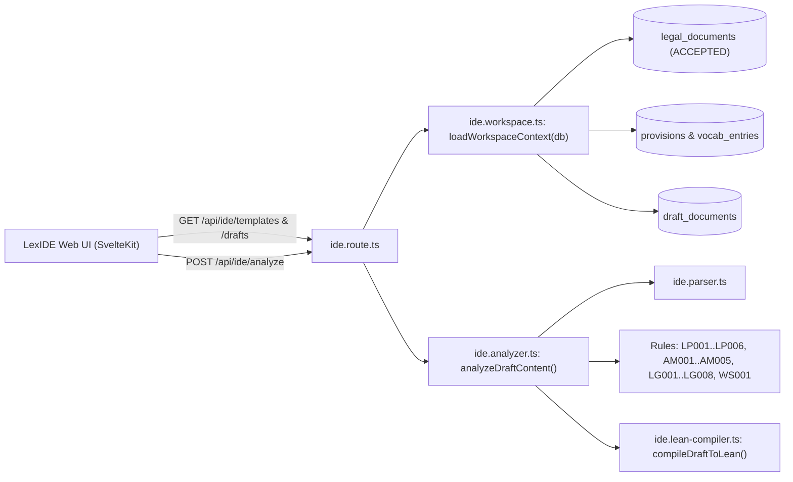
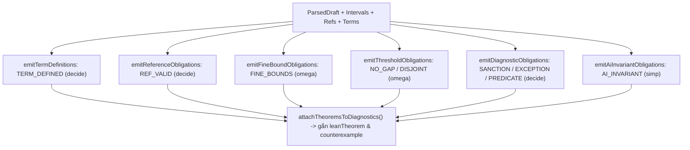
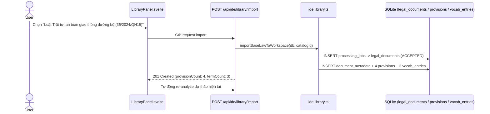

# LexIDE — Walkthrough End-to-End từ Empty Workspace (12 Slides)

> Bộ slide này minh họa **1 test case xuyên suốt** từ **Empty Workspace** (`0` văn bản kho, `0` dự thảo đã lưu, `0` thuật ngữ định nghĩa) và giải thích đầy đủ **nghiệp vụ lõi**: Kiểm định quy phạm (18 mã lỗi & chấm điểm), Kiểm tra định nghĩa thuật ngữ, Biên dịch **Lean 4** & tối ưu token, **Run & Debug** + tinh chỉnh điểm mơ hồ, **Library Import**, **Autocompletion / IntelliSense**, và **Source Control**.

---

## Slide 1 — Bối cảnh Test Case & Nguyên tắc Empty Workspace

### Kịch bản Test Case
- **Trạng thái khởi tạo**: Workspace hoàn toàn trống (`0 kho · 0 dự thảo · 0 thuật ngữ`).
- **Tài liệu soạn thảo**: Dự thảo `15/2026/NĐ-CP (Dự thảo)` (`tpl-nd-smart-traffic` trong [ide.templates.ts](../backend/src/modules/ide/ide.templates.ts)) — *Nghị định quy định xử phạt vi phạm hành chính trong lĩnh vực giao thông thông minh và xe tự hành*.
- **Mục tiêu kiểm chứng**:
  1. Kiểm định quy phạm, phát hiện kẽ hở, mơ hồ, lỗi toán học và thiếu định nghĩa thuật ngữ (`điểm giấy phép lái xe`) mà **không bịa nguồn ngoài workspace**.
  2. Biên dịch sang **Lean 4** với **0 LLM token** (`savedPercent = 100%`).
  3. Mô phỏng tình huống tòa án trong **Run & Debug** khi có điểm mơ hồ và tinh chỉnh kết quả mơ hồ.
  4. Import `Luật 36/2024/QH15` từ **Library** để giải quyết tự động thuật ngữ, mở khóa **Autocompletion / IntelliSense** và theo dõi diff trong **Source Control**.

### Nguyên tắc Grounding (`strictlyWorkspaceOnly: true`)
Mọi kiểm tra thuật ngữ, đối chiếu dẫn chiếu và gợi ý tự động chỉ được phép lấy dữ liệu từ:
1. Văn bản chính thức đã `ACCEPTED` trong DB (`legal_documents`, `provisions`, `vocab_entries`).
2. Các dự thảo đang lưu trong `draft_documents`.
3. Chính phần `Giải thích từ ngữ` trong văn bản đang mở.

---

## Slide 2 — Kiến trúc Backend & Tải Ngữ cảnh Workspace ([ide.workspace.ts](../backend/src/modules/ide/ide.workspace.ts))



### Nghiệp vụ tải ngữ cảnh `WorkspaceContext`
Khi gọi `loadWorkspaceContext(db)` trong [ide.workspace.ts](../backend/src/modules/ide/ide.workspace.ts), hệ thống đóng gói 8 thành phần phục vụ cả kiểm định lẫn autocompletion:
- `corpusDocumentCount`, `savedDraftCount`: đếm số văn bản kho (`ACCEPTED`) và dự thảo đã lưu.
- `bases`: danh sách căn cứ pháp lý hợp lệ (`Căn cứ Luật ...;`).
- `articlePatterns`, `clausePatterns`, `pointPatterns`: mẫu cấu trúc trích từ văn bản trong workspace.
- `provisions`: danh sách điều/khoản/điểm dùng cho dẫn chiếu chéo và IntelliSense.
- `definedTerms`: tập thuật ngữ chuẩn hóa kèm nguồn định nghĩa.

Trên **Empty Workspace**, toàn bộ các mảng này rỗng (`0 kho · 0 dự thảo · 0 thuật ngữ`).

---

## Slide 3 — Nghiệp vụ Kiểm định Quy phạm (Phần 1): AST, Interval Engine & Ma trận 18 Mã lỗi

### Bước 1: Phân tích cấu trúc & Khoảng giá trị
- **AST Parser ([ide.parser.ts](../backend/src/modules/ide/ide.parser.ts))**: `parseDraftDocument()` tách cây `CHAPTER` / `ARTICLE` / `CLAUSE` / `POINT` kèm tọa độ chính xác (`startOffset`, `endOffset`, `startLine`, `endLine`) và trích `Giải thích từ ngữ` cục bộ.
- **Interval Engine ([ide.intervals.ts](../backend/src/modules/ide/ide.intervals.ts))**: `extractFineRanges()` bắt khung tiền phạt `từ X đồng đến Y đồng`; `extractNumericThresholds()` bắt ngưỡng định lượng (`km/h`, `mg/100ml`...), phân loại tính liên tục thành `OK`, `GAP_BEFORE`, `OVERLAP`, hoặc `INVERTED`.

### Bước 2: Ma trận 18 Mã lỗi Kiểm định
| Nhóm | Mã lỗi | Nghiệp vụ phát hiện | Mức độ |
| :--- | :--- | :--- | :--- |
| **Kẽ hở** ([ide.rules-loophole.ts](../backend/src/modules/ide/ide.rules-loophole.ts)) | `LP001` | Ngoại lệ mở (*trường hợp đặc biệt...*) thiếu căn cứ | `warning` |
| | `LP002` | Hành vi bị cấm (*nghiêm cấm...*) thiếu chế tài trong cùng Điều | `error` |
| | `LP003` | Khoảng trống định lượng giữa hai ngưỡng liên tiếp (`GAP_BEFORE`) | `error` |
| | `LP004` | Hình phạt bổ sung (*tước GPLX, trừ điểm...*) thiếu thời hạn/định mức | `warning` |
| | `LP005` | Thiếu điều khoản Hiệu lực thi hành / Chuyển tiếp khi sửa đổi | `warning` |
| | `LP006` | Chỉ quy định mức phạt cá nhân, bỏ sót tổ chức | `warning` |
| **Mơ hồ** ([ide.rules-ambiguity.ts](../backend/src/modules/ide/ide.rules-ambiguity.ts)) | `AM001` | Ngôn từ định tính mơ hồ (*nghiêm trọng, hợp lý, kịp thời...*) | `warning` |
| | `AM002` | Liệt kê mở không giới hạn (*và các trường hợp khác...*) | `warning` |
| | `AM003` | Chế tài tùy nghi (*có thể bị phạt...*) thiếu điều kiện bắt buộc | `warning` |
| | `AM004` | Tham chiếu mơ hồ (*theo quy định của pháp luật...*) | `info` |
| | `AM005` | Thuật ngữ chuyên ngành chưa có văn bản định nghĩa trong workspace | `warning` |
| **Logic & Kho** ([ide.rules-logic.ts](../backend/src/modules/ide/ide.rules-logic.ts), [ide.corpus-check.ts](../backend/src/modules/ide/ide.corpus-check.ts)) | `LG001` | Khung tiền phạt hoặc ngưỡng định lượng bị đảo ngược (`min > max`) | `error` |
| | `LG002` | Chồng chéo ngưỡng (`OVERLAP`, `error`) hoặc mức phạt không tăng tiến (`warning`) | `error` / `warning` |
| | `LG003` | Dẫn chiếu nội bộ tới điều/khoản/điểm không tồn tại | `error` |
| | `LG004` | Dẫn chiếu tự vòng lặp vào chính nó | `error` |
| | `LG005` | Trùng số thứ tự (`error`) hoặc nhảy cóc đánh số Chương/Điều/Khoản/Điểm (`warning`) | `error` / `warning` |
| | `LG007` | Dẫn chiếu tới điều khoản đã có lệnh bãi bỏ | `error` |
| | `LG008` | Dẫn chiếu văn bản kho không khớp (`error`) hoặc chồng lấn khung phạt (`warning`) | `error` / `warning` |
| | `WS001` | Văn bản dẫn chiếu chưa có trong workspace (chưa thể đối chiếu) | `info` |

---

## Slide 4 — Nghiệp vụ Kiểm định (Phần 2): Chấm điểm 3 Trụ cột, Deduplication & Hover Tooltip

### Cơ chế Khử trùng & Chấm điểm ([ide.analyzer.ts](../backend/src/modules/ide/ide.analyzer.ts))
1. **Deduplication & Sorting**: `deduplicateDiagnostics()` loại bỏ trùng lặp theo khóa `` `${code}:${startOffset}:${endOffset}` ``, sau đó sắp xếp theo vị trí xuất hiện và trọng số `error (3) > warning (2) > info (1)`.
2. **Công thức chấm điểm `computeMetrics()`**:
   - Trọng số trừ điểm mỗi lỗi theo nhóm: `error = -14`, `warning = -7`, `info = -3`.
   - Điểm từng trụ cột có sàn tối thiểu `10`: `loopholeScore`, `clarityScore`, `logicScore = max(10, 100 - penalties)`.
   - Điểm tổng thể: `overallScore = round(loopholeScore * 0.35 + clarityScore * 0.25 + logicScore * 0.40)`.
3. **Kết quả trên Test Case (Empty Workspace)**:
   - Tổng điểm: **`25/100`** (`Chống kẽ hở 10%` · `Độ rõ ràng ngôn từ 27%` · `Tính nhất quán Logic 37%`).
   - `26` vấn đề (`10` Kẽ hở · `11` Mơ hồ · `5` Logic), Status Bar: `Workspace · Lean 4: 5✓ 18✗ (0 tok)`.
4. **Hover Tooltip (`LegalEditor.svelte`)**:
   - Hover dòng 16 `từ 6.000.000 đồng đến 4.000.000 đồng` → hiện `LG001 · Lỗ hổng logic`, bằng chứng Lean 4 `fine_bounds_L16_3 ↳ 6000000 > 4000000 (chênh lệch 2000000 đồng)`, và nút **Quick Fix 1-click** *Đổi thành "từ 4.000.000 đồng đến 6.000.000 đồng"*.

---

## Slide 5 — Nghiệp vụ Kiểm định Định nghĩa Thuật ngữ & Chống Bịa Nguồn (`AM005` & `WS001`)

### Quy trình kiểm tra Thuật ngữ ([ide.rules-ambiguity.ts](../backend/src/modules/ide/ide.rules-ambiguity.ts))
Trong `15/2026/NĐ-CP (Dự thảo)` có các thuật ngữ như `điểm giấy phép lái xe`, `phương tiện giao thông thông minh`, `hệ thống hỗ trợ lái`.
1. **Chuẩn hóa & Biến thể (`normalizeLegalTerm`)**: chuyển chữ thường, chuẩn hóa khoảng trắng, ánh xạ đồng nghĩa (ví dụ `điểm gplx` ↔ `điểm giấy phép lái xe`).
2. **Khớp biên Unicode an toàn**: dùng lookaround `(?<![\p{L}\p{N}_])` thay cho `\b` của ASCII để không cắt nhầm chữ tiếng Việt có dấu.
3. **Tra cứu 3 tầng trong Workspace**:
   - Tầng 1: Điều `Giải thích từ ngữ` trong chính dự thảo đang mở.
   - Tầng 2: Thuật ngữ đã định nghĩa trong `draft_documents`.
   - Tầng 3: Bảng `vocab_entries` của các `legal_documents` đã `ACCEPTED`.
   - Nếu không tìm thấy ở cả 3 tầng → gắn **`AM005 · Mơ hồ`** và đánh dấu `CHƯA ĐỊNH NGHĨA` ở tab **Terms**.

### Quy trình đối chiếu Kho văn bản ([ide.corpus-check.ts](../backend/src/modules/ide/ide.corpus-check.ts))
- Bắt mẫu trích dẫn ngoài `EXTERNAL_CITE` (ví dụ `Điều X của Luật 36/2024/QH15`):
  - Nếu văn bản chưa có trong `legal_documents (ACCEPTED)` → gắn **`WS001`** (nhắc người dùng nạp văn bản vào workspace, không tự suy đoán).
  - Nếu đã có trong kho nhưng không tìm thấy Điều/Khoản/Điểm hoặc khung phạt mới trùng hành vi nhưng khác mức phạt mà thiếu lệnh sửa đổi/bãi bỏ → gắn **`LG008`**.

---

## Slide 6 — Nghiệp vụ Biên dịch Lean 4 (Phần 1): Quy trình AST → 6 Nhóm Định lý & Tactic



### Giải thích 6 nhóm Định lý trong [ide.lean-compiler.ts](../backend/src/modules/ide/ide.lean-compiler.ts)
1. **`TERM_DEFINED` (`decide`)**: Sinh `inductive LegalTerm` và hàm `DefinedInWorkspace : LegalTerm → Bool`; chứng minh `term_defined_*`.
2. **`REF_VALID` (`decide`)**: Kiểm tra `ExistsInDraft`, `IsRepealed = false`, `TargetOf ≠ SelfNode` (`ref_valid_L*`).
3. **`FINE_BOUNDS` (`omega`)**: Chứng minh cận khung phạt `(min : Nat) ≤ max` (`fine_bounds_L*`).
4. **`NO_GAP` & `DISJOINT` (`omega`)**: Chứng minh phân hoạch liên tục không khoảng trống (`no_gap_L*`) và không chồng chéo (`disjoint_L*`), kèm `witness` phản ví dụ.
5. **`SANCTION_COVERAGE` / `EXCEPTION_BOUNDED` / `PREDICATE_CLEAR` (`decide`)**: Kiểm tra `HasSanction`, `ExceptionHasCriteria`, `PredicateQuantified`.
6. **`AI_INVARIANT` (`simp`)**: Nhận mệnh đề bất biến rút gọn từ AI (nếu bật).

### Ví dụ mã Lean 4 sinh tự động từ Test Case
```lean
namespace LexIDE
inductive LegalTerm where
  | diem_giay_phep_lai_xe
  deriving DecidableEq

def DefinedInWorkspace : LegalTerm → Bool
  | .diem_giay_phep_lai_xe => false

theorem term_defined_diem_giay_phep_lai_xe : DefinedInWorkspace .diem_giay_phep_lai_xe = true := by decide
theorem fine_bounds_L16_3 : (6000000 : Nat) ≤ 4000000 := by omega
end LexIDE
```

---

## Slide 7 — Nghiệp vụ Biên dịch Lean 4 (Phần 2): Kiến trúc Tối ưu Token (0-Token + Hybrid IR)

### Hai chế độ thực thi trong [ide.lean-compiler.ts](../backend/src/modules/ide/ide.lean-compiler.ts) & [ide.llm.ts](../backend/src/modules/ide/ide.llm.ts)
1. **Chế độ mặc định — `BUILTIN_KERNEL` (0 LLM token)**:
   - Toàn bộ AST, khoảng số học, dẫn chiếu, thuật ngữ được biên dịch tất định sang Lean 4 ngay trên backend.
   - `actualAiTokens = 0`, `savedPercent = 100%`.
   - Công thức ước lượng tiết kiệm (`computeTokenStats`):
     - `naiveFullTokens = max(250, ceil(content.length / 3.2) + 450)`
     - `savedPercent = actualAiTokens === 0 ? 100 : clamp(0..99, round((1 - actualAiTokens / naiveFullTokens) * 100))`
2. **Chế độ Hybrid Extract-Only — `includeAi: true` ([ide.llm.ts](../backend/src/modules/ide/ide.llm.ts))**:
   - **Ranh giới Neuro-Symbolic**: LLM **chỉ** đóng vai trò trích xuất sự kiện cấu trúc (`legislative_extract_facts_v1`: `quote`, `modality`, `subject`, `actionKey`, `fineMin/Max`, `thresholdMin/Max`, `hasSanction`, `hasOpenException`, `referencedTerms`) trên tối đa **12** khoản phức tạp (`selectAiCandidateClauses`); LLM **không** tự kết luận lỗi hay sinh mã Lean 4.
   - `anchorExtractedFacts()` kiểm chứng `quote` nguyên văn trong văn bản, sau đó `emitExtractedFactObligations()` trong [ide.lean-compiler.ts](../backend/src/modules/ide/ide.lean-compiler.ts) mới biên dịch tất định sang Lean 4 (`omega` / `decide`) và tự chứng minh `PROVED` / `REFUTED` (bao gồm kiểm tra mâu thuẫn đạo nghĩa `DEONTIC_CONSISTENT`).

---

## Slide 8 — Nghiệp vụ Run & Debug: Mô phỏng Xét xử Tòa án ([ide.debug.ts](../backend/src/modules/ide/ide.debug.ts))

### Pipeline mô phỏng `runLegalDebugSimulation()`
1. **Trích xuất sự kiện tình huống (`extractScenarioFacts`)**:
   - Tách thông số định lượng qua `MEASUREMENT_PATTERN` (`km/h`, `mg/100ml`, `mg/lít`, `tấn`, `kg`, `%`).
   - Nhận diện chủ thể: `ORGANIZATION` (công ty, doanh nghiệp, tổ chức...) hoặc `INDIVIDUAL`.
   - Phát hiện tình tiết viện dẫn ngoại lệ (`trường hợp đặc biệt`, `lý do chính đáng`, `bất khả kháng`) và tách từ khóa hành vi.
2. **Đối chiếu định lượng & điều khoản (`evaluateNumericMeasurements`, `evaluateMatchedClauses`)**:
   - Kiểm tra xem thông số đo có rơi vào khoảng trống (`LP003` → `LOOPHOLE_HIT`), chồng chéo (`LG002` → `CONFLICT_HIT`), đảo ngược (`LG001` → `CONFLICT_HIT`), hoặc thiếu chủ thể tổ chức (`LP006` → `LOOPHOLE_HIT`).
   - Xây dựng **Call Stack** từng bước kèm `leanCheck` và `diagnosticCode`.
3. **Tổng hợp Phán quyết (`synthesizeVerdict`)**:
   - `GUILTY_SANCTIONED`: Đủ căn cứ tuyên phạt kèm mức phạt `applicableFine`.
   - `PARTIALLY_ENFORCEABLE`: Phạt được tiền nhưng vướng chế tài bổ sung/thuật ngữ chưa định nghĩa (`UNENFORCEABLE_TERM`).
   - `ACQUITTED_LOOPHOLE`: Đương sự thoát chế tài do khai thác đúng kẽ hở.
   - `CONFLICT_AMBIGUOUS`: Có điểm mơ hồ chưa chọn hoặc xung đột quy phạm.
   - `NOT_COVERED`: Chưa có quy phạm điều chỉnh.
   - Tùy chọn `LEAN_PLUS_AI` (`judge_verdict_v1`) chỉ diễn giải lại từ `trace` đã có, tuyệt đối không viện dẫn văn bản ngoài workspace.

---

## Slide 9 — Nghiệp vụ Tinh chỉnh Điểm Mơ hồ trong Run & Debug

### Cơ chế Interactive Ambiguity Overrides
- Khi quy phạm khớp tình huống có chứa `AM001`, `AM002`, `AM003`, `AM005`, hoặc `LP001`, `buildAmbiguityDecision()` chuyển từng lỗi thành 1 `AmbiguityDecisionItem` với `question`, `trueLabel`, `falseLabel`.
- **Trạng thái chưa chọn (`selectedValue === null`)**:
  - Call Stack dừng nhánh ở `AMBIGUOUS_BRANCH` (`Ambiguity("...") = ?`) và Tòa trả `CONFLICT_AMBIGUOUS` — **không tự đoán ngầm**.
- **Khi người dùng tinh chỉnh (`ambiguityOverrides: Record<string, boolean>`)**:
  - Chọn `true` → bước chuyển sang `MATCHED` (*Assume = true → APPLY*), tiếp tục áp dụng khung phạt.
  - Chọn `false` → bước chuyển sang `SKIPPED` (*Assume = false → SKIP*), bỏ qua khung phạt này.
- **Kết quả trên Test Case `"Quá tốc độ 25 km/h (Mơ hồ 'nghiêm trọng')"`**:
  - Hiển thị **`TINH CHỈNH ĐIỂM MƠ HỒ (3)`** (`AM001 · "nghiêm trọng"` L16, `AM002 · "và các trường hợp khác"` L16, `AM005 · "phương tiện giao thông thông minh"` L4) và **`CALL STACK THỰC THI (7)`**.

---

## Slide 10 — Nghiệp vụ Library Import: Xây dựng Dự thảo trên Bộ Luật Nền ([ide.library.ts](../backend/src/modules/ide/ide.library.ts))



### Hiệu ứng dây chuyền sau khi Import `36/2024/QH15`
- **Ghi dữ liệu chuẩn quan hệ ([ide.library.ts](../backend/src/modules/ide/ide.library.ts))**: chèn tuần tự `processing_jobs` → `legal_documents` (`ACCEPTED`) → `document_metadata` → `provisions` (`4` điều) → `vocab_entries` (`3` thuật ngữ: `điểm giấy phép lái xe`, `xe tự hành`, `hệ thống hỗ trợ lái`).
- **Tự động Re-analyze ngay lập tức**:
  - Workspace Scope: `0 kho · 0 dự thảo` → **`1 kho · 0 dự thảo`**.
  - Thuật ngữ `điểm giấy phép lái xe`: `CHƯA ĐỊNH NGHĨA` → **`TRONG WORKSPACE (36/2024/QH15 (Khoản 1 Điều 1))`**.
  - Tổng số vấn đề giảm từ `26` → **`23`**; Lean 4 tăng từ `5✓ 18✗` → **`8✓ 15✗ (0 tok)`**.
- **Quản lý vòng đời**: `DELETE /api/ide/library/:id` cho phép gỡ bộ luật mẫu `lib-*` khỏi workspace bất cứ lúc nào.

---

## Slide 11 — Nghiệp vụ Autocompletion / IntelliSense Workspace-Only ([ide-intellisense.ts](../web/src/lib/ide-intellisense.ts))

### 7 Bộ kích hoạt Ngữ cảnh trong `computeCompletions()`
1. **`BASIS_TRIGGER`** (`Căn cứ ...`, `Theo đề nghị ...`): lấy từ `workspaceContext.bases` + các dòng căn cứ trong dự thảo. Nếu workspace trống, hiển thị `emptyMessage` nhắc nhập tài liệu thay vì bịa luật ngoài.
2. **`ARTICLE_START_TRIGGER` / `ARTICLE_COLON_TRIGGER`** (`Điều`, `Điều N.`): tự tính số điều kế tiếp (`nextArticleNumber`) + mẫu điều từ `workspaceContext.articlePatterns` và tiêu đề dự thảo.
3. **`CLAUSE_TRIGGER`** (`N. ...`): gợi ý mẫu khoản từ `workspaceContext.clausePatterns`.
4. **`DASH_BULLET_TRIGGER`** (`- `, `* `, `• `): đề xuất chuẩn hóa gạch đầu dòng sang Điểm tiếng Việt chuẩn (`nextVietnamesePointLetter`: `a, b, c, d, đ, e, g, h, i, k...`, bỏ qua `f, j, w, z`).
5. **`POINT_TRIGGER`** (`a) ...`): gợi ý mẫu điểm từ `workspaceContext.pointPatterns`.
6. **`REF_TRIGGER`** (`tại/theo/từ điểm|khoản|Điều ...`): gợi ý dẫn chiếu điều/khoản/điểm nội bộ + `workspaceContext.provisions` (tối đa 12 mục).
7. **`manualTrigger`** (`Ctrl+Space`): mở bộ khởi tạo nhanh (`Căn cứ ...`, `Điều kế tiếp`, `Điểm kế tiếp`).

### Lọc thông minh & Chèn chuẩn
- `normalizeSearch()` chuẩn hóa Unicode NFD, bỏ dấu tiếng Việt và đổi `đ → d` để gõ không dấu vẫn khớp.
- `applyCompletion()` thay thế đúng dải `[replaceStart, replaceEnd]` và đặt con trỏ tại `cursorOffsetInInsert`.
- **Trên Test Case**: sau khi import `36/2024/QH15`, gõ `Căn cứ ` bật ngay **`CC Luật 36/2024/QH15 (Kho: 36/2024/QH15)`**.

---

## Slide 12 — Nghiệp vụ Source Control, Find & Replace & Bảng Tổng hợp Kiến trúc

### Source Control, Find & Replace và Theme
- **Source Control**: so sánh từng dòng giữa bản gốc (baseline) và nội dung đang sửa trong editor (badge `53`, diff `+27 -26`), hỗ trợ xem diff inline xanh/đỏ, khôi phục từng thay đổi hoặc lưu snapshot vào `draft_documents`.
- **Find & Replace & Theme**: tìm/thay thế toàn văn bản (hỗ trợ regex, phân biệt hoa thường) và chuyển đổi **Dark Modern** / **Light Modern**.

### Bảng Tổng hợp Nghiệp vụ & Kết quả Test Case
| Nghiệp vụ | Module chính | Kết quả kiểm chứng trên Test Case |
| :--- | :--- | :--- |
| **Workspace Grounding** | [ide.workspace.ts](../backend/src/modules/ide/ide.workspace.ts) | Bắt đầu từ `0 kho · 0 dự thảo`, không bịa nguồn ngoài |
| **Kiểm định 18 mã lỗi & Chấm điểm** | [ide.analyzer.ts](../backend/src/modules/ide/ide.analyzer.ts), [ide.intervals.ts](../backend/src/modules/ide/ide.intervals.ts) | `25/100`, `26` vấn đề, bắt `LG001` dòng 16 & Quick Fix |
| **Thuật ngữ & Đối chiếu kho** | [ide.rules-ambiguity.ts](../backend/src/modules/ide/ide.rules-ambiguity.ts), [ide.corpus-check.ts](../backend/src/modules/ide/ide.corpus-check.ts) | Bắt `AM005` cho `điểm giấy phép lái xe`, khớp Unicode |
| **Biên dịch Lean 4 & Tối ưu Token** | [ide.lean-compiler.ts](../backend/src/modules/ide/ide.lean-compiler.ts), [ide.llm.ts](../backend/src/modules/ide/ide.llm.ts) | `5✓ 18✗` → `8✓ 15✗`, **`0` token LLM (`100%` tiết kiệm)** |
| **Run & Debug + Tinh chỉnh mơ hồ** | [ide.debug.ts](../backend/src/modules/ide/ide.debug.ts) | `3` điểm mơ hồ tương tác, `7` call stack frames |
| **Library Import & Autocompletion** | [ide.library.ts](../backend/src/modules/ide/ide.library.ts), [ide-intellisense.ts](../web/src/lib/ide-intellisense.ts) | Nạp `36/2024/QH15` (`4` điều, `3` thuật ngữ), gợi ý `Căn cứ ` |
| **Source Control** | [ide.route.ts](../backend/src/modules/ide/ide.route.ts), Web UI SCM | Diff `+27 -26`, badge `53`, lưu `draft_documents` |
